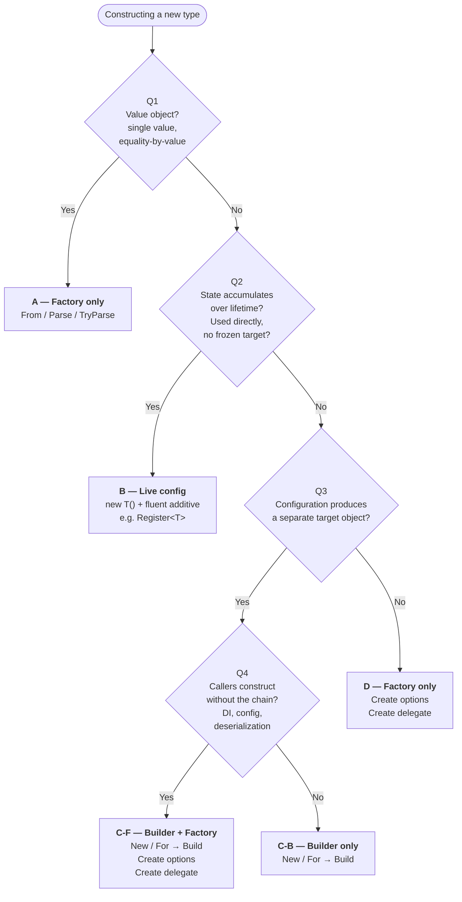

# Builder & Factory Conventions

> How types are constructed across the SDK — builder flow, factory flow, and live config.

## Contents

- [What "Entry" means](#what-entry-means)
    - [Choosing between them — decision tree](#choosing-between-them--decision-tree)
- [Builder flow (Outcomes C-B and C-F)](#builder-flow-outcomes-c-b-and-c-f)
- [Factory flow (Outcomes A, C-F, D)](#factory-flow-outcomes-a-c-f-d)
    - [Canonical: `Create(TOptions options)`](#canonical-createtoptions-options)
    - [Convenience overload](#convenience-overload)
    - [Required initial args](#required-initial-args)
    - [Value objects (Outcome A)](#value-objects-outcome-a)
- [Live config flow (Outcome B)](#live-config-flow-outcome-b)
- [Facades](#facades)
- [Forbidden](#forbidden)

## What "Entry" means

How you obtain an instance. Three distinct flows:

- **Builder flow** — obtain a builder, configure it, call `.Build()` to get the target object
- **Factory flow** — call a static method that returns the instance directly, no builder exposed
- **Live config flow** — `new` the object directly, configure via fluent methods; the object *is* the thing being used (no separate build step)

A type picks one *primary* flow. Builder + Factory may coexist when both serve real use cases; other combinations are forbidden.

### Choosing between them — decision tree

Walk the questions in order. Stop at the first match.

1. **(Q1) Is the type a value object?**
   Single conceptual value, equality-by-value, typically immutable: identifiers, money, ranges, time spans, etc.
    - **Yes → Outcome A:** Factory only. Use `From(...)`, `Parse(...)`, `TryParse(...)`. Stop.
    - **No** → continue.

2. **(Q2) Does the type accumulate state over its lifetime and get used directly?**
   Registry, context, or collection — no separate "frozen" target makes sense. Registrations or settings can keep coming after first use.
    - **Yes → Outcome B:** Live config. Use `new T()` + fluent additive methods. Stop.
    - **No** → continue.

3. **(Q3) Does configuration produce a separate target object?**
   Configurator and target are different types. Target is typically immutable.
    - **Yes** → continue to Q4.
    - **No → Outcome D:** Factory only. `Create(options)` and `Create(Action<>)`.

4. **(Q4) Will callers ever construct without the fluent chain?**
   DI binding, config-driven construction, deserialized options, or one-shot delegate use.
    - **Yes → Outcome C-F:** Builder + Factory. `New()` / `For(...)` → `.Build()`, plus `Create(options)` and `Create(Action<>)`.
    - **No → Outcome C-B:** Builder only. `New()` / `For(...)` → `.Build()`.



---

## Builder flow (Outcomes C-B and C-F)

### Entry to the builder

- **`static XxxBuilder New()`** — parameterless only, returns the builder
- **`static XxxBuilder For(...)` / `From(...)` / `Of(...)`** — when required params must be set at construction

`New()` **never** has parameterised overloads. Required params go to `For`/`From`/`Of`, or skip the builder entirely and use a factory `Create(...)`.

> **Provisional rule:** when there's a single required param, use `For(...)` / `From(...)` / `Of(...)` — the verb adds meaning and keeps `New()` purely parameterless. Use with caution; a stricter decision (locking in one keyword, or banning the others) will be made later as patterns settle.

### Configuration methods

- **Setters** (last-write-wins) → bare noun: `Host(...)`, `Port(...)`
- **Additive** (accumulate across calls) → verb prefix: `AddRecord(...)`, `AddCheck(...)`, `MapHandler<T>(...)`
- **Positional / directional setters** → `From*` prefix allowed when it carries origin or direction meaning: `FromStart()`, `FromEnd()`, `FromLatest()`, `FromEarliest()`, `FromRevision(n)`, `FromPosition(p)`. The verb-noun shape is doing semantic work; bare-noun (`Revision(n)`, `Position(p)`) loses it.
- **Booleans** → imperative + `bool = true` default: `EnableTls()`, `SkipDecoding()`
- **Nested config** → bare noun + callback: `Logging(b => ...)`, `Retry(r => ...)`
- **Same concept, both additive** → same name, let overload resolution disambiguate. `AddMetadata(Metadata)` replaces the whole object; `AddMetadata<T>(string, T)` adds a single entry. Both use the additive name because both are "adding metadata to the thing being built."
- Return `this` for chaining; one concept per method

### Terminal

- `.Build()` returns the constructed object

### Examples

**Simple fluent builder**

```csharp
var client = KurrentClient.New()
    .Host("localhost")
    .Port(2113)
    .EnableTls()
    .Build();
```

**Builder with required construction param**

```csharp
var req = AppendStreamRequest.For("my-stream")
    .AddRecord(record)
    .Build();
```

**Additive methods**

```csharp
var req = AppendRecordsRequest.New()
    .AddRecord(transferEvent, skuStream)
    .AddRecord(transferEvent, "transfer-log")
    .AddMessage<OrderShipped>(orderShipped, "orders")  // typed variant
    .AddCheck(ConsistencyCheck.StreamExists(skuStream))
    .Build();
```

**Same concept, overloaded**

```csharp
var req = AppendStreamRequest.For("my-stream")
    .AddRecord(record)
    .AddMetadata("trace-id", traceId)              // single entry
    .AddMetadata("user-id", userId)
    .Build();

// elsewhere — replace the whole metadata object
var req = AppendStreamRequest.For("my-stream")
    .AddRecord(record)
    .AddMetadata(precomputedMetadata)               // whole object
    .Build();
```

**Positional / directional setters**

```csharp
var read = ReadStreamRequest.For("orders")
    .FromStart()
    .Limit(100)
    .Build();

var read = ReadRecordsRequest.New()
    .FromRevision(42)
    .Forwards()
    .Build();
```

**Booleans**

```csharp
var client = KurrentClient.New()
    .Host("localhost")
    .EnableTls()             // default true
    .SkipDecoding()          // default true
    .UseCompression(false)   // programmatic toggle (double-negative tolerable)
    .Build();
```

**Nested config**

```csharp
var processor = KurrentProcessor.New()
    .Stream("orders")
    .Logging(l => l.AddConsole().MinimumLevel(LogLevel.Debug))
    .Retry(r => r.MaxAttempts(3).Backoff(TimeSpan.FromSeconds(1)))
    .Build();
```

**Staged builder (compile-time required params)**

```csharp
// .AddRecord() not available on the type returned by For() until stream is set
var req = AppendStreamRequest.For("my-stream")  // returns IRequestWithStream
    .AddRecord(record)                           // only available on staged interface
    .Build();
```

---

## Factory flow (Outcomes A, C-F, D)

Static method on the target type. Always terminal. Always returns the constructed instance.

### Canonical: `Create(TOptions options)`

```csharp
static T Create(TOptions options);
```

The foundational factory. When a type has a meaningful options bag — DI binding, config-driven construction, deserialized settings — this is the canonical entry point. Every other factory overload ultimately delegates to this one.

It's the *only* form guaranteed to compose with infrastructure that produces options objects (`IOptions<T>`, `IConfiguration.Get<T>()`, JSON deserialization, etc.). The delegate form can't be expressed by those mechanisms.

### Convenience overload

```csharp
static T Create(Action<TOptions> configure);
```

Layers on top of the canonical form for ergonomics: the caller mutates a fresh options object via delegate, and the method internally calls `Create(options)`.

### Required initial args

When construction requires an argument that callers must provide — a connection string, a stream name, an ID, a key — expose a Factory variation alongside the canonical pair:

```csharp
static T Create(TArg arg, Action<TOptions>? configure = null);
```

This mirrors the Builder flow's `For(...)` entry: both express required-at-construction inputs while keeping the no-args canonical path intact. The variation parses or assigns `arg` into a fresh options object, applies the optional configuration delegate, then delegates to `Create(options)`.

Example: `KurrentClient.Create(string connectionString, Action<KurrentClientOptions>? configure = null)` — the connection string is the required initial arg.

### Value objects (Outcome A)

- **`static T From(...)`** — canonical constructor (always present on value objects)
- **`static T Parse(string)`** — when string parsing is meaningful (mirrors BCL: `Guid.Parse`, `TimeSpan.Parse`)
- **`static bool TryParse(string, out T)`** — when parsing can fail without exceptions

### Examples

**Canonical: pre-built options**

```csharp
var options = new KurrentClientOptions {
    Host = "localhost",
    Port = 2113,
    Resilience = KurrentClientResilienceOptions.HighAvailability
};

var client = KurrentClient.Create(options);
```

**Canonical with DI / config binding**

```csharp
services.Configure<KurrentClientOptions>(configuration.GetSection("Kurrent"));
services.AddSingleton(sp =>
    KurrentClient.Create(sp.GetRequiredService<IOptions<KurrentClientOptions>>().Value));
```

**Convenience: delegate**

```csharp
var processor = KurrentProcessor.Create(p => p
    .Stream("orders")
    .BatchSize(100)
    .EnableCheckpointing());
```

**Required initial arg: connection string + tuning**

```csharp
var client = KurrentClient.Create("kurrentdb://localhost:2113");

var client = KurrentClient.Create("kurrentdb://localhost:2113", opts => {
    opts.Resilience = KurrentClientResilienceOptions.HighAvailability;
    opts.Schema.Mapper.Map<OrderPlaced>();
});
```

**Required initial arg layered over canonical** (the implementation pattern)

```csharp
public static KurrentClient Create(KurrentClientOptions options) =>
    new(options);

public static KurrentClient Create(string connectionString, Action<KurrentClientOptions>? configure = null) {
    var options = KurrentClientOptions.Parse(connectionString);
    configure?.Invoke(options);
    return Create(options);
}
```

**Value object**

```csharp
var streamName = StreamName.From("orders-123");
var streamName = StreamName.Parse("orders-123");

if (StreamName.TryParse(input, out var name)) { ... }
```

**Builder + factory coexisting on the same type** (Outcome C-F)

```csharp
// Builder when caller wants the chain
var processor = KurrentProcessor.New()
    .Stream("orders")
    .BatchSize(100)
    .Build();

// Factory when caller has options or wants delegate config
var processor = KurrentProcessor.Create(p => p
    .Stream("orders")
    .BatchSize(100));
```

---

## Live config flow (Outcome B)

Object is constructed directly with `new`, configured via fluent methods, and used as-is. No builder, no `.Build()`, no static factory.

Identifying traits:
- Configuration can accumulate over the object's lifetime
- The object is itself the working instance (registry, context, collection)
- Freezing into a different "built" type would be artificial

### What applies

- Additive methods → verb prefix: `Register<T>(...)`, `Add(...)`, `Map(...)`
- Setters → bare noun
- Booleans → imperative + `bool = true` default
- Return `this` for chaining
- No `With` prefix
- No `New()` / `Build()` / `Create(...)` — caller uses `new` directly

### Examples

**Protobuf registration**

```csharp
var protoContext = new ProtoSerializerContext()
    .Register(OrderPlaced.Parser, OrderPlaced.Descriptor)
    .Register(OrderConfirmed.Parser, OrderConfirmed.Descriptor);

// later, more registrations are still valid
protoContext.Register(OrderCancelled.Parser, OrderCancelled.Descriptor);
```

**Message handler registry**

```csharp
var handlers = new MessageHandlerRegistry()
    .On<OrderPlaced>((msg, ctx) => PlaceOrder(msg))
    .On<OrderShipped>((msg, ctx) => NotifyCustomer(msg));

// dynamic registration still valid after the registry is in use
handlers.On<OrderCancelled>((msg, ctx) => Refund(msg));
```

**Message type mapper**

```csharp
var mapper = new MessageTypeMapper()
    .Map<UserCreated>("user-created")
    .Map<UserDeleted>("user-deleted");

// mapper is used directly — Map / TryMap can still be called later
if (mapper.TryMap(typeName, out var type)) { ... }
mapper.Map<UserUpdated>("user-updated");
```

---

## Facades

When SDK aesthetics matter, a hand-curated facade can wrap uniform underlying APIs. The facade gives friendly per-use-case names; the underlying types still follow the standard conventions.

```csharp
// Facade — friendly names per use case
KurrentPlatform.Processor(h => h.On<Foo>(handler));
KurrentPlatform.CreateProcessor(prebuilt, opts => opts.BatchSize(100));

// Underlying type follows the standard convention
KurrentProcessor.Create(handlers, configure);
KurrentProcessor.New().Handlers(h => ...).Build();
```

---

## Forbidden

- **More than one primary flow per type.** A type picks one of Builder / Factory / Live config as its primary entry pattern. The only legal combination is Builder + Factory on the same type when both serve real use cases. Builder + Live config and Factory + Live config are contradictory — pick one.
- `With` prefixes (`WithHost`, `WithRecord`) — Java cruft
- Static properties as entry (`Create`, `New`, `Builder` as properties) — can't take params, can't overload, collide with factory methods
- `New()` with parameter overloads — required params go to `For`/`From`/`Of` or to `Create(...)`
- `Create()` returning a builder — `Create` is terminal, always returns the thing
- `Build()` as a static factory — `Build` is the builder's terminal, not an entry point
- Mixing imperative and adjective boolean forms (`EnableTls()` and `TlsEnabled()`) in the same SDK
