# KurrentDB Processors

## Feature Design Document

**Version:** 2.5  
**Status:** Draft  
**Date:** December 16, 2025  
**Authors:** Sérgio Silveira

---

## Executive Summary

KurrentDB Processors enable distributed, fault-tolerant stream processing over the KurrentDB log. Multiple workers can connect to process records in parallel while maintaining exactly-once state semantics through coordinated checkpointing.

**Key capabilities:**
- **Elastic scaling**: Add or remove workers without stopping processing
- **Fault tolerance**: Automatic recovery from worker failures with no data loss
- **Stateful processing**: Maintain state across records with automatic redistribution
- **Simple protocol**: Single gRPC bidirectional stream for all operations

**The "Hive Mind" model**: Unlike traditional job schedulers, KurrentDB doesn't deploy or manage workers. Workers are autonomous—they connect when ready, disconnect when done. The processor emerges from workers coordinating through the server. This is similar to Apache Flink's Reactive Mode (2021).

---

## Table of Contents

1. [Design Goals](#1-design-goals)
2. [Background: Stream Processing in 5 Minutes](#2-background-stream-processing-in-5-minutes)
3. [Problem 1: Distributing Stateful Work](#3-problem-1-distributing-stateful-work)
4. [Problem 2: Recovering from Failures](#4-problem-2-recovering-from-failures)
5. [Problem 3: Scaling Without Downtime](#5-problem-3-scaling-without-downtime)
6. [Problem 4: Coordinating Distributed Checkpoints](#6-problem-4-coordinating-distributed-checkpoints)
7. [Problem 5: Managing Worker State](#7-problem-5-managing-worker-state)
8. [Problem 6: Handling Checkpoint Failures](#8-problem-6-handling-checkpoint-failures)
9. [Scaling Pattern: Client-Side Parallelism](#9-scaling-pattern-client-side-parallelism)
10. [System Architecture](#10-system-architecture)
11. [Server-Side Component Design](#11-server-side-component-design)
12. [Client-Side Component Design](#12-client-side-component-design)
13. [Protocol Overview](#13-protocol-overview)
14. [Observability](#14-observability)
15. [Alternatives Considered](#15-alternatives-considered)
16. [Implementation Roadmap](#16-implementation-roadmap)
17. [Glossary](#17-glossary)
18. [References](#18-references)

---

## 1. Design Goals

| Goal                       | Description                                                               | Priority |
|----------------------------|---------------------------------------------------------------------------|----------|
| **Fault Tolerance**        | Recover from any worker failure without data loss                         | P0       |
| **Elastic Scaling**        | Add/remove workers dynamically without restart or data loss               | P0       |
| **Stateful Processing**    | Support local state with automatic redistribution on scaling              | P0       |
| **At-Least-Once Delivery** | Every record delivered at least once (duplicates possible after recovery) | P0       |
| **Exactly-Once State**     | State reflects each record exactly once through coordinated checkpoints   | P0       |
| **Simple API**             | Single gRPC stream; minimal worker implementation complexity              | P1       |
| **Observable**             | Lag metrics, throughput, checkpoint statistics                            | P1       |
| **Pluggable Storage**      | Checkpoint storage is an abstraction (DuckDB, S3, KurrentDB streams)      | P2       |

**Non-goals (current scope):**
- Operator DAGs (chaining filter→map→aggregate)
- Server-hosted workers (we coordinate, not execute)
- Exactly-once to external systems (worker's responsibility)

---

## 2. Background: Stream Processing in 5 Minutes

*Skip this section if you're familiar with stream processing concepts.*

### What is Stream Processing?

**Batch processing**: Collect data, process in bulk, output results.
```
[Wait] → [Collect 1000 records] → [Process all] → [Output] → [Wait]...
```

**Stream processing**: Process each record as it arrives.
```
[Record arrives] → [Process immediately] → [Update state] → [Next record]...
```

### What are Records?

In KurrentDB, the log contains **records**. Each record wraps a user **message** which can be:
- **Commands**: Instructions to do something (e.g., `PlaceOrder`)
- **Events**: Facts that happened (e.g., `OrderPlaced`)
- **Telemetry**: Measurements and observations (e.g., `TemperatureReading`)
- **State snapshots**: Point-in-time state (e.g., `OrderState`)
- **Any other data**: Whatever your application needs

We use "record" as the generic term for any item in the log.

### Stateless vs Stateful Processing

**Stateless**: Each record processed independently. Any worker can handle any record.
```csharp
// Stateless: convert temperature
record => new { Fahrenheit = record.Data.Celsius * 9/5 + 32 }
```

**Stateful**: Processing depends on history. Must keep related records together.
```csharp
// Stateful: running average per sensor
record => {
    state[record.SensorId].Sum += record.Value;
    state[record.SensorId].Count++;
    return state[record.SensorId].Sum / state[record.SensorId].Count;
}
```

### The Core Challenge

> How do you parallelize stateful processing?

If Worker A has the running average for Sensor-1, and Worker B joins:
- How does B get some of A's state?
- How do we split without losing data?
- How do we do this without stopping everything?

This document explains how we solve these challenges.

---

## 3. Problem 1: Distributing Stateful Work

### The Problem

In stateful processing, records with the same key must go to the same worker (to access the same state). But we want parallelism.

**Naive approach**: Assign keys directly to workers.
```
Worker A: customers 1-500
Worker B: customers 501-1000
```

**Problem**: When Worker C joins, how do we redistribute? Keys aren't uniform—customer-42 might have 10x more records than customer-999.

### The Solution: Key Groups (Partitions)

Instead of assigning keys to workers, we introduce an intermediate layer: **partitions** (inspired by Flink's "key groups" and Kafka's partitions).

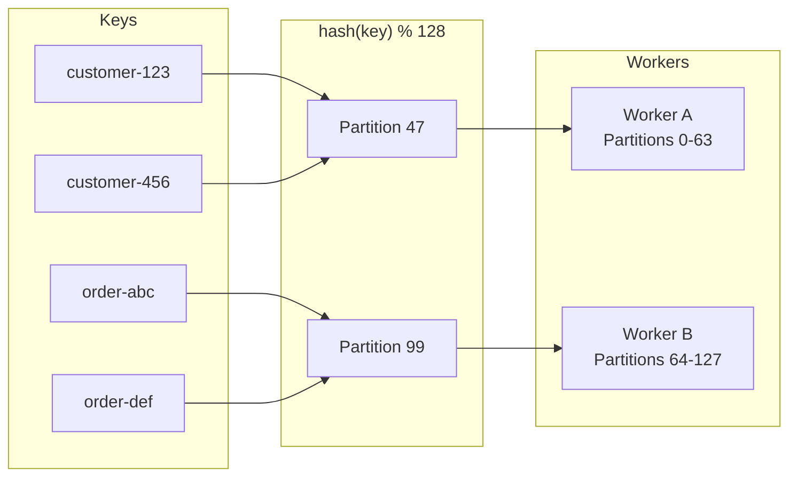

**Key properties:**
1. **Fixed partition count**: Set at creation (`max_parallelism`), never changes
2. **Deterministic mapping**: Same key → same partition (always)
3. **Movable partitions**: Partitions move between workers, not individual keys
4. **State per partition**: Each partition has its own state blob

**Why this works:**
- Adding Worker C? Move partitions 86-127 from B to C. That's it.
- State follows partition—download partition 86's state, you have all keys that hash to 86.
- No need to track individual keys, just partition assignments.

### The Interfaces

```csharp
/// <summary>
/// Assigns partitions to workers using consistent hashing.
/// </summary>
public interface IPartitionAssigner {
    /// <summary>
    /// Calculate partition for a given key.
    /// </summary>
    int GetPartition(string key, int maxParallelism);
    
    /// <summary>
    /// Assign partitions to workers. Called when workers join/leave.
    /// </summary>
    IReadOnlyDictionary<string, int[]> AssignPartitions(
        IReadOnlyList<string> workerIds,
        int maxParallelism);
    
    /// <summary>
    /// Determine which partitions need to move after worker change.
    /// </summary>
    PartitionMovement CalculateMovement(
        IReadOnlyDictionary<string, int[]> currentAssignment,
        IReadOnlyDictionary<string, int[]> newAssignment);
}

public record PartitionMovement(
    IReadOnlyDictionary<string, int[]> Added,    // worker → partitions gained
    IReadOnlyDictionary<string, int[]> Removed   // worker → partitions lost
);
```

```csharp
/// <summary>
/// Extracts partition key from a record.
/// </summary>
public interface IPartitionKeySelector {
    /// <summary>
    /// Extract the partition key from a record.
    /// Returns null if record should be skipped.
    /// </summary>
    string? GetKey(Record record);
}

/// <summary>
/// Selector that extracts key using a JSON path expression.
/// </summary>
/// <remarks>
/// Supports paths like:
/// - "stream_id"              → The stream ID
/// - "data.customer_id"       → Field in record data
/// - "metadata.tenant"        → Field in record metadata
/// </remarks>
public class JsonPathPartitionKeySelector : IPartitionKeySelector {
    public JsonPathPartitionKeySelector(string jsonPath) { }
    public string? GetKey(Record record) { }
}

/// <summary>
/// Selector that extracts key using a SQL expression evaluated against the record.
/// </summary>
/// <remarks>
/// Enables complex key extraction logic using SQL syntax.
/// The record is available as a virtual table with columns:
/// stream_id, position, data (JSON), metadata (JSON), timestamp
/// 
/// Example: "SELECT JSON_EXTRACT(data, '$.tenant_id') || '-' || JSON_EXTRACT(data, '$.region')"
/// </remarks>
public class SqlPartitionKeySelector : IPartitionKeySelector {
    public SqlPartitionKeySelector(string sqlExpression) { }
    public string? GetKey(Record record) { }
}
```

---

## 4. Problem 2: Recovering from Failures

### The Problem

Worker A is processing records 1000-2000 when it crashes at record 1500.

**Questions:**
- Did records 1000-1500 update external systems? (emails sent, APIs called)
- What state did Worker A have at record 1500?
- How do we resume without losing or duplicating work?

### The Solution: Coordinated Checkpoints

Periodically, all workers snapshot their state and progress at a **consistent point**. On recovery, restore from the last checkpoint.

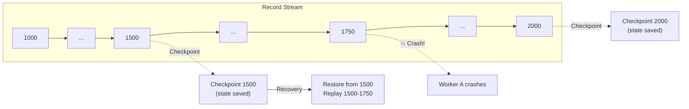

**Recovery scenario**: Worker A crashes at record 1750. We restore checkpoint 1500, replay records 1500-1750. Some records processed twice, but state is consistent.

**What gets checkpointed:**
- Position in the log (per partition)
- Worker state (per partition)
- Metadata (timestamp, trigger reason)

**Trade-offs:**
- **Checkpoint often**: Less replay on recovery, more I/O overhead
- **Checkpoint rarely**: More replay on recovery, less overhead
- **Default**: Every 30 seconds or 1000 records

### The Interfaces

```csharp
/// <summary>
/// A checkpoint represents a consistent snapshot across all partitions.
/// </summary>
public record Checkpoint(
    string ProcessorId,
    long CheckpointId,         // Log position at barrier
    DateTimeOffset CreateTime,
    TimeSpan Duration,         // How long checkpoint took
    bool IsSavepoint,          // Never auto-deleted if true
    IReadOnlyDictionary<int, PartitionCheckpoint> Partitions
);

public record PartitionCheckpoint(
    int Partition,
    long Position,             // Log position for this partition
    ReadOnlyMemory<byte> State,
    IReadOnlyDictionary<string, string> Metadata
);
```

```csharp
/// <summary>
/// Stores and retrieves checkpoint data.
/// </summary>
public interface ICheckpointStorage {
    /// <summary>
    /// Store checkpoint state for partitions.
    /// </summary>
    Task StoreAsync(
        string processorId,
        long checkpointId,
        IEnumerable<PartitionCheckpoint> partitions,
        CancellationToken ct = default);
    
    /// <summary>
    /// Retrieve checkpoint state for specific partitions.
    /// </summary>
    IAsyncEnumerable<PartitionCheckpoint> RetrieveAsync(
        string processorId,
        long checkpointId,
        IEnumerable<int> partitions,
        CancellationToken ct = default);
    
    /// <summary>
    /// Delete old checkpoints based on retention policy.
    /// Savepoints are never deleted.
    /// </summary>
    Task ApplyRetentionAsync(
        string processorId,
        int retentionCount,
        CancellationToken ct = default);
    
    /// <summary>
    /// List checkpoints for a processor.
    /// </summary>
    IAsyncEnumerable<CheckpointSummary> ListAsync(
        string processorId,
        CancellationToken ct = default);
}

public record CheckpointSummary(
    long CheckpointId,
    DateTimeOffset CreateTime,
    TimeSpan Duration,
    long TotalBytes,
    int PartitionCount,
    bool IsSavepoint,
    CheckpointStatus Status
);

public enum CheckpointStatus {
    InProgress,
    Completed,
    Failed
}
```

---

## 5. Problem 3: Scaling Without Downtime

### The Problem

We have 2 workers processing happily. Load increases, we need to add Worker C.

**Challenges:**
- Worker A and B have state in memory
- We need to give C some partitions, with their state
- We can't stop processing for minutes while transferring state

### The Solution: The Hive Mind Model

Workers are autonomous agents that join and leave freely. The server coordinates but doesn't control.

| Traditional Job Manager           | KurrentDB Hive Mind                                              |
|-----------------------------------|------------------------------------------------------------------|
| Server starts workers             | Workers start themselves                                         |
| Server can pause/resume           | Workers decide when to leave                                     |
| Fixed parallelism                 | Dynamic parallelism                                              |
| Manager deploys → Workers (owned) | Processor (concept) ← Workers (autonomous) → Server (coordinate) |

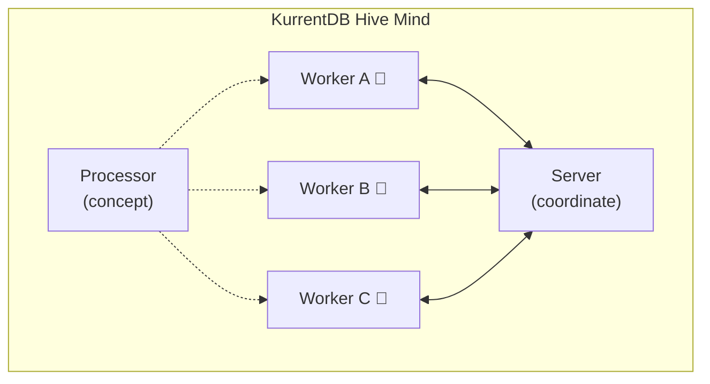

**Scaling workflow (Adding Worker C):**

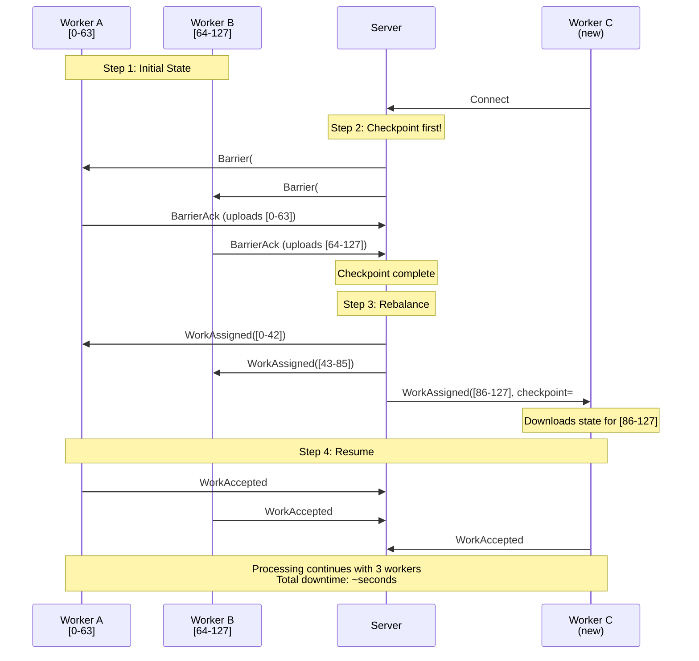

### The Interfaces

```csharp
/// <summary>
/// Manages worker sessions and lifecycle on the server.
/// </summary>
public interface IWorkerSessionManager {
    /// <summary>
    /// Register a new worker connection.
    /// </summary>
    Task<WorkerSession> ConnectAsync(
        string processorId,
        string workerId,
        ProcessorSettings settings,
        CancellationToken ct = default);
    
    /// <summary>
    /// Mark worker as having accepted work and ready to receive records.
    /// </summary>
    Task WorkAcceptedAsync(string sessionId, CancellationToken ct = default);
    
    /// <summary>
    /// Handle graceful worker disconnect.
    /// </summary>
    Task DisconnectAsync(
        string sessionId, 
        DisconnectReason reason,
        CancellationToken ct = default);
    
    /// <summary>
    /// Handle unexpected worker disconnection (crash, network failure).
    /// </summary>
    Task HandleDisconnectionAsync(string sessionId);
    
    /// <summary>
    /// Get all active sessions for a processor.
    /// </summary>
    IReadOnlyList<WorkerSession> GetSessions(string processorId);
}

public record WorkerSession(
    string SessionId,           // Unique per connection (detects reconnects)
    string ProcessorId,
    string WorkerId,
    DateTimeOffset ConnectTime,
    WorkerState State,
    IReadOnlyList<int> Partitions,
    IReadOnlyDictionary<int, long> Positions  // partition → log position
);

public enum WorkerState {
    Connecting,    // Just connected, waiting for partition assignment
    Restoring,     // Downloading checkpoint state
    Ready,         // Ready to process records
    Processing,    // Actively processing
    Checkpointing, // Responding to barrier
    Disconnecting  // Graceful shutdown in progress
}

public enum DisconnectReason {
    Requested,     // Worker asked to disconnect
    Shutdown,      // Graceful shutdown (SIGTERM)
    Error,         // Worker reported error
    Timeout,       // Checkpoint timeout
    ServerShutdown // Server shutting down
}
```

---

## 6. Problem 4: Coordinating Distributed Checkpoints

### The Problem

With multiple workers, how do we get a **consistent** checkpoint? If Worker A checkpoints at position 1000 and Worker B at position 2000, we don't have a coherent snapshot.

### The Solution: Barrier Protocol (Chandy-Lamport Algorithm)

Our checkpoint mechanism is based on the **Chandy-Lamport distributed snapshot algorithm**, developed by K. Mani Chandy and Leslie Lamport in 1985 [^1].

**The Chandy-Lamport algorithm** solves the fundamental problem of capturing a consistent global snapshot of a distributed system without halting operations. It works under these assumptions:
- Processes communicate via message passing
- Channels are FIFO (messages arrive in order sent)
- Channels are reliable (no message loss)
- The graph of processes is strongly connected

**How it applies to KurrentDB Processors:**

| Chandy-Lamport Concept | KurrentDB Implementation        |
|------------------------|---------------------------------|
| Marker message         | Barrier message                 |
| Process state          | Worker state (per partition)    |
| Channel state          | Not needed (single source log)  |
| Initiator              | Server (Checkpoint Coordinator) |

**Key insight**: KurrentDB has a simpler topology than general distributed systems. There's a **single source log** that feeds all workers—no complex fan-in of multiple channels. This means we don't need to capture channel state or handle "barrier alignment" (a Flink complexity). Each worker simply:
1. Receives barrier
2. Finishes current record
3. Snapshots state
4. Acknowledges

[^1]: Chandy, K.M. and Lamport, L. (1985). "Distributed Snapshots: Determining Global States of Distributed Systems". ACM Transactions on Computer Systems, 3(1), 63-75. [DOI:10.1145/214451.214456](https://doi.org/10.1145/214451.214456)

**The barrier flow:**

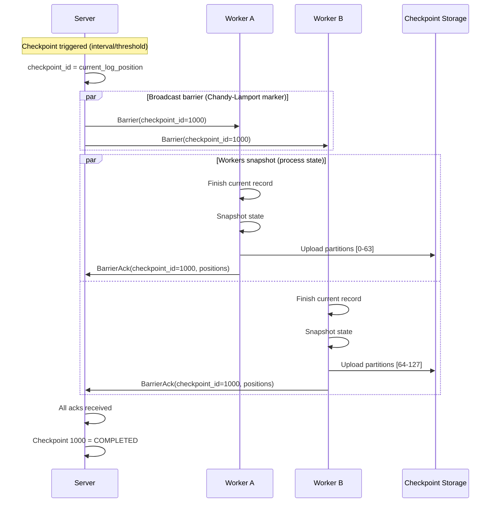

### Understanding Barrier Positions vs. Worker Positions

A common point of confusion: **the barrier position is NOT the position each worker reports**. The barrier tells workers *where to stop*, but each worker reports *the last record they actually processed*.

**Key insight**: The barrier position is a **logical stopping point** in the log. Workers process records up to (but not beyond) this position. However, due to partitioning and filtering, each worker may have processed a different subset of records—and thus report a different "last processed position."

#### Example 1: Basic Case (2 Workers, Equal Distribution)

```
Log positions:    1    2    3    4    5    6    7    8    9    10
Partition keys:   A    B    A    B    A    B    A    B    A    B
                  │    │    │    │    │    │    │    │    │    │
Worker 1 (A):     ✓    ·    ✓    ·    ✓    ·    ✓    ·    ✓    ·
Worker 2 (B):     ·    ✓    ·    ✓    ·    ✓    ·    ✓    ·    ✓
```

**Barrier sent at position 10.**

- Worker 1 processes: positions 1, 3, 5, 7, 9 → reports **position 9**
- Worker 2 processes: positions 2, 4, 6, 8, 10 → reports **position 10**

**Checkpoint result:**

| Worker | Last Position |
|--------|---------------|
| 1      | 9             |
| 2      | 10            |

#### Example 2: Uneven Distribution

Real workloads aren't evenly distributed. Some partition keys appear more frequently:

```
Log positions:    1    2    3    4    5    6    7    8    9    10
Partition keys:   A    A    A    B    A    A    B    A    A    B
                  │    │    │    │    │    │    │    │    │    │
Worker 1 (A):     ✓    ✓    ✓    ·    ✓    ✓    ·    ✓    ✓    ·
Worker 2 (B):     ·    ·    ·    ✓    ·    ·    ✓    ·    ·    ✓
```

**Barrier sent at position 10.**

- Worker 1 processes: positions 1, 2, 3, 5, 6, 8, 9 → reports **position 9**
- Worker 2 processes: positions 4, 7, 10 → reports **position 10**

**Checkpoint result:**

| Worker | Last Position |
|--------|---------------|
| 1      | 9             |
| 2      | 10            |

#### Example 3: With Filtering

Filters can cause records to be skipped entirely. No worker processes them:

```
Log positions:    1    2    3    4    5    6    7    8    9    10
Record types:     ORD  SYS  ORD  ORD  SYS  ORD  ORD  SYS  ORD  SYS
Filter:           orders-* (skips SYS records)
Partition keys:   A    -    B    A    -    B    A    -    B    -
                  │    │    │    │    │    │    │    │    │    │
Worker 1 (A):     ✓    ·    ·    ✓    ·    ·    ✓    ·    ·    ·
Worker 2 (B):     ·    ·    ✓    ·    ·    ✓    ·    ·    ✓    ·
```

**Barrier sent at position 10.**

- Worker 1 processes: positions 1, 4, 7 → reports **position 7**
- Worker 2 processes: positions 3, 6, 9 → reports **position 9**
- Nobody processed position 10 (filtered out as SYS record)

**Checkpoint result:**

| Worker | Last Position |
|--------|---------------|
| 1      | 7             |
| 2      | 9             |

#### Example 4: Three Workers with Filtering

```
Log positions:    1    2    3    4    5    6    7    8    9    10   11   12
Record types:     ORD  ORD  SYS  ORD  ORD  SYS  ORD  ORD  SYS  ORD  ORD  SYS
Filter:           orders-* (skips SYS records)
Partition (0-2):  0    1    -    2    0    -    1    2    -    0    1    -
                  │    │    │    │    │    │    │    │    │    │    │    │
Worker 1 (P0):    ✓    ·    ·    ·    ✓    ·    ·    ·    ·    ✓    ·    ·
Worker 2 (P1):    ·    ✓    ·    ·    ·    ·    ✓    ·    ·    ·    ✓    ·
Worker 3 (P2):    ·    ·    ·    ✓    ·    ·    ·    ✓    ·    ·    ·    ·
```

**Barrier sent at position 12.**

- Worker 1 processes: positions 1, 5, 10 → reports **position 10**
- Worker 2 processes: positions 2, 7, 11 → reports **position 11**
- Worker 3 processes: positions 4, 8 → reports **position 8**
- Nobody processed positions 3, 6, 9, 12 (filtered out as SYS records)

**Checkpoint result:**

| Worker | Partitions | Last Position |
|--------|------------|---------------|
| 1      | [0]        | 10            |
| 2      | [1]        | 11            |
| 3      | [2]        | 8             |

#### The Mental Model

Think of it this way:

1. **Server says**: "Everyone stop at position 10"
2. **Each worker does**:
    - Process records from my channel/buffer
    - Stop when I see a record with position > 10
    - Report the last position I actually processed
3. **Result**: Each worker's position ≤ barrier position, but varies based on what records they received

```
                    Barrier Position = 10
                           │
                           ▼
Log:  ═══════════════════════════════════════▶
      1   2   3   4   5   6   7   8   9   10
          │       │           │       │   │
          │       │           │       │   └── Worker 2 last: 10
          │       │           │       └────── Worker 1 last: 9
          │       │           └────────────── (not processed by anyone due to filter)
          │       └────────────────────────── Worker 3 last: 4
          └────────────────────────────────── (etc.)
```

#### Why This Matters for Recovery

On recovery from checkpoint:

1. **We know**: All records up to position 10 have been fully processed
2. **We resume from**: Position 10 (the barrier position)
3. **We DON'T resume from**: Each worker's individual position

The barrier position is the **global consistent cut**—the point where we know exactly what state corresponds to what input. Worker positions are just metadata for debugging and validation.

### Barriers and Batching

The server reads records one-by-one from the log and batches them before sending to workers (for efficiency). This raises a question: **what happens when a checkpoint needs to trigger while a batch is being built?**

```
Server building batches:
  Worker A buffer: [pos 1, pos 3, pos 5, pos 7]  ← still accumulating
  Worker B buffer: [pos 2, pos 4, pos 6]         ← still accumulating
  
  Checkpoint triggers!
  
  Now what? Send partial batches? Split them?
```

**Our approach: Flush-then-Barrier**

When a checkpoint triggers, the server:
1. **Flushes all pending batches** (sends whatever is buffered to each worker)
2. **Sends Barrier to all workers**
3. Resumes normal batching

This keeps workers simple—they never need to handle checkpoints mid-batch.

#### Example: Checkpoint During Batching

Setup:
- 2 workers (A handles partition 0, B handles partition 1)
- Batch size: 4 records
- Checkpoint triggers at position 8

```
Log:        1    2    3    4    5    6    7    8    9    10   11   12
Partition:  0    1    0    1    0    1    0    1    0    1    0    1
            │    │    │    │    │    │    │    │    │    │    │    │
            └─A  └─B  └─A  └─B  └─A  └─B  └─A  └─B  └─A  └─B  └─A  └─B
```

**Server-side timeline:**

```
Read pos 1 → add to Worker A buffer: [1]
Read pos 2 → add to Worker B buffer: [2]
Read pos 3 → add to Worker A buffer: [1, 3]
Read pos 4 → add to Worker B buffer: [2, 4]
Read pos 5 → add to Worker A buffer: [1, 3, 5]
Read pos 6 → add to Worker B buffer: [2, 4, 6]
Read pos 7 → add to Worker A buffer: [1, 3, 5, 7]  ← batch full, send!
             Worker A receives: Records([1, 3, 5, 7])

Read pos 8 → CHECKPOINT TRIGGERS!
             1. Flush Worker B buffer → Worker B receives: Records([2, 4, 6])
             2. Send barriers → Both workers receive: Barrier(checkpoint_id=8)

Read pos 9  → add to Worker A buffer: [9]
Read pos 10 → add to Worker B buffer: [10]
... continue normal batching ...
```

**What each worker sees (in order):**

```
Worker A stream:
  1. Records([1, 3, 5, 7])    ← full batch (hit batch_size)
  2. Barrier(8)               ← checkpoint
  3. Records([9, 11, ...])    ← next batch

Worker B stream:
  1. Records([2, 4, 6])       ← partial batch (flushed for checkpoint)
  2. Barrier(8)               ← checkpoint
  3. Records([10, 12, ...])   ← next batch
```

**Worker logic stays simple:**

```csharp
while (await stream.MoveNextAsync()) {
    switch (stream.Current) {
        case Records batch:
            // Just process everything in the batch
            foreach (var record in batch.Records)
                await ProcessAsync(record);
            break;
            
        case Barrier barrier:
            // Checkpoint - we know all prior records are processed
            await SnapshotAndUploadStateAsync(barrier.CheckpointId);
            await SendBarrierAckAsync(barrier.CheckpointId);
            break;
    }
}
```

No mid-batch splitting. No position checking. Workers simply process what arrives in order.

#### Why This Works

The FIFO guarantee of gRPC streams ensures:
1. All `Records` messages arrive before the `Barrier`
2. Workers fully process batches before seeing the barrier
3. When barrier arrives, all records up to checkpoint position are processed

This is the Chandy-Lamport requirement: markers (barriers) travel through the same channels as regular messages, maintaining causality.

### The Interfaces

```csharp
/// <summary>
/// Coordinates checkpoint lifecycle across all workers.
/// Implements the server-side of the Chandy-Lamport algorithm.
/// </summary>
public interface ICheckpointCoordinator {
    /// <summary>
    /// Trigger a checkpoint across all workers.
    /// Broadcasts barrier (Chandy-Lamport marker) to all connected workers.
    /// </summary>
    Task<long> TriggerCheckpointAsync(
        string processorId,
        BarrierTrigger trigger,
        CancellationToken ct = default);
    
    /// <summary>
    /// Handle worker acknowledgment of checkpoint.
    /// </summary>
    Task AcknowledgeAsync(
        string processorId,
        long checkpointId,
        string sessionId,
        IReadOnlyDictionary<int, long> positions,
        CancellationToken ct = default);
    
    /// <summary>
    /// Get current checkpoint status.
    /// </summary>
    CheckpointProgress? GetProgress(string processorId, long checkpointId);
    
    /// <summary>
    /// Get the last completed checkpoint.
    /// </summary>
    long? GetLastCompletedCheckpoint(string processorId);
    
    /// <summary>
    /// Raised when checkpoint completes successfully.
    /// </summary>
    event EventHandler<CheckpointCompletedEventArgs> CheckpointCompleted;
    
    /// <summary>
    /// Raised when checkpoint fails.
    /// </summary>
    event EventHandler<CheckpointFailedEventArgs> CheckpointFailed;
}

public record CheckpointProgress(
    long CheckpointId,
    BarrierTrigger Trigger,
    DateTimeOffset StartTime,
    IReadOnlySet<string> PendingWorkers,
    IReadOnlySet<string> CompletedWorkers,
    IReadOnlySet<string> FailedWorkers
);

public enum BarrierTrigger {
    Interval,           // Time since last checkpoint
    Threshold,          // Record count threshold
    CaughtUp,           // Reached end of log
    WorkerDisconnecting,// Graceful shutdown
    Savepoint           // Manual trigger (never auto-deleted)
}

public record CheckpointCompletedEventArgs(
    string ProcessorId,
    long CheckpointId,
    TimeSpan Duration,
    bool IsSavepoint
);

public record CheckpointFailedEventArgs(
    string ProcessorId,
    long CheckpointId,
    IReadOnlyList<string> FailedWorkers,
    string Reason
);
```

---

## 7. Problem 5: Managing Worker State

### The Problem

Workers need to:
1. Store state locally (fast access during processing)
2. Snapshot state for checkpoints (serialize efficiently)
3. Restore state on recovery (deserialize)
4. Handle state for multiple partitions (some may be added/removed)

### The Solution: Pluggable State Store

State management is the worker's responsibility, but we provide patterns:

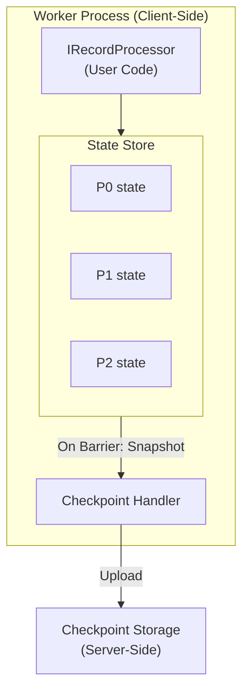

**State store options:**
- **In-memory dictionary**: Simple, fast, limited size
- **DuckDB**: Queryable, persistent, good for complex state
- **RocksDB**: High performance, large state
- **Custom**: Whatever fits your use case

### The Interfaces

```csharp
/// <summary>
/// Manages partitioned state for a worker.
/// This is a client-side component.
/// </summary>
public interface IStateStore : IAsyncDisposable {
    /// <summary>
    /// Get or create state for a partition.
    /// </summary>
    TState GetState<TState>(int partition) where TState : new();
    
    /// <summary>
    /// Check if partition has state.
    /// </summary>
    bool HasState(int partition);
    
    /// <summary>
    /// Add partitions (during rebalancing).
    /// </summary>
    Task AddPartitionsAsync(
        IEnumerable<int> partitions,
        IReadOnlyDictionary<int, ReadOnlyMemory<byte>>? initialState,
        CancellationToken ct = default);
    
    /// <summary>
    /// Remove partitions (during rebalancing).
    /// </summary>
    Task RemovePartitionsAsync(
        IEnumerable<int> partitions,
        CancellationToken ct = default);
    
    /// <summary>
    /// Snapshot all partition states for checkpoint.
    /// </summary>
    Task<IReadOnlyDictionary<int, ReadOnlyMemory<byte>>> SnapshotAsync(
        CancellationToken ct = default);
    
    /// <summary>
    /// Restore state from checkpoint.
    /// </summary>
    Task RestoreAsync(
        IReadOnlyDictionary<int, ReadOnlyMemory<byte>> state,
        CancellationToken ct = default);
}
```

```csharp
/// <summary>
/// DuckDB-based state store implementation.
/// Each partition is a separate table or table partition.
/// </summary>
public class DuckDbStateStore : IStateStore {
    private readonly DuckDBConnection _connection;
    private readonly IStateSerializer _serializer;
    
    public DuckDbStateStore(string databasePath, IStateSerializer serializer) { }
    
    // Snapshots by exporting to Parquet format
    public async Task<IReadOnlyDictionary<int, ReadOnlyMemory<byte>>> SnapshotAsync(
        CancellationToken ct = default) {
        var result = new Dictionary<int, ReadOnlyMemory<byte>>();
        foreach (var partition in _partitions) {
            // Export partition table to Parquet bytes
            var bytes = await ExportPartitionToParquetAsync(partition, ct);
            result[partition] = bytes;
        }
        return result;
    }
}

/// <summary>
/// Serializes state to/from bytes for checkpointing.
/// </summary>
public interface IStateSerializer {
    ReadOnlyMemory<byte> Serialize<T>(T state);
    T Deserialize<T>(ReadOnlyMemory<byte> bytes);
}
```

---

## 8. Problem 6: Handling Checkpoint Failures

### The Problem

What if a worker doesn't respond to a barrier? Options:
1. Wait forever (blocks all progress)
2. Fail the whole processor (too aggressive?)
3. Remove the slow worker and continue (lose some parallelism)
4. Make it configurable (flexibility)

### The Solution: Configurable Failure Policy

**Scenario 1: Worker Timeout**

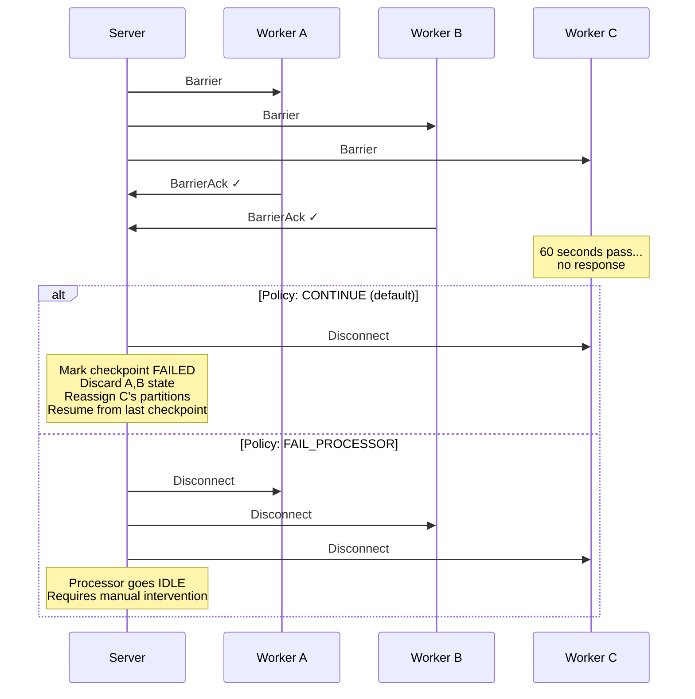

**Scenario 2: Upload Failure**

Worker receives Barrier → snapshots state → upload fails → retries with backoff:
- Retry 1: fail
- Retry 2: fail
- Retry 3: success → send BarrierAck

OR: All retries fail → timeout expires → worker disconnected (same as Scenario 1)

### The Interfaces

```csharp
/// <summary>
/// Policy for handling checkpoint failures.
/// </summary>
public enum CheckpointFailurePolicy {
    /// <summary>
    /// Disconnect failed workers, continue with remaining workers.
    /// Processing resumes from last successful checkpoint.
    /// </summary>
    Continue,
    
    /// <summary>
    /// Disconnect all workers, processor goes idle.
    /// Requires manual intervention to resume.
    /// </summary>
    FailProcessor
}

/// <summary>
/// Checkpoint configuration.
/// </summary>
public record CheckpointSettings(
    TimeSpan Interval = default,      // Default: 30s
    int Threshold = 1000,             // Min records between checkpoints
    TimeSpan Timeout = default,       // Default: 60s
    int RetentionCount = 3,           // Checkpoints to keep (per processor)
    CheckpointFailurePolicy FailurePolicy = CheckpointFailurePolicy.Continue
) {
    public static CheckpointSettings Default => new(
        Interval: TimeSpan.FromSeconds(30),
        Threshold: 1000,
        Timeout: TimeSpan.FromSeconds(60),
        RetentionCount: 3,
        FailurePolicy: CheckpointFailurePolicy.Continue
    );
}
```

---

## 9. Scaling Pattern: Client-Side Parallelism

### The Insight

A common concern with our single-stream-per-worker design is head-of-line blocking: if one partition is slow, it blocks records for other partitions on the same stream.

**But here's the key insight**: Nothing stops you from running multiple workers in the same process!

### The Pattern

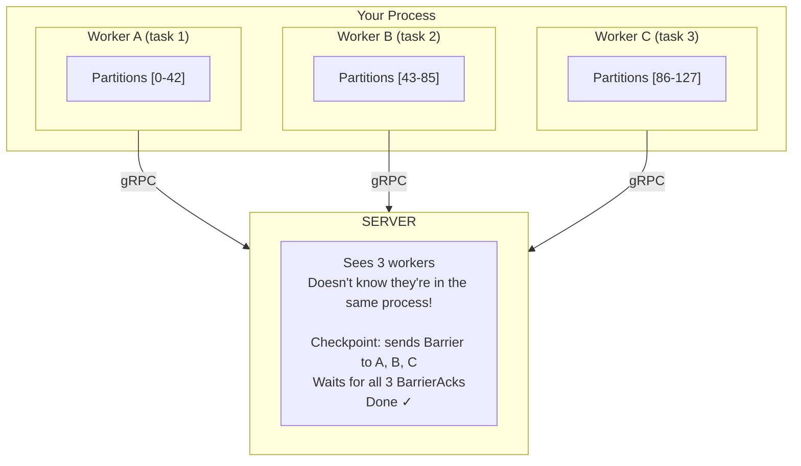

### Why This Works

The "barrier alignment" problem we discussed in [Section 15.2](#152-barrier-alignment-flink-style) requires alignment when a **single worker** has **multiple input channels**. But here:

- Each local worker has **ONE input channel** (its gRPC stream)
- The server coordinates barriers **across workers** (which it already does!)
- The "alignment" happens server-side, where it's already implemented

**The server waits for all workers before completing a checkpoint.** That IS the coordination—it just happens server-side across workers instead of client-side across channels.

### What You Get

| Benefit                         | Description                                      |
|---------------------------------|--------------------------------------------------|
| **Parallel TCP connections**    | No head-of-line blocking between partitions      |
| **Parallel processing threads** | CPU cores fully utilized                         |
| **Independent backpressure**    | Slow partition doesn't block fast ones           |
| **No code changes**             | Server already handles multi-worker coordination |
| **Flexible scaling**            | Choose parallelism at runtime                    |

### The Code

```csharp
/// <summary>
/// Runs multiple workers in the same process for maximum throughput.
/// Each worker gets its own gRPC connection and partition set.
/// </summary>
public class ParallelProcessorHost {
    private readonly string _connectionString;
    private readonly string _processorId;
    private readonly Func<IRecordProcessor> _processorFactory;
    
    public ParallelProcessorHost(
        string connectionString,
        string processorId,
        Func<IRecordProcessor> processorFactory) {
        _connectionString = connectionString;
        _processorId = processorId;
        _processorFactory = processorFactory;
    }
    
    /// <summary>
    /// Run N local workers in parallel.
    /// </summary>
    public async Task RunAsync(int localWorkerCount, CancellationToken ct = default) {
        var tasks = Enumerable
            .Range(0, localWorkerCount)
            .Select(i => RunWorkerAsync(i, ct))
            .ToArray();
        
        await Task.WhenAll(tasks);
    }
    
    private async Task RunWorkerAsync(int index, CancellationToken ct) {
        var workerId = $"{Environment.MachineName}-{index}";
        
        await using var worker = new ProcessorWorkerBuilder()
            .WithConnection(_connectionString)
            .WithStateStore(new DuckDbStateStore($"state-{workerId}.db"))
            .Build();
        
        await worker.RunAsync(
            processorId: _processorId,
            workerId: workerId,
            processor: _processorFactory(),
            ct: ct);
    }
}

// Usage
public class Program {
    public static async Task Main() {
        var host = new ParallelProcessorHost(
            connectionString: "esdb://localhost:2113",
            processorId: "order-processor",
            processorFactory: () => new OrderRecordProcessor()
        );
        
        // Run 4 workers in this process
        // Server will assign ~32 partitions to each (128 / 4)
        await host.RunAsync(localWorkerCount: 4);
    }
}
```

### Scaling Dimensions

With this pattern, you have **two independent scaling dimensions**:
- **Horizontal (machines)**: Add more machines/pods/containers
- **Vertical (local workers)**: Add more workers per machine

**Example**: 4 machines × 4 local workers = 16 total workers → 128 partitions ÷ 16 workers = 8 partitions each

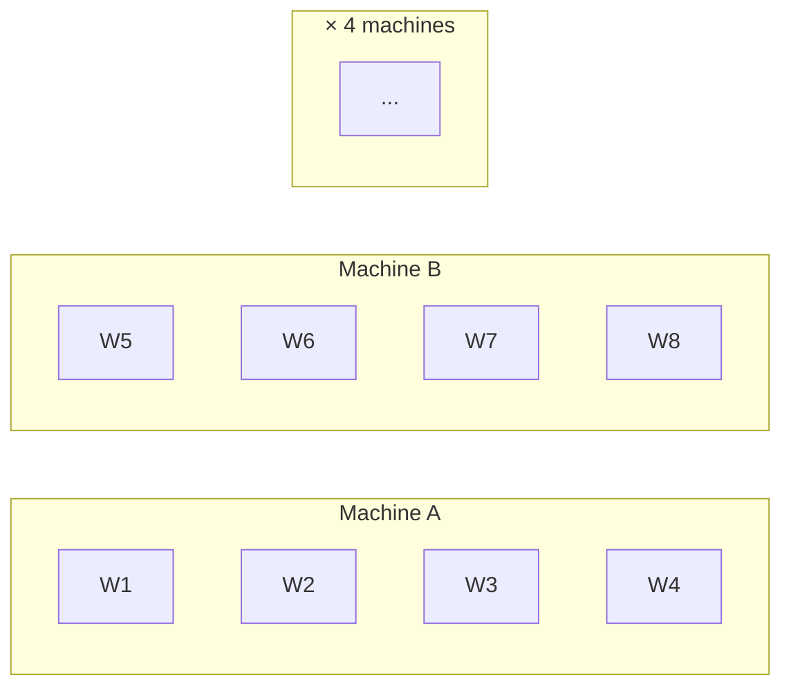

**Kubernetes**: Set `replicas=4`, `WORKER_COUNT=4` env var  
**Auto-scaling**: Adjust either dimension based on lag

### When to Use This

| Scenario                          | Recommendation                        |
|-----------------------------------|---------------------------------------|
| Low throughput, simple processing | 1 worker per process (keep it simple) |
| High throughput, CPU-bound        | N workers where N = CPU cores         |
| High throughput, I/O-bound        | N workers where N = 2-4× CPU cores    |
| Mixed workload                    | Benchmark to find optimal N           |

### The Hive Mind Advantage

This pattern emerges naturally from the Hive Mind architecture. The server doesn't distinguish between:
- Workers on different continents
- Workers on different machines in a rack
- Workers in different containers on same machine
- Workers in different threads of the same process

**They're all just workers.** Connect more for more parallelism. The server handles coordination. That's the beauty of the design. 🐝🐝🐝

---

## 10. System Architecture

### 9.1 Component Overview

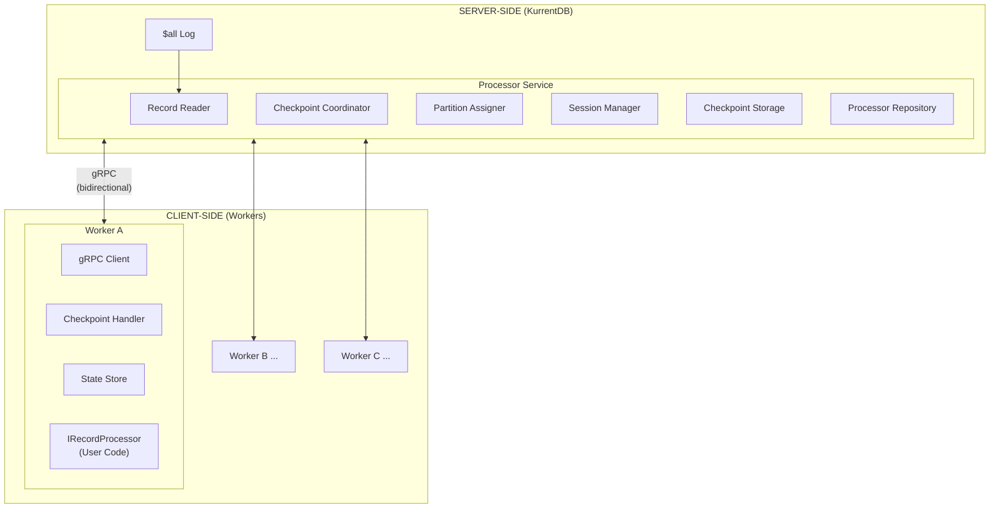

### 9.2 Server-Side Components

| Component                  | Responsibility                                                   |
|----------------------------|------------------------------------------------------------------|
| **Record Reader**          | Reads from $all, applies filters, routes to workers by partition |
| **Session Manager**        | Tracks worker connections, handles connect/disconnect lifecycle  |
| **Partition Assigner**     | Calculates partition assignments, triggers rebalancing           |
| **Checkpoint Coordinator** | Sends barriers, collects acks, manages checkpoint lifecycle      |
| **Checkpoint Storage**     | Stores/retrieves state, applies retention, manages savepoints    |
| **Processor Repository**   | Persists processor configuration and state (event-sourced)       |

### 9.3 Client-Side Components

| Component              | Responsibility                                                             |
|------------------------|----------------------------------------------------------------------------|
| **ProcessorWorker**    | Main entry point; manages connection lifecycle and orchestrates components |
| **gRPC Client**        | Maintains bidirectional stream with server, handles reconnection           |
| **State Store**        | Local state storage (DuckDB, in-memory, etc.)                              |
| **Checkpoint Handler** | Snapshots state on barrier, uploads to server, sends ack                   |
| **IRecordProcessor**   | User-implemented interface for processing records                          |

---

## 11. Server-Side Component Design

### 10.1 Processor Service (gRPC Entry Point)

```csharp
/// <summary>
/// Main entry point for the Processor gRPC service.
/// Server-side component.
/// </summary>
public interface IProcessorService {
    /// <summary>
    /// Handle bidirectional stream for a worker.
    /// </summary>
    Task ProcessAsync(
        IAsyncEnumerable<WorkerMessage> requests,
        IServerStreamWriter<ServerMessage> responses,
        ServerCallContext context);
    
    /// <summary>
    /// Upload checkpoint state from worker.
    /// </summary>
    Task UploadCheckpointsAsync(
        IAsyncEnumerable<Checkpoint> checkpoints,
        ServerCallContext context);
    
    /// <summary>
    /// Download checkpoint state to worker.
    /// </summary>
    IAsyncEnumerable<Checkpoint> DownloadCheckpointsAsync(
        DownloadCheckpointsRequest request,
        ServerCallContext context);
    
    // Management APIs
    Task<GetProcessorResponse> GetProcessorAsync(GetProcessorRequest request);
    Task<ListProcessorsResponse> ListProcessorsAsync(ListProcessorsRequest request);
    Task<DeleteProcessorResponse> DeleteProcessorAsync(DeleteProcessorRequest request);
    Task<CreateCheckpointResponse> CreateCheckpointAsync(CreateCheckpointRequest request);
    Task<ListCheckpointsResponse> ListCheckpointsAsync(ListCheckpointsRequest request);
}
```

### 10.2 Processor Aggregate (Event-Sourced)

```csharp
/// <summary>
/// Represents a processor instance on the server.
/// Event-sourced from $processors-{id} stream.
/// Server-side component.
/// </summary>
public class Processor {
    public string ProcessorId { get; }
    public ProcessorSettings Settings { get; }
    public ProcessorState State { get; private set; }
    public IReadOnlyDictionary<string, WorkerSession> Workers { get; }
    public long? LastCheckpointId { get; private set; }
    public ProcessorStats Stats { get; }
    
    // Apply domain events (event sourcing)
    public void Apply(ProcessorCreated evt) { }
    public void Apply(WorkerConnected evt) { }
    public void Apply(WorkerReady evt) { }
    public void Apply(WorkerDisconnected evt) { }
    public void Apply(CheckpointStarted evt) { }
    public void Apply(CheckpointCompleted evt) { }
    public void Apply(CheckpointFailed evt) { }
    public void Apply(PartitionsReassigned evt) { }
}

public enum ProcessorState {
    Idle,          // No workers connected
    Running,       // Processing records
    Checkpointing, // Waiting for barrier acks
    Rebalancing    // Redistributing partitions
}

public record ProcessorStats(
    long ProcessedRecordCount,
    long ProcessedBytes,
    long CheckpointCount,
    long FailedCheckpointCount,
    DateTimeOffset? LastActivityTime
);
```

---

## 12. Client-Side Component Design

### 11.1 IRecordProcessor (User-Implemented)

This interface matches the existing KurrentDB client patterns. Users implement this to process records.

```csharp
/// <summary>
/// Defines the interface for processing records from a processor.
/// Implement this interface to receive callbacks during the processing lifecycle.
/// 
/// All methods except ProcessRecords have default implementations
/// that do nothing, allowing you to override only the methods you need.
/// 
/// Note: All lifecycle methods are informational. The SDK handles
/// checkpointing, state management, and coordination automatically.
/// </summary>
/// <example>
/// // Minimal implementation - only ProcessRecords is required
/// class MinimalProcessor : IRecordProcessor {
///     public ValueTask ProcessRecords(ProcessRecordsContext ctx) {
///         foreach (var record in ctx.Records)
///             Console.WriteLine(record.Schema.Name);
///         return ValueTask.CompletedTask;
///     }
/// }
/// </example>
[PublicAPI]
public interface IRecordProcessor {
    /// <summary>
    /// Called when the processor starts, before any records are processed.
    /// </summary>
    ValueTask OnInitialize(InitializationContext context) => ValueTask.CompletedTask;

    /// <summary>
    /// Called when records are available for processing.
    /// This is the only method that must be implemented.
    /// </summary>
    ValueTask ProcessRecords(ProcessRecordsContext context);

    /// <summary>
    /// Called when a checkpoint occurs (informational).
    /// The SDK handles state snapshots and uploads automatically.
    /// Use ctx.Reason to determine why the checkpoint was triggered.
    /// </summary>
    ValueTask OnCheckpoint(CheckpointContext context) => ValueTask.CompletedTask;

    /// <summary>
    /// Called when partition assignment changes (informational).
    /// The SDK handles state transfer automatically.
    /// </summary>
    ValueTask OnAssignmentChange(AssignmentChangeContext context) => ValueTask.CompletedTask;

    /// <summary>
    /// Called when processing stops, regardless of reason.
    /// </summary>
    ValueTask OnShutdown(ShutdownContext context) => ValueTask.CompletedTask;
}
```

### 11.2 Context Objects

```csharp
/// <summary>
/// Context provided when a processor is initialized.
/// </summary>
public record InitializationContext(
    string ProcessorId,
    string WorkerId,
    IReadOnlyList<int> Partitions,
    long? CheckpointId,
    ProcessorSettings Settings,
    CancellationToken CancellationToken
);

/// <summary>
/// Context provided when records are available for processing.
/// </summary>
public record ProcessRecordsContext {
    public ProcessRecordsContext(
        IProcessorSession session,
        Record[] records,
        CancellationToken cancellationToken) {
        Session = session;
        Records = records;
        CancellationToken = cancellationToken;
    }

    private IProcessorSession Session { get; }

    /// <summary>
    /// The records available for processing.
    /// </summary>
    public Record[] Records { get; }

    /// <summary>
    /// Token to observe for cancellation requests.
    /// </summary>
    public CancellationToken CancellationToken { get; }

    /// <summary>
    /// Get state for a partition.
    /// </summary>
    public TState GetState<TState>(int partition) where TState : new() =>
        Session.StateStore.GetState<TState>(partition);

    /// <summary>
    /// Stop processing by requesting shutdown.
    /// </summary>
    public void StopProcessing() =>
        throw new OperationCanceledException("Processing stopped by user request.");
}

/// <summary>
/// Context provided when a checkpoint occurs (informational).
/// </summary>
public record CheckpointContext(
    long CheckpointId,
    CheckpointReason Reason,
    CancellationToken CancellationToken
);

/// <summary>
/// Why a checkpoint was triggered.
/// </summary>
public enum CheckpointReason {
    Interval,           // Time-based checkpoint
    Threshold,          // Record count threshold reached
    CaughtUp,           // Reached end of log
    Savepoint,          // Manual trigger via CreateCheckpoint
    WorkerDisconnecting // Graceful shutdown in progress
}

/// <summary>
/// Context provided when partition assignment changes (informational).
/// </summary>
public record AssignmentChangeContext(
    IReadOnlyList<int> AssignedPartitions,   // Newly gained partitions
    IReadOnlyList<int> RevokedPartitions,    // Lost partitions
    IReadOnlyList<int> CurrentPartitions,    // Full set after change
    AssignmentChangeReason Reason,
    CancellationToken CancellationToken
);

/// <summary>
/// Why partition assignment changed.
/// </summary>
public enum AssignmentChangeReason {
    Initial,        // First assignment on connect
    WorkerJoined,   // Another worker joined, we lost some partitions
    WorkerLeft,     // Another worker left, we gained some partitions
    Rebalance       // Manual rebalance triggered
}

/// <summary>
/// Context provided when processing stops.
/// </summary>
public record ShutdownContext(
    ProcessorInfo Info,
    ProcessorMetrics Metrics,
    ShutdownReason Reason,
    Exception? Error
);

public enum ShutdownReason {
    Completed,   // Reached end of stream (if bounded)
    Cancelled,   // User requested stop
    Error        // Error occurred
}

public record ProcessorMetrics(
    long TotalRecordsProcessed,
    long TotalBatchesProcessed,
    long TotalCheckpoints,
    TimeSpan TotalProcessingTime,
    double RecordsPerSecond
);
```

### 11.3 ProcessorWorker (SDK Entry Point)

```csharp
/// <summary>
/// High-level worker client for connecting to KurrentDB Processors.
/// Client-side SDK component.
/// </summary>
public interface IProcessorWorker : IAsyncDisposable {
    /// <summary>
    /// Connect to a processor and start processing.
    /// </summary>
    Task RunAsync(
        string processorId,
        string workerId,
        IRecordProcessor processor,
        ProcessorSettings? settings = null,
        CancellationToken ct = default);
    
    /// <summary>
    /// Access to the state store.
    /// </summary>
    IStateStore StateStore { get; }
    
    /// <summary>
    /// Current assigned partitions.
    /// </summary>
    IReadOnlyList<int> Partitions { get; }
    
    /// <summary>
    /// Current lag metrics.
    /// </summary>
    LagMetrics Lag { get; }
}

public record LagMetrics(
    long Records,   // Records behind (requires index)
    long Bytes,     // Bytes behind
    TimeSpan Time   // Time behind
);
```

### 11.4 Worker Position Tracking (SDK Internal)

The SDK needs to track which positions each partition has processed so it can report them accurately during checkpoints. This is handled "under the hood" by `IWorkerPositionTracker` - one tracker per partition.

```csharp
/// <summary>
/// Tracks processed positions for a single partition.
/// Used internally by the SDK to build BarrierAck.positions.
/// </summary>
public interface IWorkerPositionTracker {
    /// <summary>
    /// The currently tracked positions for checkpointing.
    /// </summary>
    RecordPosition[] TrackedPositions { get; }

    /// <summary>
    /// The next ready positions for checkpointing.
    /// </summary>
    RecordPosition[] NextReadyPositions { get; }

    /// <summary>
    /// Gets the last flushed position.
    /// </summary>
    RecordPosition LastFlushedPosition { get; }

    /// <summary>
    /// Gets the latest next ready position.
    /// </summary>
    RecordPosition NextReadyPosition => NextReadyPositions.Length > 0 
        ? NextReadyPositions[^1] 
        : RecordPosition.Unset;

    /// <summary>
    /// Gets the number of currently tracked (processed) positions.
    /// </summary>
    int Count { get; }

    /// <summary>
    /// Tracks one or more positions after processing.
    /// </summary>
    void Track(params RecordPosition[] positions);

    /// <summary>
    /// Flushes all ready positions up to the current ready boundary.
    /// </summary>
    RecordPosition[] Flush();

    /// <summary>
    /// Flushes positions up to and including the specified position.
    /// Used when barrier arrives to capture all positions up to barrier.
    /// </summary>
    RecordPosition[] FlushUpTo(RecordPosition position);
}
```

**Key operations:**

- `Track()` - Called after successfully processing record(s)
- `FlushUpTo(position)` - Called when barrier arrives; returns all tracked positions ≤ barrier position
- `Flush()` - Used for periodic position commits (separate from checkpointing)

#### Why Track Per-Partition?

With KEYED subscriptions, workers see non-contiguous positions. Each partition needs its own tracker:

```
Log:        1    2    3    4    5    6    7    8    9    10
Partition:  0    1    0    1    0    1    0    1    0    1
            ↓         ↓         ↓         ↓         ↓
Worker A:  [1]       [3]       [5]       [7]       [9]   (partitions 0)
Worker B:       [2]       [4]       [6]       [8]       [10] (partition 1)
```

When `Barrier(8)` arrives, Worker A calls `FlushUpTo(8)` on its partition tracker and gets positions `[1, 3, 5, 7]` - only the positions it actually processed up to position 8.

#### Complete Worker Loop (SDK Internal)

This shows how the SDK orchestrates position tracking and checkpointing - users never see this code:

```csharp
internal class ProcessorWorker {
    private readonly Dictionary<int, IWorkerPositionTracker> _trackers = new();
    private readonly IStateStore _stateStore;
    private readonly IRecordProcessor _processor;
    private IReadOnlyList<int> _currentPartitions = Array.Empty<int>();
    
    public async Task RunAsync(/* ... */) {
        while (await _stream.MoveNextAsync()) {
            switch (_stream.Current) {
                case WorkAssigned assigned:
                    await HandleWorkAssignedAsync(assigned);
                    break;
                    
                case Records batch:
                    await ProcessBatchAsync(batch);
                    break;
                    
                case Barrier barrier:
                    await HandleBarrierAsync(barrier);
                    break;
                    
                case Disconnected disconnected:
                    return; // Exit loop
            }
        }
    }
    
    private async Task HandleWorkAssignedAsync(WorkAssigned assigned) {
        var newPartitions = assigned.Partitions.ToHashSet();
        var oldPartitions = _currentPartitions.ToHashSet();
        
        var gained = newPartitions.Except(oldPartitions).ToList();
        var lost = oldPartitions.Except(newPartitions).ToList();
        
        // Clean up trackers for lost partitions
        foreach (var partition in lost) {
            _trackers.Remove(partition);
        }
        
        // Create trackers for gained partitions
        foreach (var partition in gained) {
            _trackers[partition] = new WorkerPositionTracker();
        }
        
        // Download state for gained partitions if checkpoint exists
        if (assigned.CheckpointId.HasValue && gained.Count > 0) {
            await DownloadAndRestoreStateAsync(assigned.CheckpointId.Value, gained);
        }
        
        _currentPartitions = assigned.Partitions.ToList();
        
        // Notify user (informational only)
        await _processor.OnAssignmentChange(new AssignmentChangeContext(
            gained, lost, _currentPartitions, 
            DetermineReason(oldPartitions, newPartitions),
            _ct));
        
        // Signal ready
        await _stream.SendAsync(new WorkAccepted());
    }
    
    private async Task ProcessBatchAsync(Records batch) {
        // Call user's processor
        await _processor.ProcessRecords(new ProcessRecordsContext(
            _session, batch.Records, _ct));
        
        // Track positions per partition
        foreach (var record in batch.Records) {
            var partition = record.Properties["$partition"].GetInt32();
            _trackers[partition].Track(record.Position);
        }
    }
    
    private async Task HandleBarrierAsync(Barrier barrier) {
        // 1. Notify user (informational)
        await _processor.OnCheckpoint(new CheckpointContext(
            barrier.CheckpointId,
            MapTriggerToReason(barrier.Trigger),
            _ct));
        
        // 2. Flush positions and snapshot state per partition
        var positions = new Dictionary<int, long>();
        
        foreach (var (partition, tracker) in _trackers) {
            // Get all positions up to barrier
            var flushed = tracker.FlushUpTo(barrier.Position);
            if (flushed.Length > 0) {
                positions[partition] = flushed[^1].Position;
            } else if (tracker.LastFlushedPosition != RecordPosition.Unset) {
                positions[partition] = tracker.LastFlushedPosition.Position;
            }
        }
        
        // 3. Snapshot and upload state
        var stateSnapshots = await _stateStore.SnapshotAsync();
        await UploadCheckpointsAsync(barrier.CheckpointId, stateSnapshots);
        
        // 4. Send acknowledgment
        await _stream.SendAsync(new BarrierAck {
            CheckpointId = barrier.CheckpointId,
            Positions = { positions }
        });
    }
    
    private static CheckpointReason MapTriggerToReason(BarrierTrigger trigger) => trigger switch {
        BarrierTrigger.Interval => CheckpointReason.Interval,
        BarrierTrigger.Threshold => CheckpointReason.Threshold,
        BarrierTrigger.CaughtUp => CheckpointReason.CaughtUp,
        BarrierTrigger.Savepoint => CheckpointReason.Savepoint,
        BarrierTrigger.WorkerDisconnecting => CheckpointReason.WorkerDisconnecting,
        _ => throw new ArgumentOutOfRangeException(nameof(trigger))
    };
}
```

#### Position Tracking Example

Walkthrough showing tracker state as records flow:

| Step | Action                   | Tracker State | Last Flushed |
|------|--------------------------|---------------|--------------|
| 1    | Process pos 1, Track(1)  | [1]           | (none)       |
| 2    | Process pos 3, Track(3)  | [1, 3]        | (none)       |
| 3    | Process pos 5, Track(5)  | [1, 3, 5]     | (none)       |
| 4    | Process pos 7, Track(7)  | [1, 3, 5, 7]  | (none)       |
| 5    | **Barrier(8)** arrives   |               |              |
|      | FlushUpTo(8) → [1,3,5,7] | []            | 7            |
|      | → BarrierAck(pos=7)      |               |              |
| 6    | Process pos 9, Track(9)  | [9]           | 7            |

**Key insight**: `FlushUpTo(8)` returns positions `[1, 3, 5, 7]` because those are all positions ≤ 8 that this partition processed. Position 8 itself wasn't processed by this partition.

### 11.5 Example: Customer Record Counter

```csharp
/// <summary>
/// Example: Counts records per customer stream.
/// Only ProcessRecords is required - all other lifecycle methods are optional.
/// </summary>
public class CustomerRecordCounter : IRecordProcessor {
    public ValueTask ProcessRecords(ProcessRecordsContext ctx) {
        foreach (var record in ctx.Records) {
            // Get partition from $partition property (set by server for KEYED subscriptions)
            var partition = record.Properties["$partition"].GetInt32();
            var state = ctx.GetState<CustomerState>(partition);
            state.RecordCount++;
            state.LastRecordTime = record.Timestamp;
        }
        return ValueTask.CompletedTask;
    }
}

public class CustomerState {
    public long RecordCount { get; set; }
    public DateTimeOffset? LastRecordTime { get; set; }
}

// Usage
public class Program {
    public static async Task Main() {
        await using var worker = new ProcessorWorkerBuilder()
            .WithConnection("esdb://localhost:2113")
            .WithStateStore(new DuckDbStateStore("customer-state.db"))
            .Build();
        
        await worker.RunAsync(
            processorId: "customer-counter",
            workerId: Environment.MachineName,
            processor: new CustomerRecordCounter(),
            settings: new ProcessorSettings {
                Subscription = new SubscriptionSettings {
                    Filter = "stream_id LIKE 'customer-%'",
                    Type = SubscriptionType.Keyed,
                    PartitionKeySelector = "stream_id"
                }
            });
    }
}
```

---

## 13. Protocol Overview

### 12.1 Message Flow

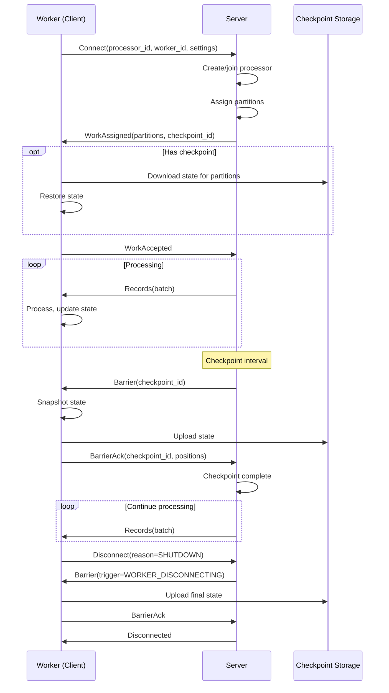

### 12.2 gRPC Service Definition

See [processors_service_v7.proto](processors_service_v7.proto) for complete definition.

**Key RPCs:**

| RPC                   | Direction            | Purpose                                                                     |
|-----------------------|----------------------|-----------------------------------------------------------------------------|
| `Process`             | Bidirectional stream | Main worker↔server communication                                            |
| `UploadCheckpoints`   | Client streaming     | Upload checkpoint state                                                     |
| `DownloadCheckpoints` | Server streaming     | Download checkpoint state                                                   |
| `GetProcessor`        | Unary                | Get processor details                                                       |
| `ListProcessors`      | Unary                | List all processors                                                         |
| `DeleteProcessor`     | Unary                | Delete processor and state (fails if workers connected unless `force=true`) |
| `CreateCheckpoint`    | Unary                | Trigger savepoint                                                           |
| `ListCheckpoints`     | Unary                | Get checkpoint history                                                      |

---

## 14. Observability

### 13.1 Lag Metrics

Three metrics to understand "how far behind":

| Metric        | Formula                              | Use Case  |
|---------------|--------------------------------------|-----------|
| `lag_records` | `COUNT(*) WHERE position > current`  | Alerting  |
| `lag_bytes`   | `head_position - current_position`   | Capacity  |
| `lag_time`    | `head_timestamp - current_timestamp` | Freshness |

> **Note**: `lag_records` requires a secondary index on the log. Without it, only `lag_bytes` and `lag_time` are available.

### 13.2 OTEL Metrics

**Processor metrics (server-side):**

| Metric                                    | Type      | Tags                     | Description       |
|-------------------------------------------|-----------|--------------------------|-------------------|
| `kurrentdb.processor.records.processed`   | Counter   | `processor_id`           | Total records     |
| `kurrentdb.processor.bytes.processed`     | Counter   | `processor_id`           | Total bytes       |
| `kurrentdb.processor.checkpoint.count`    | Counter   | `processor_id`, `status` | Checkpoints       |
| `kurrentdb.processor.checkpoint.duration` | Histogram | `processor_id`           | Duration          |
| `kurrentdb.processor.workers.count`       | Gauge     | `processor_id`           | Connected workers |

**Worker metrics (client-side):**

| Metric                                 | Type      | Tags                        | Description     |
|----------------------------------------|-----------|-----------------------------|-----------------|
| `kurrentdb.worker.records.processed`   | Counter   | `processor_id`, `worker_id` | Records         |
| `kurrentdb.worker.lag.records`         | Gauge     | `processor_id`, `worker_id` | Record lag      |
| `kurrentdb.worker.lag.bytes`           | Gauge     | `processor_id`, `worker_id` | Byte lag        |
| `kurrentdb.worker.lag.time`            | Gauge     | `processor_id`, `worker_id` | Time lag        |
| `kurrentdb.worker.partitions.count`    | Gauge     | `processor_id`, `worker_id` | Partitions      |
| `kurrentdb.worker.checkpoint.duration` | Histogram | `processor_id`, `worker_id` | Checkpoint time |

---

## 15. Alternatives Considered

### 14.1 Server-Hosted Workers

**Considered:** Server deploys and manages worker processes (like Flink JobManager).

**Rejected because:**
- Adds significant complexity to server
- Requires container orchestration
- Users lose flexibility in deployment
- Can always add later as optional mode

**Trade-off:** Users must manage their own worker deployment.

### 14.2 Barrier Alignment (Flink-style)

**Considered:** When a worker has multiple input channels, buffer records from channels that have received the barrier until all channels have.

**Rejected because:**
- KurrentDB has single source ($all log)
- No fan-in at worker level
- Adds complexity for no benefit

**Trade-off:** None—we don't need it.

### 14.3 Incremental Checkpoints

**Considered:** Upload only changed state since last checkpoint.

**Deferred because:**
- Adds significant complexity
- State format must support diffing
- Benefit depends on state size and change rate

**Trade-off:** Full state upload on each checkpoint.

### 14.4 Exactly-Once Sinks

**Considered:** Built-in transactional writes to external systems.

**Rejected because:**
- Each sink has different transaction semantics
- Worker can implement idempotency
- Adds coupling to specific systems

**Trade-off:** Workers responsible for exactly-once to external systems.

---

## 16. Implementation Roadmap

### Phase 1: Core Protocol (MVP)

- [ ] gRPC service definition
- [ ] Worker connection and session management
- [ ] Partition assignment (simple round-robin)
- [ ] Record routing by partition
- [ ] Basic checkpoint coordination (Chandy-Lamport barriers)
- [ ] In-memory checkpoint storage
- [ ] Single subscription type (KEYED)

### Phase 2: Production Ready

- [ ] All subscription types (EXCLUSIVE, SHARED, KEYED)
- [ ] DuckDB checkpoint storage
- [ ] Consistent hashing for partition assignment
- [ ] Checkpoint retention and savepoints
- [ ] Failure policies
- [ ] OTEL metrics integration
- [ ] Management APIs (Get/List/Delete)

### Phase 3: Client SDK

- [ ] .NET ProcessorWorker SDK
- [ ] DuckDB state store implementation
- [ ] Reconnection with backoff
- [ ] Graceful shutdown handling
- [ ] High-level API with IRecordProcessor

### Phase 4: Observability

- [ ] Lag metrics (with index support)
- [ ] Dashboard templates
- [ ] Alerting recommendations
- [ ] Performance tuning guide

---

## 17. Glossary

### Core Concepts

| Term          | Definition                                                                                                                                   |
|---------------|----------------------------------------------------------------------------------------------------------------------------------------------|
| **Processor** | A logical grouping of workers that process records together. Not a running process—it's a concept that emerges when workers connect.         |
| **Worker**    | A process (running on any machine) that connects to KurrentDB to process records. Workers are autonomous—they decide when to join and leave. |
| **Session**   | A unique identifier for a worker connection. Each time a worker connects, it gets a new session ID. Used to detect stale connections.        |
| **Hive Mind** | Our model where workers are autonomous agents and the processor emerges from their coordination. No central controller.                      |

### Data Concepts

| Term         | Definition                                                                                                     |
|--------------|----------------------------------------------------------------------------------------------------------------|
| **Record**   | A single item in the KurrentDB log. Contains a message (command, event, telemetry, state, etc.) plus metadata. |
| **Message**  | The user data inside a record. Can be any type: commands, events, telemetry, state snapshots, etc.             |
| **Stream**   | An ordered sequence of records grouped by a stream ID. Like a topic in Kafka.                                  |
| **Log**      | The append-only sequence of all records ($all). The single source of truth.                                    |
| **Position** | A marker indicating location in the log. Like an offset but may have gaps.                                     |

### Scaling Concepts

| Term                        | Definition                                                                                                                                                                                                              |
|-----------------------------|-------------------------------------------------------------------------------------------------------------------------------------------------------------------------------------------------------------------------|
| **Client-Side Parallelism** | Running multiple workers within the same process to maximize throughput. Each local worker gets its own gRPC connection and partition set. Server coordinates barriers across all workers regardless of where they run. |
| **Horizontal Scaling**      | Adding more machines/pods/containers, each running one or more workers.                                                                                                                                                 |
| **Vertical Scaling**        | Adding more workers per machine (client-side parallelism).                                                                                                                                                              |

### Partitioning Concepts

| Term                | Definition                                                                                                          |
|---------------------|---------------------------------------------------------------------------------------------------------------------|
| **Partition**       | A subdivision of the key space (0 to max_parallelism-1). Records with the same key always go to the same partition. |
| **Key Group**       | Flink's term for what we call partitions.                                                                           |
| **Partition Key**   | A value extracted from each record used to determine which partition (and thus which worker) processes it.          |
| **max_parallelism** | The number of partitions. Set at processor creation, cannot be changed. Determines maximum possible parallelism.    |
| **Rebalancing**     | Redistributing partitions when workers join or leave. Involves checkpoint → reassign → restore.                     |

### Checkpoint Concepts

| Term                                    | Definition                                                                                             |
|-----------------------------------------|--------------------------------------------------------------------------------------------------------|
| **Checkpoint**                          | A consistent snapshot of all workers' state and positions. Enables recovery after failures.            |
| **Savepoint**                           | A manually-triggered checkpoint that is never automatically deleted. Used for migrations and upgrades. |
| **Barrier**                             | A marker message sent to workers to trigger a checkpoint. Based on Chandy-Lamport algorithm.           |
| **Barrier Acknowledgment (BarrierAck)** | Worker's response to a barrier, confirming state has been uploaded and providing current positions.    |
| **Checkpoint ID**                       | Identifier for a checkpoint. In our design, this is the log position when the barrier was sent.        |
| **Retention**                           | Policy for how many old checkpoints to keep. Savepoints are exempt from retention.                     |

### State Concepts

| Term            | Definition                                                                                          |
|-----------------|-----------------------------------------------------------------------------------------------------|
| **State**       | Data that a worker maintains across records. Examples: running totals, aggregations, lookup tables. |
| **State Store** | Component that manages partitioned state. Can be in-memory, DuckDB, RocksDB, etc.                   |
| **Snapshot**    | Serialized state at checkpoint time. Uploaded to checkpoint storage.                                |
| **Restore**     | Loading state from a checkpoint after failure or rebalancing.                                       |

### Processing Concepts

| Term                     | Definition                                                                                   |
|--------------------------|----------------------------------------------------------------------------------------------|
| **Stateless Processing** | Each record processed independently. Any worker can handle any record.                       |
| **Stateful Processing**  | Processing depends on previous records. Same key must go to same worker.                     |
| **At-Least-Once**        | Delivery guarantee where records may be delivered multiple times but never lost.             |
| **Exactly-Once State**   | State reflects each record exactly once (via checkpoints), even if delivered multiple times. |
| **Lag**                  | How far behind a worker is from the latest record. Measured in records, bytes, or time.      |

### Subscription Concepts

| Term          | Definition                                                                                                   |
|---------------|--------------------------------------------------------------------------------------------------------------|
| **EXCLUSIVE** | One active worker receives all records. Others are standby.                                                  |
| **SHARED**    | Round-robin distribution. No ordering guarantees. Maximum throughput.                                        |
| **KEYED**     | Partition by key. Same key always goes to same worker. Per-key ordering.                                     |
| **Filter**    | Expression that selects which records to process (e.g., `stream_id LIKE 'order-%'` or `category = 'order'`). |

### Protocol Concepts

| Term                     | Definition                                                                         |
|--------------------------|------------------------------------------------------------------------------------|
| **gRPC**                 | High-performance RPC framework used for worker↔server communication.               |
| **Bidirectional Stream** | A gRPC connection where both sides can send messages at any time.                  |
| **Connect**              | Worker message to join a processor.                                                |
| **WorkAssigned**         | Server message with partition assignments. Sent on connect and during rebalancing. |
| **WorkAccepted**         | Worker message indicating it has accepted work and is ready to receive records.    |
| **Disconnect**           | Graceful shutdown request from worker.                                             |

### Algorithm Concepts

| Term                         | Definition                                                                                         |
|------------------------------|----------------------------------------------------------------------------------------------------|
| **Chandy-Lamport Algorithm** | 1985 algorithm for capturing consistent distributed snapshots. Basis for our checkpoint mechanism. |
| **Consistent Hashing**       | Algorithm for distributing partitions to workers with minimal redistribution when workers change.  |
| **FIFO**                     | First-In-First-Out. Messages arrive in the order sent. Required by Chandy-Lamport.                 |

### Infrastructure Concepts

| Term                     | Definition                                                                               |
|--------------------------|------------------------------------------------------------------------------------------|
| **DuckDB**               | Embedded analytical database. Used for state storage and potentially checkpoint storage. |
| **OpenTelemetry (OTEL)** | Standard for metrics, traces, and logs. We export metrics via OTEL.                      |
| **Parquet**              | Columnar storage format. Used for efficient state snapshots.                             |

### Related Technologies

| Term                    | Definition                                                                              |
|-------------------------|-----------------------------------------------------------------------------------------|
| **Apache Flink**        | Distributed stream processing framework. Inspiration for checkpointing design.          |
| **Apache Kafka**        | Distributed event streaming platform. Inspiration for consumer groups and partitioning. |
| **Apache Pulsar**       | Distributed messaging platform. Inspiration for subscription types.                     |
| **Flink Reactive Mode** | Flink feature (2021) where workers manage themselves, similar to our Hive Mind.         |

---

## 18. References

### Academic Papers

1. Chandy, K.M. and Lamport, L. (1985). **"Distributed Snapshots: Determining Global States of Distributed Systems"**. ACM Transactions on Computer Systems, 3(1), 63-75.  
   [DOI:10.1145/214451.214456](https://doi.org/10.1145/214451.214456)  
   *Foundation for our checkpoint mechanism.*

2. Carbone, P., et al. (2015). **"Lightweight Asynchronous Snapshots for Distributed Dataflows"**. arXiv:1506.08603.  
   [arXiv:1506.08603](https://arxiv.org/abs/1506.08603)  
   *Flink's adaptation of Chandy-Lamport for stream processing.*

### Internal Documents

- [Protocol Specification](processors_service_v7.proto)
- [Entity Events](processor_events_v3.proto)
- [Flink Comparison](flink-comparison.md)
- [Lag Calculation](lag-calculation.md)

### External References

- [Apache Flink Checkpointing](https://nightlies.apache.org/flink/flink-docs-stable/docs/ops/state/checkpoints/)
- [Flink Reactive Mode (1.13)](https://flink.apache.org/2021/05/03/announcing-the-release-of-apache-flink-1.13/)
- [Apache Kafka Consumer Groups](https://kafka.apache.org/documentation/#consumerconfigs)
- [Apache Pulsar Subscriptions](https://pulsar.apache.org/docs/concepts-messaging/#subscriptions)
