# AWS Kinesis Client Library (KCL) 3.x — Architecture Reference

> **Purpose**: Deep-dive reference on KCL 3.x internals, written as a design reference for the Kurrent Processors Hive Mind coordination layer. Covers component architecture, coordination flows, timing, failure handling, and lessons learned.
>
> **Author**: Sérgio Silveira · Kurrent Developer Experience  
> **Date**: January 2026

---

## Table of Contents

1. [Executive Summary](#1-executive-summary)
   - Why KCL matters to us
   - The 2.x → 3.x evolution in one paragraph

2. [KCL 2.x Architecture (Baseline)](#2-kcl-2x-architecture-baseline)
   - Fully decentralized model
   - Component overview: LeaseRenewer + LeaseTaker
   - How lease taking works (conditional writes, stealing)
   - Timing intervals and formulas
   - Scaling problem: N workers × full table scan
   - Mermaid: KCL 2.x lease lifecycle

3. [KCL 3.x Architecture (Leader-Based)](#3-kcl-3x-architecture-leader-based)
   - High-level component tree
   - DynamoDB tables (Lease, Worker Metrics, Coordinator State)
   - What each worker runs vs what only the leader runs
   - Mermaid: KCL 3.x component architecture

4. [Leader Election](#4-leader-election)
   - CoordinatorState table structure
   - How a worker becomes leader (conditional writes)
   - Leader failure detection and release
   - LeaderDecider variants
   - Mermaid: Leader election sequence

5. [LeaseAssignmentManager (Leader Loop)](#5-leaseassignmentmanager-leader-loop)
   - Assignment algorithm step-by-step
   - InMemoryStorageView
   - Priority: expired → load balance → variance balance
   - Worker eligibility criteria
   - Direct write pattern (Option A)
   - Mermaid: Assignment cycle sequence

6. [LeaseDiscovery (Non-Leader Workers)](#6-leasediscovery-non-leader-workers)
   - GSI-based efficient lookup
   - How workers discover new assignments
   - Why this replaced full table scan
   - Mermaid: Discovery flow

7. [Lease Renewal](#7-lease-renewal)
   - LeaseRenewer loop (all workers)
   - Timing: renewerIntervalMillis formula
   - Conditional counter increment
   - Lease expiry detection

8. [Scenario Walkthroughs](#8-scenario-walkthroughs)
   - 8.1 Cold start (first worker joins)
   - 8.2 Worker joins existing cluster
   - 8.3 Worker crashes (ungraceful failure)
   - 8.4 Worker graceful shutdown (lease handoff)
   - 8.5 Leader crashes → new leader elected
   - 8.6 Rebalancing triggered by CPU variance
   - Each with Mermaid sequence diagram

9. [Configuration Reference](#9-configuration-reference)
   - Timing parameters table
   - Load balancing parameters table
   - Worker eligibility thresholds

10. [Lessons Learned & Applicability to Hive Mind](#10-lessons-learned--applicability-to-hive-mind)
    - Evolution from decentralized → leader-based
    - One writer for assignments avoids OCC races
    - GSI optimization → our filter injection advantage
    - CPU-aware vs lease-count balancing
    - Graceful handoff patterns
    - What KCL can't do that we can (push via filter injection)

11. [Sources](#11-sources)

---

## 1. Executive Summary

### Why KCL Matters to Us

The AWS Kinesis Client Library (KCL) is the most battle-tested distributed stream processing coordination library in production today. It solves the exact same problem we face with Kurrent Processors: **how do N workers coordinate to process P partitions of a stream, handle failures, rebalance work, and checkpoint progress — without a central orchestrator?**

KCL has been in production since 2013 (1.x), went through a major rewrite (2.x), and recently shipped a third generation (3.x) that fundamentally changed its coordination model. That evolution — from fully decentralized to leader-based — is directly relevant to our Hive Mind architecture decisions.

### The 2.x → 3.x Evolution in One Paragraph

KCL 2.x was fully decentralized: every worker independently scanned the entire DynamoDB lease table every ~20 seconds, identified expired or unbalanced leases, and raced to acquire them via conditional writes. This worked but created O(N×P) read pressure and unpredictable convergence times. **KCL 3.x moved to a leader-based model**: one elected leader runs a `LeaseAssignmentManager` that reads all state, computes optimal assignments, and writes them directly to the lease table. Non-leader workers just renew their own leases and discover assignments via a GSI query. The result: O(1) assignment computation, CPU-aware load balancing, graceful lease handoffs, and dramatically reduced DynamoDB costs. This is Option A — leader assigns directly — after years of production experience validating that one writer avoids races.

---

## 2. KCL 2.x Architecture (Baseline)

### Fully Decentralized Model

KCL 2.x has **no leader**. Every worker is equal and independently responsible for discovering, acquiring, and renewing leases. Coordination happens entirely through DynamoDB conditional writes — optimistic concurrency on a shared lease table.

### Component Overview

Every KCL 2.x worker runs two independent loops inside a `LeaseCoordinator`:

**LeaseRenewer** — Runs every ~3.3 seconds. Each worker renews only its own leases by incrementing the `leaseCounter` via conditional write. If the counter was changed by another worker (stolen), the renew fails and the worker knows it lost the lease.

**LeaseTaker** — Runs every ~20 seconds. Each worker reads the **entire** lease table from DynamoDB, builds a local view of all leases and their owners, then:
1. Identifies **expired leases** (counter not incremented within `leaseDurationMillis`)  
2. Identifies **unassigned leases** (no owner)  
3. Calculates a **target** lease count per worker: `ceil(totalLeases / numWorkers)`  
4. If under target, attempts to **take** expired/unassigned leases via conditional write  
5. If distribution is uneven, attempts to **steal** leases from the most overloaded worker

### How Lease Taking Works

Lease acquisition uses DynamoDB conditional writes for atomicity:

```
UpdateItem:
  Key: { leaseKey: "shard-005" }
  SET leaseOwner = "worker-B", leaseCounter = leaseCounter + 1
  CONDITION: leaseCounter = <expected_value>
```

Multiple workers may race to take the same expired lease. Only one succeeds (the first conditional write to land). Others get `ConditionalCheckFailedException` and move on. This is safe but wasteful at scale.

**Lease stealing** is more nuanced: workers identify the worker with the most leases and try to take `maxLeasesToStealAtOneTime` leases from it, but only from **one** victim per cycle.

### Timing Intervals

All timings derive from a single config: `failoverTimeMillis` (default: 10,000ms):

| Parameter | Formula | Default |
|-----------|---------|---------|
| `renewerIntervalMillis` | `failoverTimeMillis / 3 - epsilonMillis` | ~3,308ms |
| `takerIntervalMillis` | `(failoverTimeMillis + epsilonMillis) * 2` | ~20,050ms |
| `epsilonMillis` | Fixed jitter value | 25ms |
| `leaseDurationMillis` | = `failoverTimeMillis` | 10,000ms |

**Renewer runs ~6× faster than taker.** This ensures leases are refreshed multiple times between taker scans, so healthy leases are rarely misidentified as expired.

### Scaling Problem

The fundamental issue: **every worker scans the full lease table every ~20 seconds**. With N workers and P partitions:

- Read operations per cycle: N × P (each worker reads all P leases)
- Read operations per minute: N × P × 3 (~3 taker cycles per minute)
- With 100 workers and 1,000 shards: **300,000 reads/minute**

This is why KCL 3.x moved to a leader-based model.

### KCL 2.x Cold Start Issue

During cold start, each worker has no awareness of others (`numWorkers = 1`), so every worker sets its target to `min(totalLeases, maxLeasesForWorker)` — all of them. This creates a thundering herd of conditional writes. Eventually it converges, but initial assignment is chaotic and timing-dependent.

### KCL 2.x Rebalancing Limitation

When adding workers in bulk (e.g., 100 workers added to a cluster already processing 500 shards), the stealing algorithm can settle in a **suboptimal equilibrium**. Old workers keep 3 shards each, new workers get only 2, because the target calculation rounds up and existing workers never voluntarily release leases.

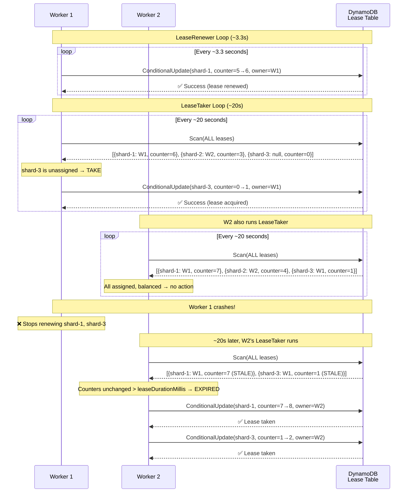

---

## 3. KCL 3.x Architecture (Leader-Based)

### High-Level Component Tree

KCL 3.x introduces role differentiation. All workers share a common base, but the elected leader runs additional components:

```
Scheduler (top-level orchestrator per worker)
│
├── LeaseRenewer              ← ALL workers, ~3.3s
│   └── Renews only own leases via conditional write
│
├── LeaseDiscovery            ← NON-LEADER workers, periodic
│   └── Queries GSI (leaseOwner = self) to find assigned leases
│
├── WorkerMetricStatsReporter ← ALL workers, periodic
│   └── Publishes CPU utilization + throughput to Worker Metrics table
│
├── LeaderDecider             ← ALL workers (election participation)
│   └── Conditional write to CoordinatorState table
│   └── Winner becomes leader, losers detect and defer
│
└── LeaseAssignmentManager    ← LEADER ONLY, ~20s
    └── Reads all leases + worker metrics
    └── Computes optimal assignment
    └── Writes lease ownership directly to lease table
```

### What Changed from 2.x

| Aspect | KCL 2.x | KCL 3.x |
|--------|---------|---------|
| **Assignment model** | Every worker competes | Leader assigns, workers accept |
| **Lease discovery** | Full table scan (all workers) | GSI query by owner (non-leaders) |
| **Load balancing** | Lease count target | CPU utilization + throughput |
| **Failure detection** | Each worker checks all counters | Leader checks all, workers check own |
| **Cold start** | Thundering herd | Leader assigns sequentially |
| **Scaling cost** | O(N × P) reads/cycle | O(P) reads (leader only) |
| **DynamoDB tables** | 1 (lease table) | 3 (lease + metrics + coordinator) |

### DynamoDB Tables

**1. Lease Table** (`{ApplicationName}`)

The same table from 2.x, with a new GSI:

| Column | Description |
|--------|-------------|
| `leaseKey` (PK) | Shard identifier (e.g., `shardId-000000000001`) |
| `leaseOwner` | Worker ID that holds this lease |
| `leaseCounter` | Monotonic counter, incremented on each renewal |
| `checkpoint` | Last checkpointed sequence number |
| `ownerSwitchesSinceCheckpoint` | Tracks handoffs for dedup |

**GSI: `leaseOwner` (partition key) → `leaseKey` (sort key)**

This GSI is the key optimization. Instead of scanning all leases, a worker queries `leaseOwner = "my-worker-id"` and gets only its assigned leases. Cost: O(K) where K = leases assigned to this worker, vs O(P) for a full scan.

**2. Worker Metrics Table** (`{ApplicationName}-WorkerMetricStats`)

| Column | Description |
|--------|-------------|
| `workerId` (PK) | Worker identifier |
| `cpuUtilization` | Exponential moving average of CPU usage |
| `throughput` | Current throughput in KB/s |
| `lastUpdateTime` | When metrics were last reported |
| `isAnyWorkerMetricFailing` | Health flag |

**3. Coordinator State Table** (`{ApplicationName}-CoordinatorState`)

| Column | Description |
|--------|-------------|
| `key` (PK) | State key (e.g., `leaderHash`) |
| `leaderWorkerId` | Current leader's worker ID |
| `leaderElectionTime` | When leadership was acquired |
| `migrationState` | KCL 2.x → 3.x migration progress |

### Component Architecture Diagram

```mermaid
graph TB
    subgraph "Worker A (Leader)"
        SA[Scheduler A]
        LR_A[LeaseRenewer<br/>~3.3s]
        WM_A[WorkerMetricStatsReporter]
        LD_A[LeaderDecider<br/>✅ I am leader]
        LAM[LeaseAssignmentManager<br/>~20s - LEADER ONLY]
        SA --> LR_A
        SA --> WM_A
        SA --> LD_A
        SA --> LAM
    end

    subgraph "Worker B (Non-Leader)"
        SB[Scheduler B]
        LR_B[LeaseRenewer<br/>~3.3s]
        WM_B[WorkerMetricStatsReporter]
        LD_B[LeaderDecider<br/>❌ Not leader]
        DISC_B[LeaseDiscovery<br/>Query GSI]
        SB --> LR_B
        SB --> WM_B
        SB --> LD_B
        SB --> DISC_B
    end

    subgraph "Worker C (Non-Leader)"
        SC[Scheduler C]
        LR_C[LeaseRenewer<br/>~3.3s]
        WM_C[WorkerMetricStatsReporter]
        LD_C[LeaderDecider<br/>❌ Not leader]
        DISC_C[LeaseDiscovery<br/>Query GSI]
        SC --> LR_C
        SC --> WM_C
        SC --> LD_C
        SC --> DISC_C
    end

    subgraph "DynamoDB"
        LT[(Lease Table<br/>+ GSI on leaseOwner)]
        MT[(Worker Metrics Table)]
        CT[(Coordinator State Table)]
    end

    LAM -->|Read all leases| LT
    LAM -->|Read all metrics| MT
    LAM -->|Write assignments| LT
    
    LR_A -->|Renew own leases| LT
    LR_B -->|Renew own leases| LT
    LR_C -->|Renew own leases| LT
    
    DISC_B -->|Query GSI<br/>owner=B| LT
    DISC_C -->|Query GSI<br/>owner=C| LT
    
    WM_A -->|Report CPU/throughput| MT
    WM_B -->|Report CPU/throughput| MT
    WM_C -->|Report CPU/throughput| MT
    
    LD_A -->|Conditional write<br/>claim leadership| CT
    LD_B -->|Check leader status| CT
    LD_C -->|Check leader status| CT
```

---

## 4. Leader Election

### How It Works

Leader election in KCL 3.x uses the **CoordinatorState DynamoDB table** with conditional writes — the same primitive used for lease acquisition. There is no separate consensus protocol (no Raft, no ZooKeeper). DynamoDB's conditional updates provide the mutual exclusion guarantee.

### Election Protocol

1. **Candidate phase**: A worker without a known leader attempts to claim leadership by writing its worker ID to the CoordinatorState table with a conditional check: `CONDITION: leaderWorkerId does not exist OR leaderElectionTime is expired`
2. **Win**: If the conditional write succeeds, this worker is the leader. It starts running `LeaseAssignmentManager`.
3. **Lose**: If the conditional write fails (another worker already claimed), this worker reads the current leader ID and defers.
4. **Renewal**: The leader periodically refreshes its `leaderElectionTime` in the CoordinatorState table (piggybacks on the existing renewer loop).
5. **Expiry**: If the leader stops refreshing (crash), other workers detect the stale `leaderElectionTime` and compete to become the new leader.

### Leader Failure Detection and Release

KCL 3.x has a built-in safety valve: if the leader's `LeaseAssignmentManager` fails continuously (`DEFAULT_FAILURE_COUNT_TO_SWITCH_LEADER` times in a row), the leader **voluntarily releases leadership**:

```java
// Pseudo-code from KCL source
if (consecutiveFailures >= DEFAULT_FAILURE_COUNT_TO_SWITCH_LEADER) {
    leaderDecider.releaseLeadershipIfHeld();
    // Another worker will pick up leadership
}
```

This handles the "zombie leader" scenario where a worker is alive but unable to perform its duties (e.g., DynamoDB throttling, network partition to lease table).

### LeaderDecider Variants

KCL 3.x ships two `LeaderDecider` implementations:

| Variant | Purpose |
|---------|---------|
| `MigrationAdaptiveLeaderDecider` | Used during 2.x → 3.x migration. Coordinates the cutover from decentralized to leader-based assignment. |
| `DeterministicShuffleShardSyncLeaderDecider` | Standard leader election. Uses deterministic shuffling to reduce contention during election races. |

### Election Sequence

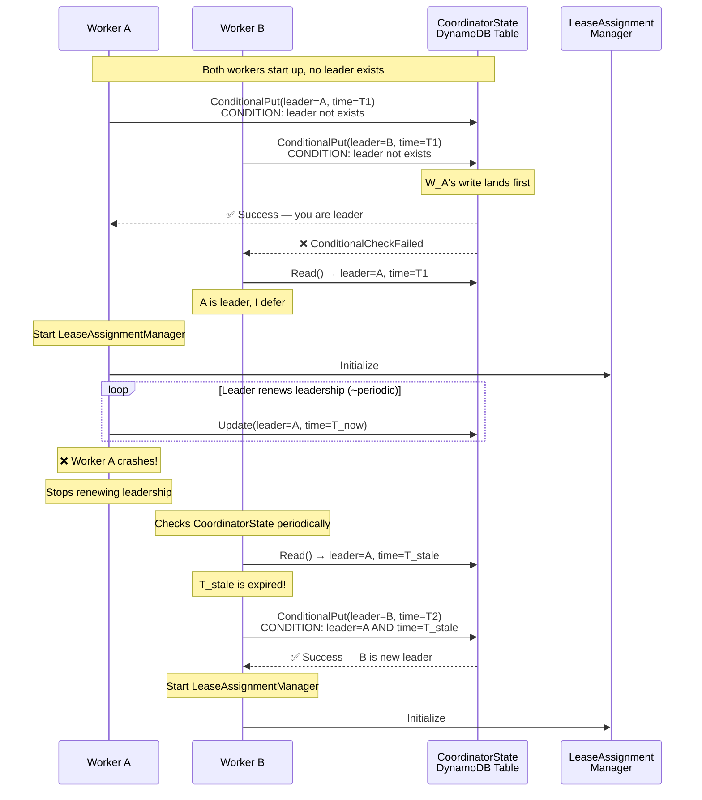

### Key Design Decisions

**Why not Raft/Paxos?** KCL already depends on DynamoDB for lease storage. Using conditional writes for leader election avoids introducing a separate consensus system. The tradeoff is weaker liveness guarantees (longer failover) but much simpler operations.

**Why voluntary release?** A leader that can't do its job is worse than no leader. The `consecutiveFailures` threshold ensures a stuck leader steps aside before the expiry timeout, enabling faster recovery.

---

## 5. LeaseAssignmentManager (Leader Loop)

The `LeaseAssignmentManager` is the heart of KCL 3.x coordination. It runs **only on the leader worker**, every ~20 seconds (configurable via `leaseAssignmentIntervalMillis`). It has a dedicated thread (`lam-thread` in logs).

### Assignment Algorithm Step-by-Step

Each cycle:

1. **Build InMemoryStorageView**: Read all leases from the lease table + all worker metrics from the metrics table. Construct a unified in-memory view of the cluster.

2. **Identify expired workers**: Any worker whose `lastUpdateTime` in the metrics table exceeds the `workerExpiryThreshold` is considered dead. Their leases become available for reassignment.

3. **Priority 1 — Assign unassigned/expired leases**: These are the most urgent. If any lease has no owner or its owner is expired, assign it to an eligible worker immediately.

4. **Priority 2 — Load balance by CPU**: If CPU utilization variance across workers exceeds `reBalanceThresholdPercentage` (default: 20%), move leases from over-utilized workers to under-utilized ones.

5. **Priority 3 — Variance balance**: Every Nth iteration (`varianceBalancingFrequency`, default: every run), rebalance to reduce overall variance even if no threshold is exceeded. This prevents slow drift.

6. **Write assignments**: The leader writes directly to the lease table: `lease[shard-X].owner = "worker-Y"`. This is a direct write, not a conditional — the leader is the single writer for assignments.

7. **Log results**: The leader logs assignment decisions (this is the source of the "LeaseAssignmentManager logs every 20 seconds" behavior seen in production).

### InMemoryStorageView

The leader constructs this view on each cycle by joining data from two tables:

```
InMemoryStorageView {
    // From Lease Table
    Map<ShardId, Lease> allLeases;        // shard → {owner, counter, checkpoint}
    Map<WorkerId, List<Lease>> byOwner;   // worker → [their leases]
    
    // From Worker Metrics Table  
    Map<WorkerId, WorkerMetrics> metrics;  // worker → {cpu, throughput, lastUpdate}
    
    // Computed
    Set<WorkerId> activeWorkers;           // metrics.lastUpdate >= threshold
    Set<WorkerId> expiredWorkers;          // metrics.lastUpdate < threshold
    List<Lease> unassignedLeases;          // no owner or expired owner
}
```

### Worker Eligibility Criteria

Before assigning a lease to a worker, the leader checks four conditions:

| Condition | Check | Default |
|-----------|-------|---------|
| **Active** | `lastUpdateTime >= workerExpiryThreshold` | Must have reported metrics recently |
| **Healthy** | `!workerMetrics.isAnyWorkerMetricFailing()` | No failing health metrics |
| **Throughput capacity** | `getTotalAssignedThroughput() <= maxThroughputPerHostKBps` | Worker not saturated |
| **Lease capacity** | `assignedLeases.size() < maxLeasesForWorker` | Under lease limit |

All four must pass. If no eligible worker exists, the lease remains unassigned until one becomes available.

### Load Balancing Algorithm Details

CPU-based balancing uses several smoothing mechanisms:

- **EMA (Exponential Moving Average)**: CPU utilization is smoothed with `workerMetricsEMAAlpha = 0.3`, preventing spiky metrics from causing thrashing.
- **Dampening**: A `dampeningPercentage = 10%` prevents oscillation. A lease won't be moved unless the improvement exceeds this threshold.
- **Throughput awareness**: When CPU metrics aren't available, falls back to balancing total shard throughput (KB/s) per worker.
- **Overshoot tolerance**: `allowThroughputOvershoot = true` permits temporarily exceeding throughput limits during rebalancing to avoid deadlocks.

### Direct Write Pattern (Option A)

This is the critical design choice. The leader writes assignments directly:

```
UpdateItem:
  Key: { leaseKey: "shard-005" }
  SET leaseOwner = "worker-B"
  // No conditional — leader is the single writer for assignments
```

Workers **don't compete** for leases. Workers **don't calculate** assignments. The leader decides, the leader writes, workers discover via LeaseDiscovery (§6).

This eliminates the OCC race conditions that plagued KCL 2.x during rebalancing.

### Assignment Cycle Sequence

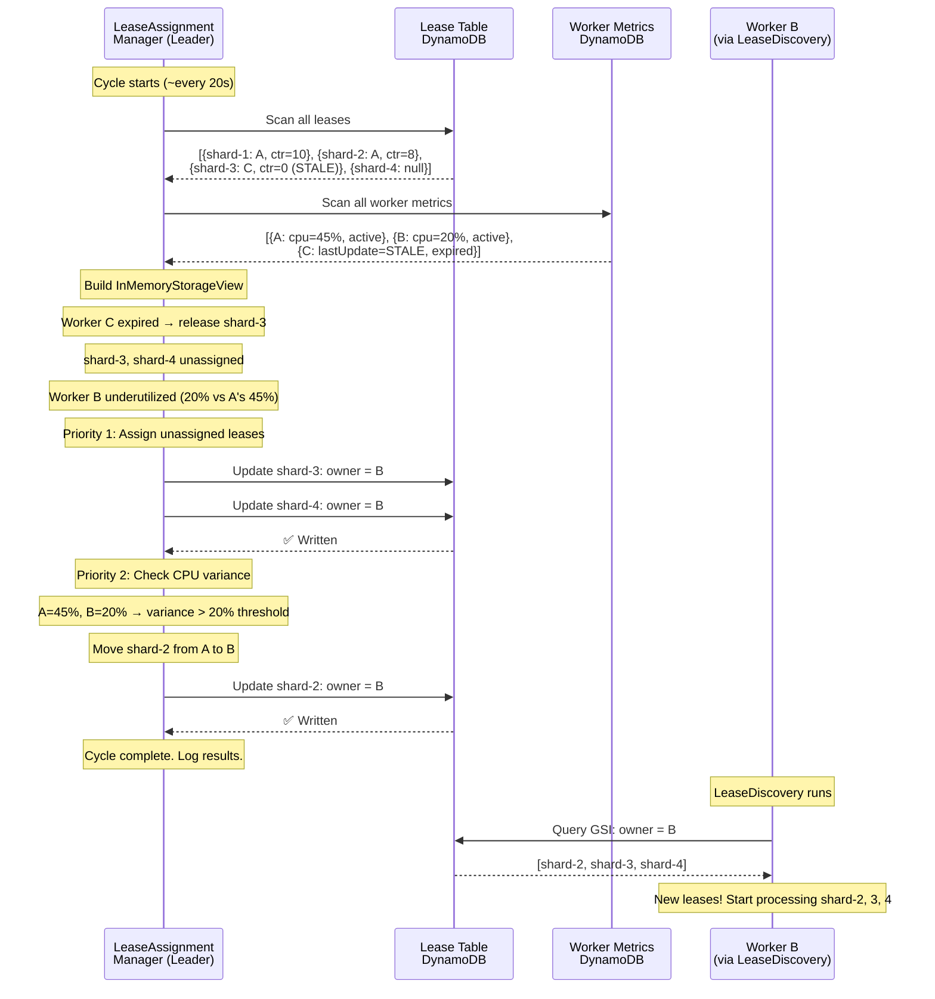

---

## 6. LeaseDiscovery (Non-Leader Workers)

### Purpose

LeaseDiscovery replaces the KCL 2.x full table scan for non-leader workers. Instead of reading every lease to figure out which ones belong to them, workers query a DynamoDB Global Secondary Index (GSI) filtered to their own worker ID.

### GSI Structure

The GSI on the lease table:

```
GSI: LeaseOwnerIndex
  Partition Key: leaseOwner (String)
  Sort Key: leaseKey (String)
  Projected attributes: leaseKey (minimum needed)
```

Query: `leaseOwner = "worker-B"` → returns only leases assigned to Worker B.

### How Workers Discover New Assignments

1. Leader runs `LeaseAssignmentManager`, writes `lease[shard-5].owner = "worker-B"` to the lease table
2. Worker B's `LeaseDiscovery` loop runs periodically
3. Worker B queries GSI: `leaseOwner = "worker-B"`
4. Response includes shard-5 (new!) plus existing leases
5. Worker B compares with its local known-leases set
6. **New lease detected** → initialize RecordProcessor, start reading from checkpoint
7. **Lease missing from response** → lease was reassigned away → stop processing, release resources

### Why This Replaced Full Table Scan

| Metric | KCL 2.x (Full Scan) | KCL 3.x (GSI Query) |
|--------|---------------------|---------------------|
| Read scope | All P leases | Only K leases (mine) |
| Cost per worker/cycle | O(P) RCU | O(K) RCU where K << P |
| Total cost (N workers) | O(N × P) | O(N × K) ≈ O(P) total |
| Data transferred | All lease data | Only my lease keys |

With 100 workers and 1,000 shards where each worker holds ~10 shards: 100 × 10 = 1,000 reads vs 100 × 1,000 = 100,000 reads. **100× reduction.**

### The Poll Problem

Despite the GSI optimization, KCL workers still **poll** to discover assignments. DynamoDB has no push/notification mechanism. Workers discover changes on their next `LeaseDiscovery` cycle — there's inherent latency between the leader assigning a lease and the worker discovering it.

This is where KurrentDB's filter injection gives us an advantage (see §10).

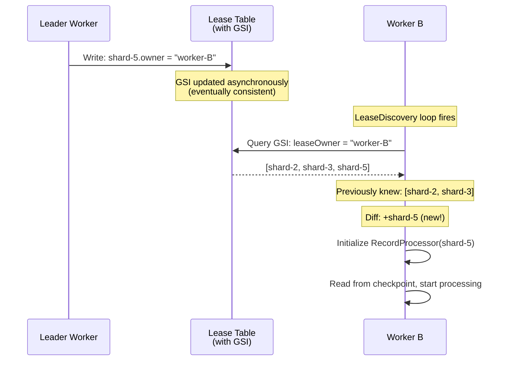

---

## 7. Lease Renewal

### LeaseRenewer Loop

`LeaseRenewer` runs on **every worker** (including the leader) at ~3.3 second intervals. It is unchanged from KCL 2.x — the lease renewal protocol is the same in both versions.

Each cycle, the worker iterates over its locally-known leases and renews each one:

```
UpdateItem:
  Key: { leaseKey: "shard-005" }
  SET leaseCounter = 11
  CONDITION: leaseCounter = 10 AND leaseOwner = "worker-B"
```

### Timing Formula

```
renewerIntervalMillis = failoverTimeMillis / 3 - epsilonMillis
                      = 10000 / 3 - 25
                      = 3308ms (~3.3s)
```

The renewer runs ~3× within a single lease duration window. This provides redundancy: even if one renewal cycle is delayed, the lease won't expire before the next one.

### Conditional Counter Increment

The conditional write serves dual purposes:

1. **Lease ownership proof**: If another worker has taken/stolen the lease and incremented the counter, the condition fails. The original worker detects it lost the lease immediately.

2. **Liveness signal**: The incrementing counter proves the worker is alive. The leader (or in 2.x, other workers) monitors counter staleness to detect failures.

### What Happens on Renewal Failure

| Failure Type | Cause | Worker Action |
|-------------|-------|---------------|
| Conditional check failed | Lease was reassigned by leader | Stop processing this shard, release resources |
| DynamoDB throttled | Rate limit hit | Retry on next cycle (3.3s later) |
| Network error | Transient failure | Retry on next cycle |
| Consecutive failures | Persistent issue | Worker may be considered unhealthy by leader |

### Lease Expiry Detection

A lease is considered **expired** when its `leaseCounter` hasn't been incremented for longer than `leaseDurationMillis` (default: 10s).

In KCL 3.x, only the leader checks for expired leases (during `LeaseAssignmentManager` cycles). In KCL 2.x, every worker checked during its `LeaseTaker` cycle.

The timing relationship:

```
Renewer interval:  3.3s   3.3s   3.3s   3.3s   3.3s   3.3s
                   ├──────┼──────┼──────┼──────┼──────┼──────►
Lease duration:    ├─────────── 10s ────────────┤
                   ↑                             ↑
                   Last successful renewal       Lease considered expired

Worker gets 3 renewal attempts within one lease duration window.
If all 3 fail → lease expires → leader reassigns.
```

---

## 8. Scenario Walkthroughs

### 8.1 Cold Start (First Worker Joins)

The first worker to start has no existing leases, no leader, and no other workers.

**Flow:**
1. Worker A starts, runs `LeaderDecider`
2. No leader exists in CoordinatorState → A claims leadership (unconditional on first write)
3. A starts `LeaseAssignmentManager`
4. LAM reads lease table: all leases unassigned
5. LAM reads metrics table: only A is active
6. LAM assigns all leases to A (up to `maxLeasesForWorker`)
7. A's `LeaseDiscovery` picks up assignments, starts processing

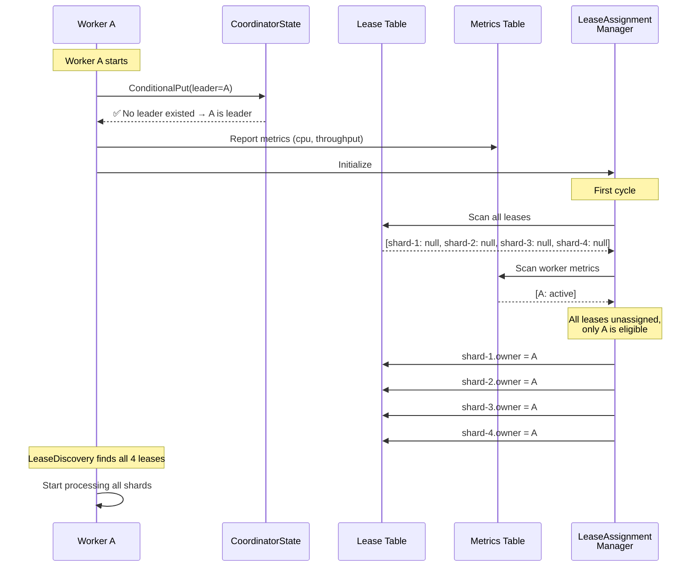

### 8.2 Worker Joins Existing Cluster

A new worker joins a cluster where Worker A (leader) already processes all shards.

**Flow:**
1. Worker B starts, runs `LeaderDecider`
2. Leader exists (A) → B defers
3. B starts reporting metrics to Worker Metrics table
4. B's `LeaseDiscovery` runs but finds no leases assigned to it yet
5. Next LAM cycle: leader A sees B is active, rebalances
6. A reassigns some leases from A to B
7. B's `LeaseDiscovery` discovers new assignments

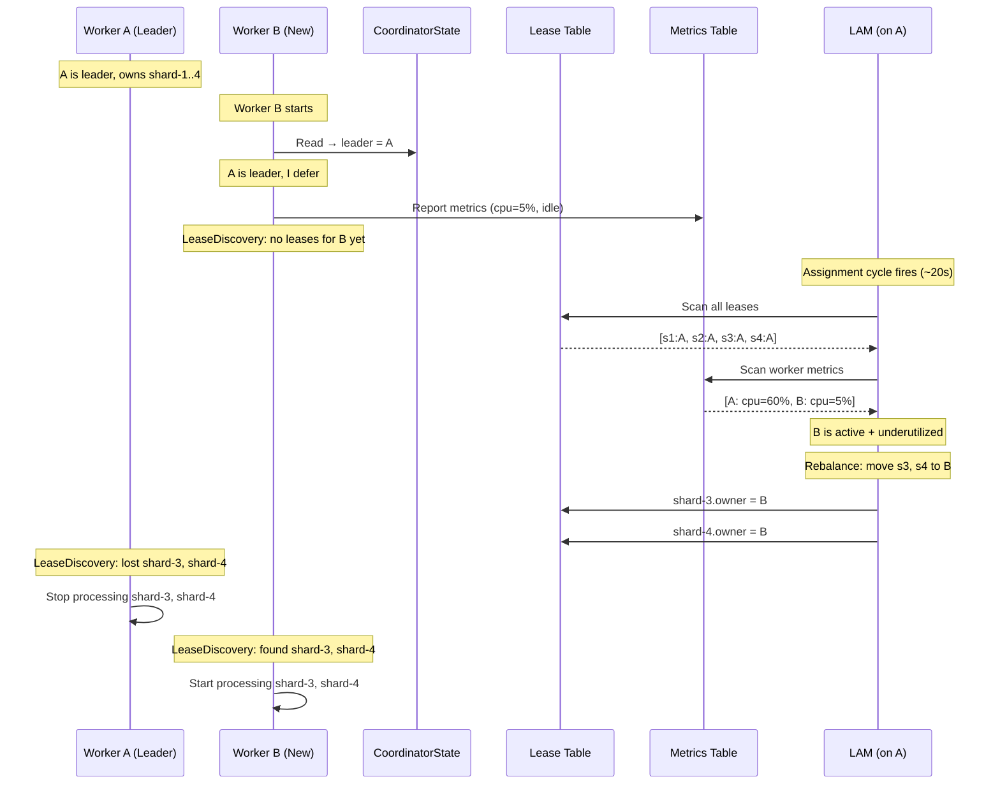

### 8.3 Worker Crashes (Ungraceful Failure)

Worker B crashes without any shutdown signal. Its leases become stale.

**Flow:**
1. Worker B crashes — stops renewing leases, stops reporting metrics
2. LeaseRenewer on B stops → `leaseCounter` for B's leases freezes
3. WorkerMetricStatsReporter on B stops → `lastUpdateTime` goes stale
4. Next LAM cycle: leader detects B's metrics are stale → marks B as expired
5. B's leases become unassigned → leader reassigns to eligible workers
6. Remaining workers discover new assignments via LeaseDiscovery

**Detection latency**: Up to `leaseAssignmentIntervalMillis` (20s) for the leader to notice + `leaseDiscoveryIntervalMillis` for workers to discover. Worst case: ~40 seconds from crash to recovery start.

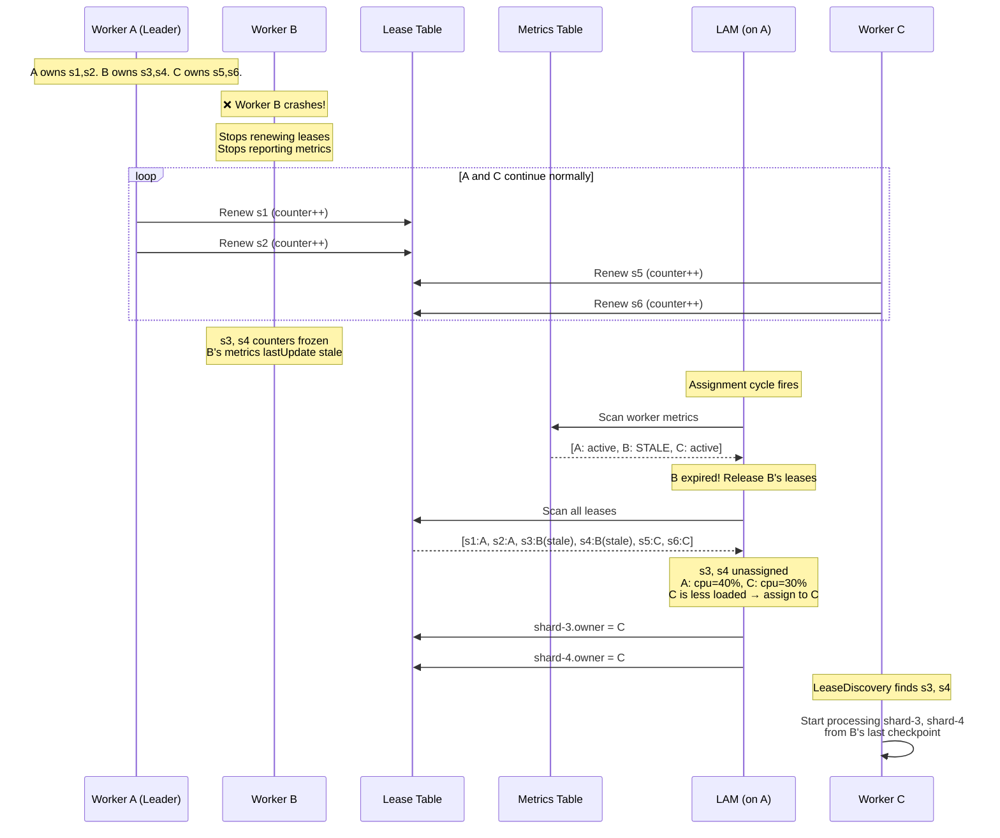

---

### 8.4 Worker Graceful Shutdown (Lease Handoff)

KCL 3.x introduces **graceful lease handoff** (enabled by default via `isGracefulLeaseHandoffEnabled`). When the leader decides to reassign a lease, the current holder gets a chance to checkpoint before releasing.

**Flow:**
1. Leader decides to move shard-3 from Worker B to Worker C (rebalancing)
2. Leader writes `shard-3.owner = C` to lease table, but sets a handoff flag
3. Worker B's next `LeaseDiscovery` detects shard-3 is being handed off
4. KCL invokes `shutdownRequested()` on B's RecordProcessor for shard-3
5. B checkpoints its current position in `shutdownRequested()`
6. B releases the lease (stops renewing)
7. Worker C's `LeaseDiscovery` picks up shard-3, starts from B's checkpoint
8. Minimal reprocessing (only records between B's last checkpoint and handoff)

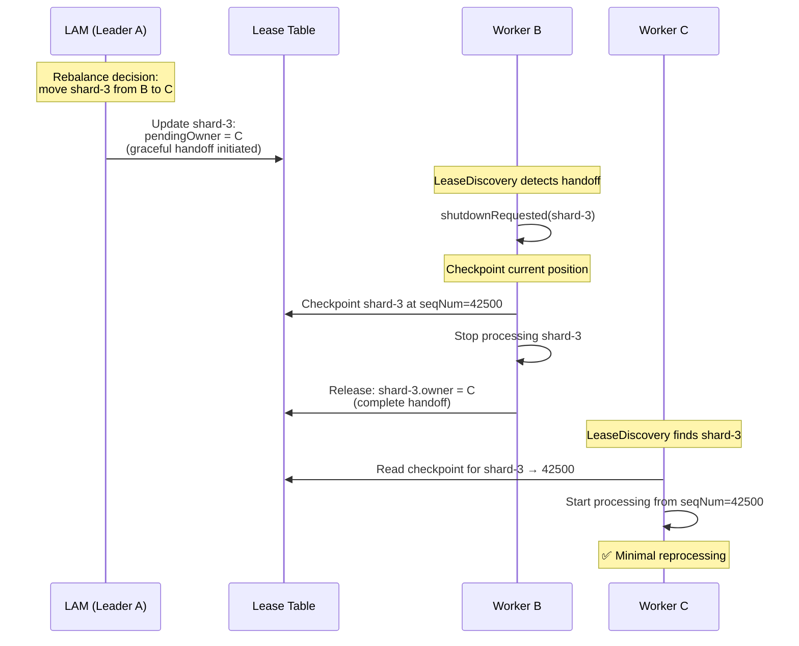

**Important caveat**: Graceful handoff reduces but doesn't eliminate reprocessing. If Worker B crashes during `shutdownRequested()` before checkpointing, Worker C will restart from B's last committed checkpoint (potentially reprocessing some records). Downstream consumers must be idempotent.

### 8.5 Leader Crashes → New Leader Elected

The leader is just a worker with extra responsibilities. When it crashes, a new leader must be elected while also handling the former leader's data leases.

**Flow:**
1. Worker A (leader) crashes
2. A's lease renewals stop → A's data leases (shard-1, shard-2) go stale
3. A's leadership renewal stops → CoordinatorState `leaderElectionTime` goes stale
4. Workers B and C detect stale leadership during `LeaderDecider` check
5. B and C race to claim leadership via conditional write
6. Winner (say B) becomes leader, starts `LeaseAssignmentManager`
7. B's first LAM cycle detects A's expired data leases → reassigns them
8. Normal operation resumes under new leader

**Total recovery time**: `leaderExpiryThreshold` + `leaseAssignmentIntervalMillis` + `leaseDiscoveryInterval`. Could be 30–60 seconds depending on timing alignment.

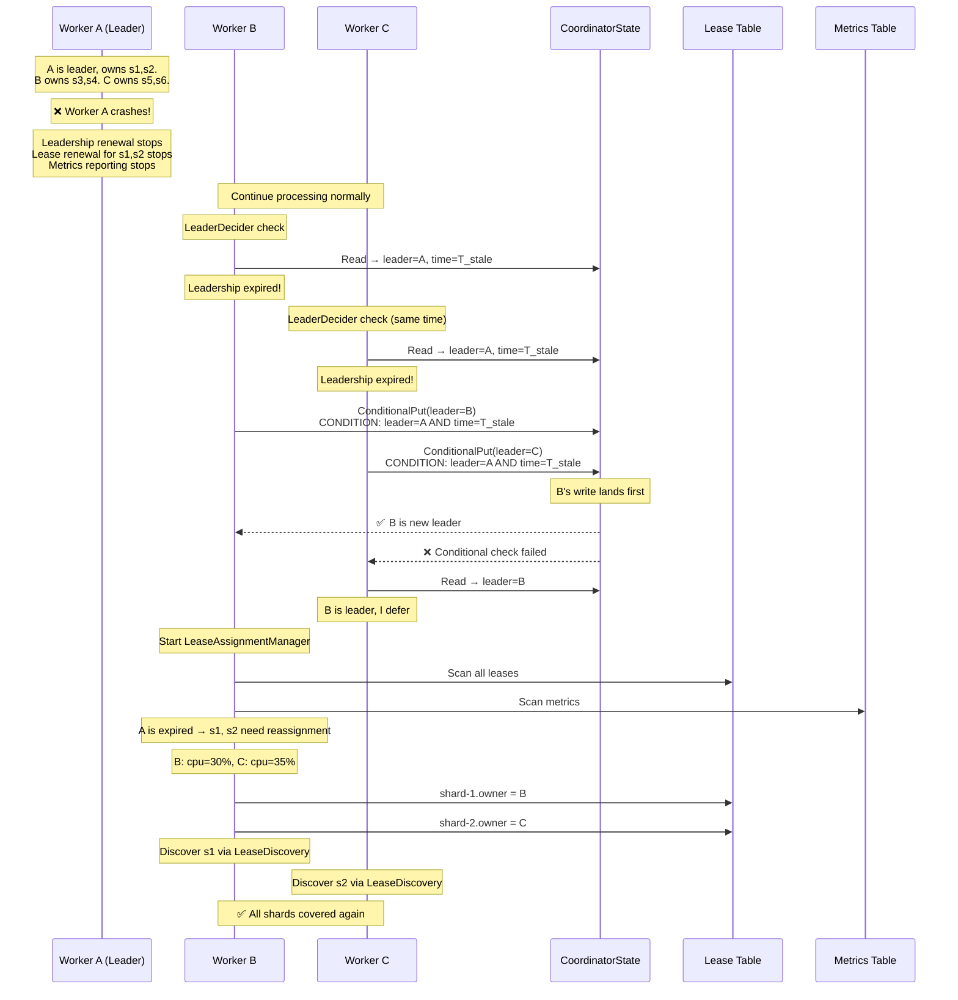

### 8.6 Rebalancing Triggered by CPU Variance

A non-failure scenario where workload imbalance triggers proactive rebalancing.

**Flow:**
1. Three workers running: A (cpu=70%), B (cpu=25%), C (cpu=30%)
2. Leader's LAM cycle detects variance exceeds `reBalanceThresholdPercentage` (20%)
3. LAM identifies A as over-utilized, B as most under-utilized
4. LAM moves one lease from A to B
5. Next cycle: A=50%, B=40%, C=30% — variance reduced, within threshold
6. No further rebalancing needed

**Dampening prevents oscillation**: The 10% dampening threshold means a lease won't be moved unless the CPU difference between source and target workers exceeds 10%. Combined with EMA smoothing (`alpha=0.3`), this prevents thrashing from transient spikes.

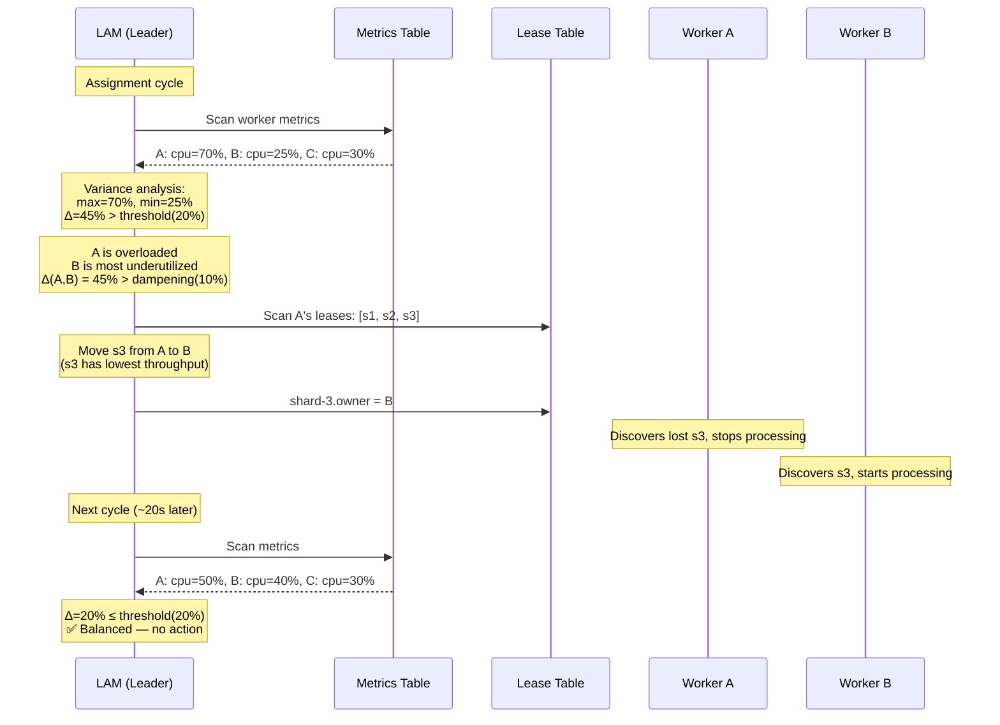

---

## 9. Configuration Reference

### Timing Parameters

| Parameter | Default | Formula / Notes |
|-----------|---------|-----------------|
| `failoverTimeMillis` | 10,000ms | Base timing constant. All other intervals derive from this. |
| `epsilonMillis` | 25ms | Jitter/safety margin to prevent edge-case collisions. |
| `renewerIntervalMillis` | ~3,308ms | `failoverTimeMillis / 3 - epsilonMillis`. How often workers renew their own leases. |
| `takerIntervalMillis` (2.x only) | ~20,050ms | `(failoverTimeMillis + epsilonMillis) * 2`. Full table scan interval per worker. Discontinued in 3.x. |
| `leaseAssignmentIntervalMillis` (3.x) | ~20,000ms | How often the leader runs the assignment cycle. Replaces `takerIntervalMillis`. |
| `leaseDurationMillis` | 10,000ms | = `failoverTimeMillis`. Lease is expired if counter unchanged for this long. |

### Load Balancing Parameters (3.x Only)

| Parameter | Default | Description |
|-----------|---------|-------------|
| `maxThroughputPerHostKBps` | Configurable | Max throughput a single worker should handle. Worker won't get more leases once saturated. |
| `dampeningPercentage` | 10% | Minimum CPU difference required before moving a lease. Prevents oscillation. |
| `reBalanceThresholdPercentage` | 20% | CPU variance threshold that triggers rebalancing. |
| `varianceBalancingFrequency` | 1 (every run) | How often variance balancing runs. Value of 3 = every 3rd LAM cycle. |
| `allowThroughputOvershoot` | true | Allow temporarily exceeding throughput limits during rebalancing. |
| `workerMetricsEMAAlpha` | 0.3 | EMA smoothing factor for CPU metrics. Lower = smoother, slower to react. |
| `staleWorkerMetricsEntryCleanupDuration` | 24h | How long to keep metrics for expired workers before cleanup. |

### Worker Eligibility Thresholds

| Check | Parameter | Default |
|-------|-----------|---------|
| Worker is active | `lastUpdateTime >= workerExpiryThreshold` | Metrics must be recent |
| Worker is healthy | `isAnyWorkerMetricFailing() == false` | No failing health flags |
| Under throughput cap | `totalAssignedThroughput <= maxThroughputPerHostKBps` | Not saturated |
| Under lease cap | `assignedLeases.size() < maxLeasesForWorker` | Default: `Integer.MAX_VALUE` |

### Other Configuration

| Parameter | Default | Description |
|-----------|---------|-------------|
| `maxLeasesForWorker` | `Integer.MAX_VALUE` | Max leases one worker can hold. In 3.x, set this high — CPU balancing handles distribution. |
| `maxLeasesToStealAtOneTime` (2.x) | 1 | How many leases to steal per cycle. Discontinued in 3.x. |
| `isGracefulLeaseHandoffEnabled` (3.x) | true | Enable graceful checkpoint-before-handoff during reassignment. |
| `DEFAULT_FAILURE_COUNT_TO_SWITCH_LEADER` | ~3 (internal) | Consecutive LAM failures before leader voluntarily releases. |

---

## 10. Lessons Learned & Applicability to Hive Mind

### Lesson 1: Evolution from Decentralized → Leader-Based

KCL spent **years in production** with the decentralized model (2.x) before moving to leader-based (3.x). The decentralized model worked but didn't scale. The problems that drove the change:

- O(N×P) read amplification on the coordination store
- Unpredictable convergence during rebalancing (thundering herd, suboptimal equilibria)
- No ability to make globally-optimal assignment decisions (each worker had only local view)
- Lease stealing was heuristic and could oscillate

**Takeaway for Hive Mind**: Start with the leader-based model from day one. We don't need to repeat KCL's evolutionary path. The leader pattern is proven at scale.

### Lesson 2: One Writer for Assignments Avoids OCC Races

The most important architectural decision in KCL 3.x: **the leader is the single writer for lease assignments**. Workers don't compete for leases. Workers don't calculate assignments. The leader decides and writes.

In KCL 2.x, multiple workers racing to acquire the same lease via conditional writes caused wasted write capacity and unpredictable timing. In 3.x, this entire class of problems disappears.

**Takeaway for Hive Mind**: This is Option A. The leader writes partition assignments directly. Workers read their assignments. No OCC races on acquisition.

### Lesson 3: GSI Optimization → Our Filter Injection Advantage

KCL 3.x added a GSI (`leaseOwner` index) so workers don't need to scan the full lease table. But workers still **poll** this GSI periodically. DynamoDB has no push mechanism.

We have something better: **filter injection**. In KurrentDB, the leader can emit a `TopologyChanged` control signal into the data stream. Workers see this inline with their data — it's push, not poll. Workers react to topology changes with zero additional latency (no discovery cycle needed).

**Takeaway for Hive Mind**: Replace `LeaseDiscovery` polling with `TopologyChanged` signals. When the leader assigns partitions, emit a signal. Workers see it instantly. This eliminates the discovery latency gap entirely.

### Lesson 4: CPU-Aware vs Lease-Count Balancing

KCL 2.x balanced by lease count (equal number of shards per worker). KCL 3.x balances by CPU utilization. This matters because not all shards have equal throughput — some are hot, some are cold.

**Takeaway for Hive Mind (v1)**: Start with partition-count balancing (simpler). CPU-aware balancing can be a v2 enhancement when we have metrics infrastructure. Don't over-engineer the first version.

### Lesson 5: Graceful Handoff Matters

KCL 3.x's graceful lease handoff lets the current worker checkpoint before releasing. This dramatically reduces reprocessing during planned rebalancing (worker joins, load balancing). Without it, the new worker restarts from the last committed checkpoint — potentially reprocessing thousands of records.

**Takeaway for Hive Mind**: Implement graceful handoff from the start. When the leader reassigns a partition:
1. Signal the current worker to checkpoint
2. Wait for acknowledgment (with timeout)
3. Only then transfer the lease
4. Fallback: if current worker doesn't respond (crashed), reassign immediately

### Lesson 6: Leader Self-Healing

KCL 3.x's leader voluntarily releases leadership after consecutive failures. This handles the "zombie leader" problem — a worker that's alive but can't perform its duties.

**Takeaway for Hive Mind**: Build in the same safety valve. If the leader can't complete N consecutive coordination cycles, it should release leadership and let another worker take over. Don't rely solely on heartbeat expiry — that's slower.

### Lesson 7: What KCL Can't Do That We Can

| Capability | KCL 3.x | Hive Mind |
|-----------|---------|-----------|
| Assignment notification | Poll (GSI query) | Push (filter injection / `TopologyChanged` signal) |
| State coordination | DynamoDB (external) | KurrentDB streams (same system) |
| Checkpoint storage | DynamoDB (external) | KurrentDB streams (same system) |
| Worker metrics | Separate DynamoDB table | Potential: inline with coordination stream |

Our single-system advantage means we don't need 3 DynamoDB tables. Leases, metrics, and coordinator state can all live in KurrentDB streams — the same system workers are already connected to.

---

## 11. Sources

### Primary Sources (AWS / GitHub)

1. **KCL GitHub Repository** — Source code for all components  
   https://github.com/awslabs/amazon-kinesis-client

2. **Scheduler.java** — Top-level orchestrator, entry point for all worker components  
   https://github.com/awslabs/amazon-kinesis-client/blob/master/amazon-kinesis-client/src/main/java/software/amazon/kinesis/coordinator/Scheduler.java

3. **LeaseAssignmentManager.java** — Leader-only assignment loop (KCL 3.x)  
   https://github.com/awslabs/amazon-kinesis-client/blob/master/amazon-kinesis-client/src/main/java/software/amazon/kinesis/coordinator/assignment/LeaseAssignmentManager.java

4. **LeaseManagementConfig.java** — All configurable parameters  
   https://github.com/awslabs/amazon-kinesis-client/blob/master/amazon-kinesis-client/src/main/java/software/amazon/kinesis/leases/LeaseManagementConfig.java

5. **DynamoDBLeaseCoordinator.java** — Lease coordination, renewer + taker thread setup  
   https://github.com/awslabs/amazon-kinesis-client/blob/master/amazon-kinesis-client/src/main/java/software/amazon/kinesis/leases/dynamodb/DynamoDBLeaseCoordinator.java

6. **LeaseRenewer.java** — Lease renewal loop implementation  
   https://github.com/awslabs/amazon-kinesis-client/blob/master/amazon-kinesis-client/src/main/java/software/amazon/kinesis/leases/LeaseRenewer.java

### AWS Documentation

7. **DynamoDB Tables Used by KCL**  
   https://docs.aws.amazon.com/streams/latest/dev/kcl-dynamoDB.html

8. **KCL Configuration Reference**  
   https://docs.aws.amazon.com/streams/latest/dev/kcl-configuration.html

9. **Monitoring KCL with CloudWatch** — Metrics for LeaseAssignmentManager, WorkerMetricStatReporter, etc.  
   https://docs.aws.amazon.com/streams/latest/dev/monitoring-with-kcl.html

### Community & Analysis

10. **KCL 2.x Consumer – Load Balancing, Rebalancing, Taking, Renewing and Stealing Leases** (Cloudsqale)  
    Best detailed analysis of KCL 2.x internals, timing formulas, and rebalancing edge cases.  
    https://cloudsqale.com/2020/05/20/kinesis-client-library-kcl-2-x-consumer-load-balancing-rebalancing-taking-renewing-and-stealing-leases/

11. **Worker Utilization-Aware Assignment** (DeepWiki)  
    KCL 3.x assignment algorithm analysis.  
    https://deepwiki.com/awslabs/amazon-kinesis-client/4.3-shard-synchronization

12. **AWS Builders' Library: Leader Election in Distributed Systems**  
    General patterns for leader election that informed KCL 3.x design.  
    https://aws.amazon.com/builders-library/leader-election-in-distributed-systems/

### Related GitHub Issues

13. **LeaseAssignmentManager excessive logging KCL 3.0.1** — Confirms LAM runs every 20s, thread name `lam-thread`  
    https://github.com/awslabs/amazon-kinesis-client/issues/1407

