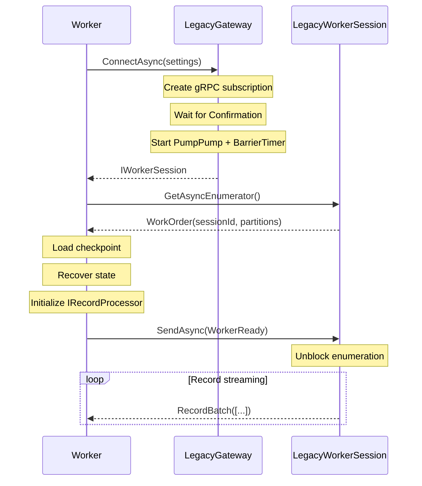
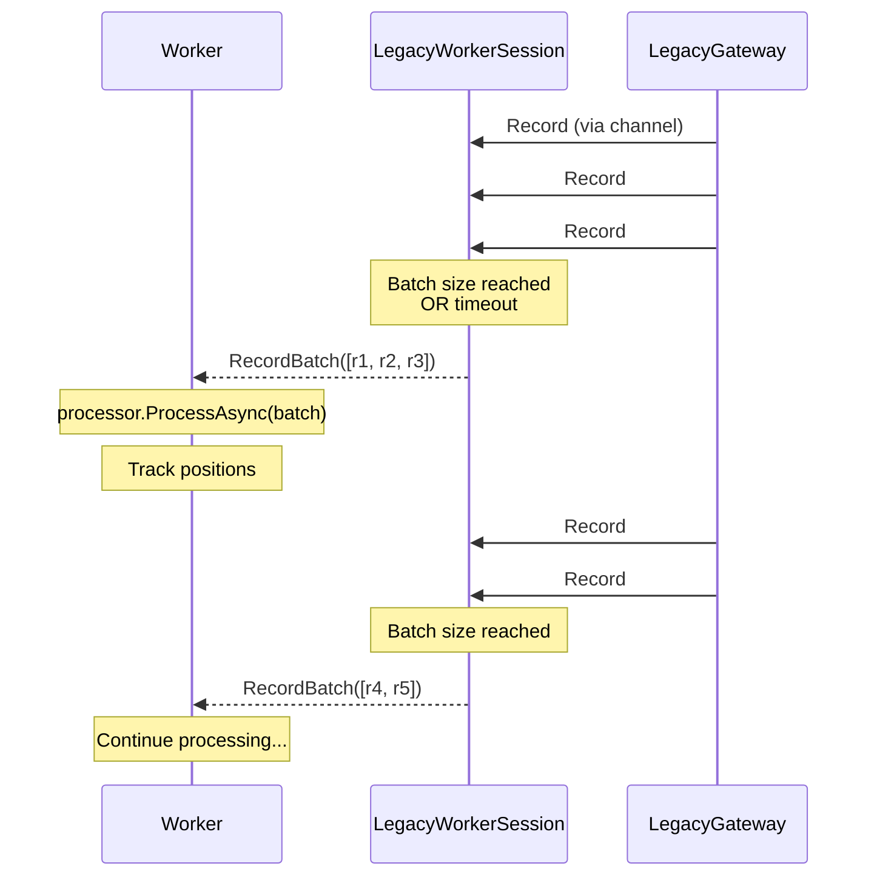
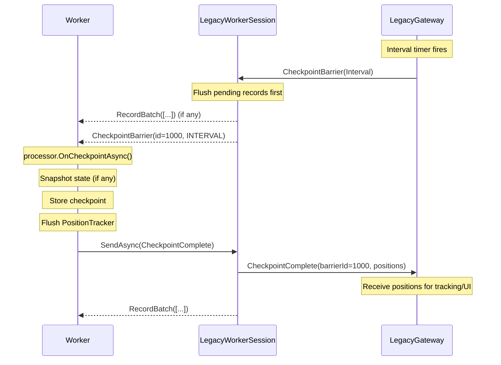
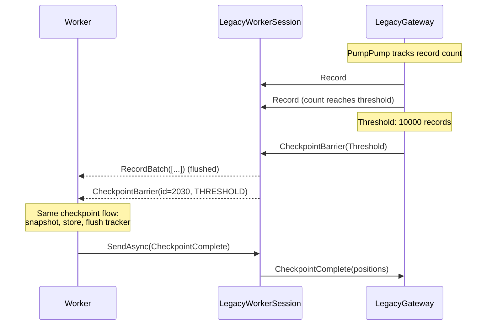
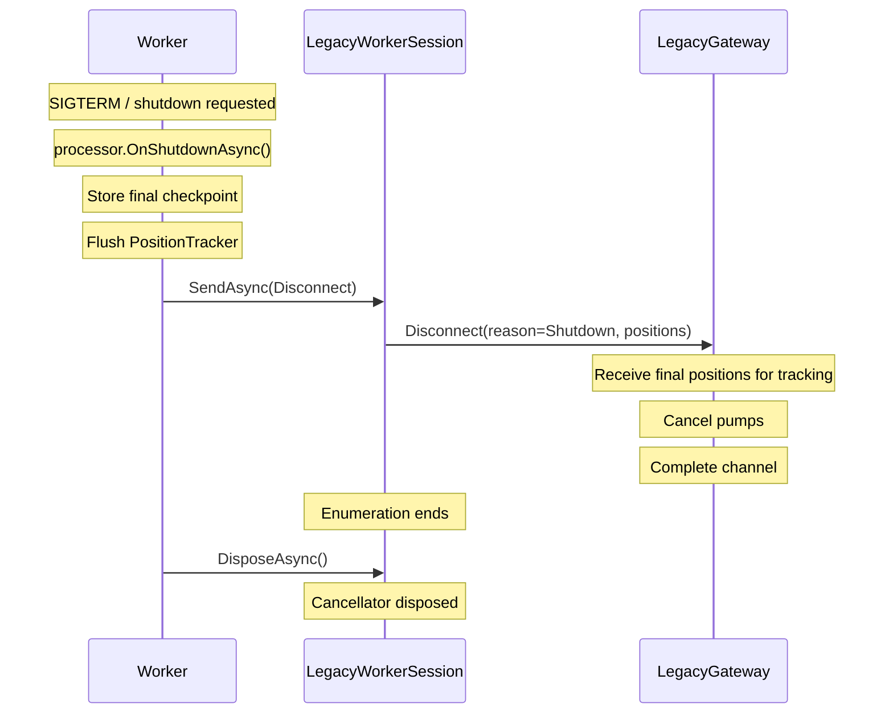

# LegacyGateway Design Specification

---

## Executive Summary

This document captures the design decisions for the **LegacyGateway** component, which enables the Kurrent Processors feature to ship in V2 Preview without requiring server-side implementation.
LegacyGateway simulates the server-side processor protocol entirely on the client, using the existing Streams API (gRPC V1) to read records.

**Key insight:** The Client/SDK becomes server-agnostic through a Ports & Adapters pattern. When the real server protocol lands, users swap `LegacyGateway` for `GrpcGateway` - the gateway returns the appropriate `IWorkerSession` implementation, so worker code requires zero changes.

---

## Table of Contents

1. [Design Goals](#1-design-goals)
2. [Design Decisions](#2-design-decisions)
3. [Architecture Overview](#3-architecture-overview)
4. [Interface Definitions](#4-interface-definitions)
5. [Message Types](#5-message-types)
6. [Component Responsibilities](#6-component-responsibilities)
7. [LegacyGateway Implementation](#7-legacygateway-implementation)
8. [Message Flows](#8-message-flows)
9. [Error Handling & Connection Failures](#9-error-handling--connection-failures)
10. [Checkpoint & Barrier Semantics Deep Dive](#10-checkpoint--barrier-semantics-deep-dive)
11. [Existing Components Reused](#11-existing-components-reused)
12. [Out of Scope (Epic 1)](#12-out-of-scope-epic-1)

---

## 1. Design Goals

| Goal                         | Description                                                                  | Priority |
|------------------------------|------------------------------------------------------------------------------|----------|
| **Server-Agnostic SDK**      | Worker code identical for LegacyGateway and future GrpcGateway               | P0       |
| **Full Checkpoint Protocol** | Position tracking and barrier handling work end-to-end                       | P0       |
| **Clean Abstractions**       | Worker knows only `IWorkerSession`, not gateway internals                    | P0       |
| **Testable**                 | Mock `IWorkerSession` for unit tests, real LegacyGateway for integration     | P1       |
| **Minimal Changes**          | Reuse existing `StreamsClient`, `PositionTracker`, checkpoint stores         | P1       |

**Non-Goals (V2 Preview):**
- Multi-worker coordination (single worker only)
- Partition distribution (always all partitions assigned to single worker)
- `ISharedStateStore` (no state persistence beyond checkpoints)

---

## 2. Design Decisions

### Decision 1: Server abstraction is a two-part interface

**Context:** Worker code needs to connect to the processor infrastructure and then communicate bidirectionally during processing.

**Decision:** The server abstraction layer is composed of two interfaces working together:
- `IProcessorGateway` - the connection factory that establishes sessions
- `IWorkerSession` - the runtime communication interface for message exchange

The worker uses `IProcessorGateway.ConnectAsync()` to establish a connection, receiving an `IWorkerSession`. From that point forward, all communication happens through the session: consuming `ProcessorControlMessage` via enumeration and sending `WorkerMessage` via `SendAsync()`.

**Rationale:** This separation mirrors the typical connection lifecycle - you connect once, then communicate many times. The gateway handles connection concerns (authentication, endpoint discovery, subscription setup), while the session handles the streaming protocol. This makes both interfaces focused and testable.

### Decision 2: Gateway implementations are swappable

**Context:** We need to ship without server-side processor support, but users shouldn't have to change code when server support arrives.

**Decision:** Both `IProcessorGateway` and `IWorkerSession` are interfaces with multiple implementations:
- `LegacyGateway` + `LegacyWorkerSession` - uses V1 gRPC Streams API, simulates server behavior locally
- `GrpcGateway` + `GrpcWorkerSession` (future) - uses V2 bidirectional gRPC with real server

Worker code that uses `IProcessorGateway` and `IWorkerSession` works unchanged across implementations.

**Rationale:** Ports & Adapters pattern. The domain (worker processing logic) is isolated from infrastructure (how we talk to servers). When the real server protocol ships, users change a single line - the gateway they instantiate - and everything else stays the same.

### Decision 3: Messages are domain model types

**Context:** Should messages be proto-generated types or custom types?

**Decision:** Messages (`ProcessorControlMessage`, `WorkerMessage`, and their variants) are clean C# records using `IVariant<T1, T2, ...>` discriminated unions. They are part of the domain model alongside `IProcessorGateway` and `IWorkerSession`. Mapping to/from wire format (protobuf) happens inside gateway implementations.

**Rationale:**
- Immutable records are idiomatic C# with value equality
- `IVariant` enables exhaustive pattern matching - the compiler ensures all cases are handled
- LegacyGateway needs no proto dependency at all
- Domain code is insulated from wire format changes
- Testing is straightforward - just construct records

### Decision 4: LegacyGateway batches records client-side

**Context:** Workers process records in batches for efficiency. How should LegacyGateway provide batches when the V1 protocol streams individual records?

**Decision:** In LegacyGateway, the server streams individual records via the V1 Streams API. The `LegacyWorkerSession` performs batching locally using the `ReadBatched` extension method with intelligent barrier handling:
- Records are accumulated until batch size or timeout is reached
- When a `CheckpointBarrier` arrives, pending records are flushed immediately, then the barrier is yielded
- This "flush-on-barrier" behavior maintains Chandy-Lamport consistent cut semantics

In the future `GrpcGateway`, the server will return pre-batched records directly - the session will simply pass them through.

**Rationale:** The V1 protocol wasn't designed for processors, so we adapt it. The barrier flush behavior is critical for checkpoint correctness: a barrier must be a true processing boundary where everything before it is processed, nothing after. By flushing pending records before yielding the barrier, we ensure the worker sees a consistent view.

### Decision 5: Session yields WorkOrder first, waits for WorkerReady

**Context:** When should records start flowing?

**Decision:** Session enumerator:
1. Yields `WorkOrder` with assigned partitions
2. Blocks until worker calls `SendAsync(WorkerReady)`
3. Then yields batched `RecordBatch` and `CheckpointBarrier` messages

**Rationale:** Worker needs to recover state before receiving new records. The `WorkerReady` handshake ensures the worker has completed initialization (checkpoint loading, state recovery) before records flow.

### Decision 6: LegacyGateway supports 4 of 5 checkpoint triggers

**Context:** Which checkpoint triggers should LegacyGateway support in V2 Preview?

**Decision:** LegacyGateway implements:
- **Interval** - Time-based (e.g., every 30 seconds)
- **Threshold** - Record count (e.g., every 10,000 records)
- **CaughtUp** - Stream reached live edge (once per lifecycle)
- **Rebalance** - Currently no-op (single worker, no rebalancing)

**NOT supported by LegacyGateway:**
- **Savepoint** - Requires server-side `TriggerSavepoint` RPC

**Rationale:** LegacyGateway is single-worker and client-only. Savepoints require a management API that only exists on the server.

### Decision 7: Fire-and-forget disconnect

**Context:** Should the gateway acknowledge disconnects?

**Decision:** No acknowledgment. When worker sends `Disconnect`, the gateway:
1. Receives final positions (for tracking/UI)
2. Cancels pumps
3. Completes channel

The `IAsyncEnumerable` simply ends - no `Disconnected` message sent back.

**Rationale:**
- LegacyGateway is single-worker - no coordination needed
- Worker already knows it's disconnecting (it initiated it)
- Simpler protocol: fire-and-forget
- `Disconnected` would only be needed for server-initiated disconnects in GrpcGateway

### Decision 8: Partition calculation happens at gateway level

**Context:** Where should records be assigned to partitions?

**Decision:** LegacyGateway calculates partition using `PartitionCalculator.Default.For(record.Stream, maxParallelism)` and sets it on the record's `FullPosition.Partition` before writing to the channel.

**Rationale:** Simulates server behavior. The real server would determine partition before routing to workers. This ensures the worker receives records with partition information already set.

### Decision 9: Strong-typed identifiers throughout

**Context:** How should session IDs, partitions, positions be represented?

**Decision:** Use strong-typed readonly record structs:
- `SessionId` - wraps `Guid`, has `None` sentinel
- `Partition` - wraps `int`, has `Any` sentinel, range validation
- `LogPosition` - wraps `ulong`, has `Unset`, `Earliest`, `Latest` sentinels
- `PartitionPositions` - wraps `ImmutableDictionary<Partition, LogPosition>`, has `MaxPosition` helper

**Rationale:** Type safety prevents mixing different ID types. Sentinel values make edge cases explicit. Helper methods like `MaxPosition` centralize common operations.

---

## 3. Architecture Overview

### Boundaries

```
┌─────────────────────────────────────────────────────────────────┐
│                    ProcessorWorker                              │
│  ─────────────────────────────────────────────────────────────  │
│  KNOWS ONLY: IWorkerSession                                     │
│                                                                 │
│  • Receives WorkOrder → loads checkpoint → sends WorkerReady    │
│  • Receives RecordBatch → processes → tracks positions          │
│  • Receives CheckpointBarrier → snapshots → sends Complete      │
│  • Initiates shutdown → sends Disconnect with final positions   │
│                                                                 │
│  KNOWS NOTHING ABOUT: IProcessorGateway, LegacyGateway          │
└─────────────────────────────────────────────────────────────────┘
                              │
                              ▼
┌─────────────────────────────────────────────────────────────────┐
│                       IWorkerSession                            │
│  ─────────────────────────────────────────────────────────────  │
│  THE COMPLETE ABSTRACTION FOR THE WORKER                        │
│                                                                 │
│  • IAsyncEnumerable<ProcessorControlMessage> (batched records)  │
│  • SendAsync(WorkerMessage) (outbound, delegates to gateway)    │
│  • SessionId (unique identifier for this session)               │
│                                                                 │
│  IMPLEMENTATIONS:                                               │
│    LegacyWorkerSession → batches from channel, delegates send   │
│    GrpcWorkerSession   → bidirectional gRPC stream (future)     │
└─────────────────────────────────────────────────────────────────┘
                              │
                              │ (created by)
                              ▼
┌─────────────────────────────────────────────────────────────────┐
│                      IProcessorGateway                          │
│  ─────────────────────────────────────────────────────────────  │
│  CONNECTION FACTORY (Worker never sees this)                    │
│                                                                 │
│  • ConnectAsync(settings) → creates IWorkerSession              │
│                                                                 │
│  IMPLEMENTATIONS:                                               │
│    LegacyGateway  → StreamsClient + local channel (V1)          │
│    GrpcGateway    → Bidirectional gRPC (future V2)              │
└─────────────────────────────────────────────────────────────────┘
```

### Data Flow

```
┌──────────────────┐                      ┌──────────────────┐                      ┌──────────────────┐
│     WORKER       │                      │ LegacyWorkerSession │                   │  LegacyGateway   │
│                  │                      │                  │                      │                  │
│                  │    (enumerate)       │                  │    (enumerate)       │                  │
│                  │ ◄──────────────────  │ IAsyncEnumerable │ ◄──────────────────  │ Channel<LegacyGW │
│                  │ ProcessorControlMsg  │ (batches records)│ LegacyGatewayMessage │ Message>         │
│                  │ (WorkOrder,          │                  │ (Record,             │                  │
│                  │  RecordBatch,        │                  │  CheckpointBarrier)  │                  │
│                  │  CheckpointBarrier)  │                  │                      │                  │
│                  │                      │                  │                      │                  │
│                  │    SendAsync()       │                  │    (delegates to)    │                  │
│                  │ ──────────────────►  │  WorkerMessage   │ ──────────────────►  │ HandleWorker     │
│                  │ (WorkerReady,        │                  │                      │ Message()        │
│                  │  CheckpointComplete, │                  │                      │                  │
│                  │  Disconnect)         │                  │                      │                  │
└──────────────────┘                      └──────────────────┘                      └──────────────────┘
```

---

## 4. Interface Definitions

### IWorkerSession

The **complete abstraction** for worker ↔ gateway communication. Worker knows ONLY this interface.

```csharp
/// <summary>
/// Represents a bidirectional session between a worker and the processor gateway.
/// Provides both inbound message streaming and outbound message sending capabilities.
/// </summary>
[PublicAPI]
public interface IWorkerSession : IAsyncEnumerable<ProcessorControlMessage>, IAsyncDisposable {
    /// <summary>
    /// Unique identifier for this processing session.
    /// Assigned when the session is established (subscription confirmed).
    /// </summary>
    SessionId SessionId { get; }

    /// <summary>
    /// Sends a message to the gateway (WorkerReady, CheckpointComplete, Disconnect).
    /// </summary>
    ValueTask SendAsync(WorkerMessage message);
}
```

**Key Responsibilities:**
- Yields `ProcessorControlMessage` to the worker (WorkOrder → RecordBatch/CheckpointBarrier stream)
- Accepts `WorkerMessage` for outbound communication
- Manages session lifecycle via `IAsyncDisposable`

### IProcessorGateway

Factory for creating sessions. **Infrastructure concern only** - Worker never sees this.

```csharp
/// <summary>
/// Connection factory for processor gateway implementations.
/// Creates bidirectional worker sessions for message streaming.
/// </summary>
/// <remarks>
/// <b>Implementations:</b>
/// <list type="bullet">
///   <item><c>LegacyGateway</c> - V1 protocol using StreamsClient</item>
///   <item><c>GrpcGateway</c> - V2 bidirectional protocol (future)</item>
/// </list>
/// </remarks>
public interface IProcessorGateway : IAsyncDisposable {
    /// <summary>
    /// Establishes a bidirectional session with the gateway.
    /// </summary>
    /// <param name="settings">Processor configuration for this session.</param>
    /// <param name="ct">Cancellation token for connection establishment.</param>
    /// <returns>A worker session for consuming messages and sending responses.</returns>
    /// <exception cref="StreamNotFoundException">Target stream does not exist.</exception>
    /// <exception cref="StreamTombstonedException">Target stream was hard-deleted.</exception>
    /// <exception cref="LogPositionNotFoundException">Start position is invalid.</exception>
    /// <exception cref="OperationCanceledException">Connection was cancelled.</exception>
    ValueTask<IWorkerSession> ConnectAsync(ProcessorSettings settings, CancellationToken ct);
}
```

**Key Responsibilities:**
- Establishes connection to the underlying transport (gRPC V1 subscription)
- Creates and configures the worker session
- Handles connection-level error translation

---

## 5. Message Types

Messages use the **IVariant** discriminated union pattern. There are **two levels** of messages plus outbound worker messages:

### 5.1 Gateway → Session (Internal)

Internal to the gateway/session communication. Streams individual records.

```csharp
/// <summary>
/// Internal message type for gateway pump to session channel.
/// Individual records - session handles batching.
/// </summary>
readonly partial record struct LegacyGatewayMessage : IVariant<Record, CheckpointBarrier>;
```

### 5.2 Session → Worker (ProcessorControlMessage)

Exposed to the worker through `IWorkerSession.GetAsyncEnumerator()`.

```csharp
/// <summary>
/// Sent when partitions are assigned to this worker.
/// Worker MUST respond with <see cref="WorkerReady"/> before the server sends records.
/// </summary>
public readonly record struct WorkOrder(
    SessionId SessionId,
    ImmutableArray<Partition> Partitions
);

/// <summary>
/// A batch of records to process.
/// Only sent after worker acknowledges with <see cref="WorkerReady"/>.
/// Implements IReadOnlyList<Record> for efficient iteration.
/// </summary>
public readonly record struct RecordBatch : IReadOnlyList<Record>;

/// <summary>
/// Signals the worker to snapshot state and respond with <see cref="CheckpointComplete"/>.
/// </summary>
public readonly record struct CheckpointBarrier(
    LogPosition BarrierId,           // Usually the max log position at barrier time
    CheckpointBarrierTrigger Trigger, // What caused this barrier
    DateTimeOffset Timestamp          // When the barrier was generated
);

/// <summary>
/// Messages sent from the Processor Controller to the worker.
/// </summary>
public readonly partial record struct ProcessorControlMessage : IVariant<
    WorkOrder,
    RecordBatch,
    CheckpointBarrier>;
```

### 5.3 Worker → Gateway (WorkerMessage)

Sent by the worker through `IWorkerSession.SendAsync()`.

```csharp
/// <summary>
/// Initial connection request (internal use).
/// </summary>
public readonly record struct Connect(ProcessorSettings Settings);

/// <summary>
/// Worker signals it has recovered to a consistent state and is ready to receive records.
/// Sent in response to <see cref="WorkOrder"/>.
/// </summary>
/// <param name="BarrierId">The barrier ID representing the recovered checkpoint position.</param>
/// <param name="Positions">Partition to log position mapping after recovery.</param>
public readonly record struct WorkerReady(
    LogPosition BarrierId,
    PartitionPositions Positions
);

/// <summary>
/// Worker has completed checkpoint - positions are ready for persistence.
/// </summary>
/// <param name="BarrierId">The barrier ID this checkpoint responds to.</param>
/// <param name="Positions">Partition to log position mapping.</param>
public readonly record struct CheckpointComplete(
    LogPosition BarrierId,
    PartitionPositions Positions
);

/// <summary>
/// Worker requests disconnect. For graceful shutdown, includes final positions.
/// </summary>
/// <param name="Reason">Why the worker is disconnecting.</param>
/// <param name="Positions">Final checkpoint positions for graceful shutdown.</param>
public readonly record struct Disconnect(
    DisconnectReason Reason,
    PartitionPositions Positions
) {
    /// <summary>
    /// Barrier ID is the max of all partition positions (the watermark).
    /// </summary>
    public LogPosition BarrierId => Positions.MaxPosition;
}

/// <summary>
/// The messages a worker can send to the gateway.
/// </summary>
public readonly partial record struct WorkerMessage : IVariant<
    Connect,
    WorkerReady,
    CheckpointComplete,
    Disconnect>;
```

### 5.4 Supporting Types

```csharp
/// <summary>
/// Maps partitions to their log positions, representing checkpoint state.
/// </summary>
public readonly record struct PartitionPositions : IReadOnlyDictionary<Partition, LogPosition> {
    public static readonly PartitionPositions Empty;

    /// <summary>
    /// The maximum position across all partitions (the watermark).
    /// Used as the BarrierId when checkpointing or disconnecting.
    /// </summary>
    public LogPosition MaxPosition { get; }
}

public enum CheckpointBarrierTrigger {
    Unspecified = 0,
    Rebalance = 1,      // Worker join/leave triggered rebalance
    Interval = 2,       // Time-based checkpoint
    Threshold = 3,      // Record count threshold reached
    CaughtUp = 4,       // Reached end of log, going live
    Savepoint = 5       // Manual checkpoint (requires server RPC)
}

public enum DisconnectReason {
    Unspecified = 0,
    Shutdown = 1,       // Graceful shutdown (SIGTERM)
    Error = 2           // Worker error (will restart in consistent state)
}
```

---

## 6. Component Responsibilities

This section describes what each component in the processor architecture owns and is responsible for. Understanding these boundaries is essential for maintenance and extension.

### IProcessorGateway

The gateway is the **connection factory** - the entry point to the processor infrastructure. Users call `ConnectAsync()` with their processor settings and receive an `IWorkerSession` in return. The gateway is responsible for:

- **Establishing the underlying connection** - In LegacyGateway, this means creating a V1 gRPC subscription and waiting for the server's confirmation message. In the future GrpcGateway, this would involve the V2 bidirectional stream handshake.

- **Translating connection errors** - When the connection fails (stream not found, tombstoned, invalid position, etc.), the gateway converts low-level gRPC errors into domain exceptions that users can handle meaningfully.

- **Creating the appropriate session** - Once connected, the gateway instantiates and returns the session implementation that matches its protocol.

The gateway itself is typically short-lived - users call `ConnectAsync()`, get a session, and then interact exclusively with the session.

### IWorkerSession

The session is the **runtime communication interface** - the bridge between worker code and the processor infrastructure. It combines two capabilities:

- **Inbound messages via `IAsyncEnumerable<ProcessorControlMessage>`** - Workers enumerate the session to receive `WorkOrder`, `RecordBatch`, and `CheckpointBarrier` messages. The enumeration is the main processing loop.

- **Outbound messages via `SendAsync(WorkerMessage)`** - Workers send `WorkerReady`, `CheckpointComplete`, and `Disconnect` messages back to the infrastructure.

The session is long-lived - it exists for the duration of the processing run, potentially hours or days.

### LegacyGateway (Implementation)

LegacyGateway implements `IProcessorGateway` for environments without server-side processor support. It simulates the server's behavior entirely on the client using the V1 Streams API. Its responsibilities include:

- **Connection establishment** - Creates a V1 gRPC subscription request with the appropriate filters and starting position. Waits for the server's confirmation response and extracts the subscription ID.

- **Relay pump management** - Runs a background task (`PumpPump`) that continuously reads from the gRPC stream, transforms responses into domain messages, calculates partitions for each record, and writes to an internal channel.

- **Barrier generation** - Emits `CheckpointBarrier` messages based on configured triggers. The interval barrier runs on a periodic timer. Threshold barriers are injected after every N records. CaughtUp barriers come from the server when the stream reaches live mode.

- **Client-side filtering** - Applies the configured `RecordFilter` before writing records to the channel. Records that don't match the filter are silently dropped.

- **Outbound message handling** - When the session delegates `WorkerMessage` calls, LegacyGateway processes them. Currently this is mostly logging/no-op since there's no real server to notify. When `CheckpointComplete` arrives, the gateway receives the positions for tracking and UI purposes only - the worker is responsible for storing checkpoints locally.

### LegacyWorkerSession (Implementation)

LegacyWorkerSession implements `IWorkerSession` for the legacy gateway. It wraps the internal channel and provides the batching and handshake logic:

- **Record batching** - Reads individual records from the gateway's channel and batches them using the `ReadBatched` extension. Batches are formed by size limit, timeout, or barrier-triggered flush.

- **WorkOrder/WorkerReady handshake** - When enumeration begins, the session immediately yields a `WorkOrder` message containing the assigned partitions. It then blocks on a `TaskCompletionSource` until the worker calls `SendAsync(WorkerReady)`. Only after this handshake do record batches start flowing.

- **Partition assignment** - Uses `PartitionAssigner` to simulate server behavior. In the single-worker LegacyGateway scenario, all partitions are assigned to the one worker.

- **SendAsync delegation** - Forwards all `WorkerMessage` calls to the gateway's handler via a delegate captured at construction time.

- **Session lifecycle** - Owns the `CancellationTokenSource` that controls the pump. When disposed or when enumeration completes, triggers cancellation to stop the gateway's background tasks.

### ProcessorWorker (User-Facing)

ProcessorWorker (not detailed in this spec) is the high-level orchestrator that users interact with. It wraps the gateway/session and provides:

- **Position tracking** - Uses `PositionTracker` to record which log positions have been processed for each partition.

- **Checkpoint protocol** - When a `CheckpointBarrier` arrives, flushes the position tracker and sends `CheckpointComplete` with the current positions.

- **Processor lifecycle management** - Calls the user's `IRecordProcessor` methods (`OnInitialize`, `ProcessAsync`, `OnCheckpoint`, `OnShutdown`) at the appropriate times.

- **Graceful shutdown** - When stopping, sends `Disconnect` with final positions so no progress is lost.

### Supporting Components

**PartitionCalculator** provides deterministic stream-to-partition mapping. Given a stream name and `maxParallelism`, it returns which partition owns that stream. Uses XXHash by default for speed and excellent distribution.

**PartitionAssigner** distributes partitions across workers. Given a list of worker IDs and `maxParallelism`, it assigns contiguous partition ranges to each worker. This simulates Apache Flink's key group model.

---

## 7. LegacyGateway Implementation

### Internal Structure

```
┌─────────────────────────────────────────────────────────────────────┐
│                         LegacyGateway                               │
│  ─────────────────────────────────────────────────────────────────  │
│                                                                     │
│  ConnectAsync(settings, ct)                                         │
│   │                                                                 │
│   ├─► Create linked CancellationTokenSource                         │
│   ├─► Create gRPC subscription request                              │
│   ├─► Open stream, read first response                              │
│   │    └─► Handle: Confirmation ✓ | StreamNotFound | Tombstoned     │
│   │                                                                 │
│   ├─► StartRelay() returns Channel<LegacyGatewayMessage>            │
│   │    │                                                            │
│   │    ├─► PumpPump task (reads gRPC → channel)                     │
│   │    │    • Maps ReadResp → Record (with partition calculation)   │
│   │    │    • Maps Checkpoint/CaughtUp → CheckpointBarrier          │
│   │    │    • Applies client-side filter                            │
│   │    │    • Injects threshold barriers                            │
│   │    │                                                            │
│   │    └─► BarrierTimerAsync task (interval barriers)               │
│   │         • PeriodicTimer at Checkpoint.Interval                  │
│   │         • Writes CheckpointBarrier(Interval) to channel         │
│   │                                                                 │
│   └─► Return LegacyWorkerSession                                    │
│                                                                     │
│  HandleWorkerMessage(message) ◄── session delegates here            │
│   ├─► Connect: no-op (logged)                                       │
│   ├─► WorkerReady: signals pump to start (if gated)                 │
│   ├─► CheckpointComplete: receive positions (for tracking/UI)       │
│   └─► Disconnect: receive final positions, stop pumps               │
└─────────────────────────────────────────────────────────────────────┘
```

### LegacyWorkerSession Flow

```
┌─────────────────────────────────────────────────────────────────────┐
│                     LegacyWorkerSession                             │
│  ─────────────────────────────────────────────────────────────────  │
│                                                                     │
│  GetAsyncEnumerator(ct)                                             │
│   │                                                                 │
│   ├─► channel.Reader.ReadAllAsync(ct)                               │
│   │    └─► .ReadBatched(maxSize, timeout, classify, transform)      │
│   │         │                                                       │
│   │         │ classify: msg =>                                      │
│   │         │   Record → BatchAction.Batch(record)                  │
│   │         │   CheckpointBarrier → BatchAction.FlushThenYield(bar) │
│   │         │                                                       │
│   │         │ transform: records => RecordBatch.From([..records])   │
│   │                                                                 │
│   ├─► yield return CreateWorkOrder()                                │
│   │    └─► PartitionAssigner.AssignPartitions([workerId], maxPar)   │
│   │                                                                 │
│   ├─► await _workerReadySignal.Task  ◄── blocks until WorkerReady   │
│   │                                                                 │
│   ├─► await foreach (var message in messages)                       │
│   │        yield return message;  // RecordBatch or CheckpointBarr. │
│   │                                                                 │
│   └─► finally: StopSessionAsync()                                   │
│                                                                     │
│  SendAsync(message)                                                 │
│   ├─► if WorkerReady: _workerReadySignal.TrySetResult()             │
│   └─► _sendHandler(message) ─► gateway.HandleWorkerMessage          │
└─────────────────────────────────────────────────────────────────────┘
```

---

## 8. Message Flows

This section illustrates the message sequences using Mermaid sequence diagrams.

### 8.1 Connection Flow



### 8.2 Record Processing Flow



### 8.3 Checkpoint Barrier Flow



### 8.4 Threshold Barrier Flow



### 8.5 Graceful Disconnect Flow

Fire-and-forget - worker sends disconnect with positions, no acknowledgment needed.



---

## 9. Error Handling & Connection Failures

### 9.1 Connection-Time Errors

These errors occur during `ConnectAsync()` before the session is returned:

| Error | Cause | Exception Thrown | Recovery |
|-------|-------|------------------|----------|
| **Stream Not Found** | Target stream doesn't exist | `StreamNotFoundException` | Create stream or use different filter |
| **Stream Tombstoned** | Stream was hard-deleted | `StreamTombstonedException` | Cannot recover - stream is permanently gone |
| **Invalid Position** | Start position doesn't exist | `LogPositionNotFoundException` | Use valid position or `Earliest`/`Latest` |
| **Cancelled** | User cancelled the operation | `OperationCanceledException` | Retry if appropriate |
| **Access Denied** | Insufficient permissions | `AccessDeniedException` | Check credentials |
| **Generic RPC Error** | Network/server error | Translated via `.ToException()` | Retry with backoff |

### 9.2 Connection Error Handling in LegacyGateway

```csharp
// Simplified error handling flow in ConnectAsync:

try {
    await session.ResponseStream.MoveNext(ct);

    // Handle StreamNotFound specially - need to determine actual state
    if (response.ContentCase is StreamNotFound) {
        var info = await StreamsClient.GetStreamInfo(stream, ct);
        throw info.State switch {
            StreamState.Missing    => new StreamNotFoundException(stream),
            StreamState.Tombstoned => new StreamTombstonedException(stream),
            _                      => new InvalidOperationException(...)
        };
    }

    // Expect Confirmation as first message
    if (response.ContentCase is not Confirmation)
        throw new InvalidOperationException("Expected subscription confirmation");

    subscriptionId = Guid.Parse(response.Confirmation.SubscriptionId);
}
catch (RpcException rex) {
    cancellator.Dispose();

    // Handle cancellation gracefully
    if (rex.StatusCode == StatusCode.Cancelled)
        throw new OperationCanceledException(rex.Message, rex);

    // Handle tombstoned stream (thrown as FailedPrecondition by V1 protocol)
    if (rex.StatusCode == StatusCode.FailedPrecondition &&
        rex.Trailers.GetValue("exception") == "stream-deleted")
        throw new StreamTombstonedException(stream);

    // Handle invalid position
    if (rex.StatusCode == StatusCode.Unknown &&
        rex.Message.Contains("InvalidPosition >>"))
        throw new LogPositionNotFoundException(position, details);

    // Generic error translation
    throw rex.ToException();
}
```

### 9.3 Runtime Errors (During Message Processing)

These errors occur after the session is established, during the pump loop:

| Error | Cause | Behavior | Worker Impact |
|-------|-------|----------|---------------|
| **gRPC Cancelled** | Server disconnected / cancellation | Channel completes normally | Enumeration ends |
| **OperationCancelled** | CancellationToken triggered | Channel completes normally | Enumeration ends |
| **Generic Exception** | Unexpected error in pump | Channel completes with error | Enumeration throws |

### 9.4 Pump Error Handling

```csharp
// In PumpPump task:

try {
    do {
        // Process messages...
    } while (await grpcSession.ResponseStream.MoveNext(ct));

    channel.Writer.TryComplete();  // Normal completion
}
catch (RpcException rex) when (rex.StatusCode == StatusCode.Cancelled) {
    channel.Writer.TryComplete();  // Graceful cancellation
}
catch (OperationCanceledException) {
    channel.Writer.TryComplete();  // User cancellation
}
catch (Exception ex) {
    channel.Writer.TryComplete(ex);  // Error propagation
}
finally {
    grpcSession.Dispose();  // Always clean up gRPC call
}
```

### 9.5 Worker Recovery Patterns

**Pattern 1: Retry Connection**
```csharp
while (!ct.IsCancellationRequested) {
    try {
        var session = await gateway.ConnectAsync(settings, ct);
        await ProcessWithSession(session, ct);
        break;  // Clean exit
    }
    catch (StreamNotFoundException) {
        throw;  // Permanent error - don't retry
    }
    catch (StreamTombstonedException) {
        throw;  // Permanent error - don't retry
    }
    catch (Exception ex) when (ex is not OperationCanceledException) {
        await Task.Delay(backoff, ct);
        backoff = Min(backoff * 2, maxBackoff);
    }
}
```

**Pattern 2: Let ProcessorWorker Handle It**

The `ProcessorWorker` class (not shown) wraps the gateway and session, providing:
- Automatic retry with exponential backoff
- Health monitoring
- Metrics and logging
- Graceful shutdown coordination

---

## 10. Checkpoint & Barrier Semantics Deep Dive

This section explains the checkpoint protocol in detail, including multi-partition scenarios, the barrier/watermark relationship, and recovery behavior. Understanding these concepts is essential for correct implementation.

### 10.1 The Chandy-Lamport Foundation

Our checkpoint mechanism is based on the **Chandy-Lamport distributed snapshot algorithm** (1985). The key requirement is:

> **FIFO channels**: Markers (barriers) travel through the same channels as data messages. Messages arrive in the order they were sent.

This means if we send `[record1, record2, barrier, record3]`, the receiver sees them in exactly that order.

### 10.2 Flush-on-Both-Sides (Maintaining FIFO with Batching)

Because we batch records for efficiency, we must explicitly maintain FIFO ordering:

**Server side (sending barrier):**
```
Server buffer: [r1, r2, r3]  ← Accumulated for batching

Checkpoint triggers!

Step 1: FLUSH - Send buffered records
        Channel: [batch: r1, r2, r3] →

Step 2: BARRIER - Send checkpoint barrier
        Channel: [Barrier(2030)] →

Step 3: RESUME - Continue batching new records
        Buffer: [r4, r5, ...]
```

**Worker side (receiving barrier):**
```
Worker receives: [r1] [r2] [r3] [BARRIER] [r4] [r5]

Worker batch buffer: [r1, r2, r3]  ← Was waiting for batch_size...

Barrier arrives: CUT BATCH SHORT!
                 Process [r1, r2, r3] immediately (even if batch not full)

Then:            Acknowledge barrier with positions

Resume:          Start fresh batch with [r4, r5, ...]
```

**Why this matters:** Without flush-on-both-sides, batching would break the FIFO guarantee that Chandy-Lamport requires. The barrier must be a true "consistent cut" - everything before it is processed, nothing after.

### 10.3 Barrier Position vs. Per-Partition Positions

This is a critical concept that often causes confusion.

**The barrier position** is a **global stopping point** in the $all log - where the checkpoint occurs.

**Per-partition positions** are **what each partition actually processed** - the last record that matched each partition's filter/key.

```
Global $all log:

Position:     1    2    3    4    5    6    7    8    9    10
Record type:  ORD  SYS  ORD  ORD  SYS  ORD  ORD  SYS  ORD  SYS
Filter:       orders-* (skips SYS records)
Partition:    0    -    1    0    -    1    0    -    1    -
              │         │    │         │    │         │
Worker 1 (P0):✓         ·    ✓         ·    ✓         ·     → reports position 7
Worker 2 (P1):·         ✓    ·         ✓    ·         ✓     → reports position 9

Barrier at position 10.
```

**Checkpoint result:**

| Worker | Partitions | Last Position | Explanation |
|--------|------------|---------------|-------------|
| 1 | [0] | 7 | Last P0 record was at position 7 |
| 2 | [1] | 9 | Last P1 record was at position 9 |

**Key insight:** Neither worker reports position 10 because position 10 was a SYS record (filtered out). The barrier position (10) is where we stopped scanning, but per-partition positions reflect actual processing.

### 10.4 Multi-Partition Disconnect: Barrier ID = max(positions)

When a worker disconnects with multiple partitions, the **barrier ID is the maximum of all partition positions** - this is the **watermark**.

**Example: Worker with 3 partitions disconnecting**

```
Worker A owns partitions [0, 1, 2]
Worker has scanned $all up to position 2030

Positions = {
    0: 1050,   ← Last record matching P0 was at position 1050
    1: 2030,   ← Last record matching P1 was at position 2030
    2: 850     ← Last record matching P2 was at position 850
}
```

**What happened in the log:**

```
$all log:

... [850] ... [900] ... [1050] ... [1500] ... [2030] ...
      ↑          ↑         ↑          ↑          ↑
      P2         P1        P0         P1         P1
      last       (some)    last       (some)     last

Positions 851-2029 had NO records for partition 2.
Positions 1051-2029 had NO records for partition 0.
That's why their "last position" is earlier.
```

**Disconnect message:**

```csharp
Disconnect(
    Reason: Shutdown,
    Positions: {0: 1050, 1: 2030, 2: 850}   // Per-partition progress
)
// BarrierId property returns max(1050, 2030, 850) = 2030 (THE WATERMARK)
```

**Why max(positions)?**

The barrier ID represents "how far we scanned in the global log." The worker has seen ALL records up to position 2030. The fact that partitions 0 and 2 have earlier positions just means no matching records appeared for them after those positions.

### 10.5 Server Broadcasts Barrier on Disconnect (GrpcGateway - Future)

When GrpcGateway receives a disconnect with positions, it broadcasts the barrier to other workers:

```
Worker A (leaving)                       Server                          Workers B, C
   │                                        │                                 │
   │  [Processed up to position 2030]       │                                 │
   │                                        │                                 │
   │─── Disconnect(                         │                                 │
   │      positions={0:1050,1:2030,2:850})─►│                                 │
   │                                        │                                 │
   │  [Worker A done - fire & forget]       │                                 │
   │                                        │─── CheckpointBarrier(2030) ────►│
   │                                        │         Rebalance trigger       │
   │                                        │                                 │
   │                                        │    [Workers catch up to 2030]   │
   │                                        │    [Workers checkpoint]         │
   │                                        │                                 │
   │                                        │◄── CheckpointComplete(pos) ─────│
   │                                        │                                 │
   │                                        │  [All workers aligned at 2030]  │
   │                                        │  [Reassign A's partitions]      │
```

### 10.6 Recovery: Resume from Barrier Position

On recovery, **ALL partitions resume from the barrier position**, not from their individual positions.

**Why?**

The per-partition positions (850, 1050, 2030) are just metadata. They tell us "last record processed for this partition." But there are no unprocessed records between those positions and the barrier - that's WHY the positions differ!

**Example: Recovery after checkpoint**

```
Checkpoint saved:
    Barrier ID: 2030
    Positions: {0: 1050, 1: 2030, 2: 850}

On recovery, we resume reading $all from position 2030 (or 2031).

Future $all log:

Position:     2030  2031  2032  2033  2100  2150  2200
Partition:      1     0     1     0     2     1     0
                ↑     ↑                 ↑
             already  │            First P2 record
             in last  First new    since position 850!
             checkpoint P0 record

Worker resumes from 2030:
- P0: Next record at 2031 ✓
- P1: Next record at 2032 ✓
- P2: Next record at 2100 ✓ (positions 851-2099 had no P2 records - that's normal!)
```

**Key insight:** We don't "lose" positions 851-2029 for partition 2. Those positions simply had no records matching partition 2. The checkpoint correctly captured that partition 2's progress was at position 850.

### 10.7 Single-Partition Shortcut (LegacyGateway)

For LegacyGateway with single partition [0], the math simplifies:

```
Positions = {0: 1050}
Barrier ID = max(positions) = 1050

// Worker stores checkpoint:
var maxPosition = positions.MaxPosition;  // 1050
await checkpointStore.StoreAsync(maxPosition, ct);

// Then sends positions to gateway for tracking:
await session.SendAsync(new CheckpointComplete(barrierId, positions));
```

This is the same formula as multi-partition - it just happens that `max` of one value is that value.

### 10.8 Complete Example: Checkpoint Lifecycle

Let's trace a full checkpoint through the system:

**Setup:**
- Worker A owns partitions [0, 1]
- Checkpoint interval: every 10 positions
- Current position in $all: 100

**Step 1: Server reads and routes records**

```
$all:    [101:P0] [102:P1] [103:SYS] [104:P0] [105:P1] [106:P0] [107:P1] [108:P0] [109:P1] [110:SYS]
                                                                                              ↑
                                                                            Checkpoint triggers at 110!
```

**Step 2: Server flushes and sends barrier**

```
Server buffer: [106:P0, 107:P1, 108:P0, 109:P1]  ← Partial batch

FLUSH: Send batch to Worker A
BARRIER: Send CheckpointBarrier(110) to Worker A
```

**Step 3: Worker receives, cuts batch short, processes**

```
Worker A receives:
  1. Batch [106:P0, 107:P1, 108:P0, 109:P1]
  2. Barrier(110)

Worker A:
  - Was accumulating batch, waiting for batch_size
  - Sees barrier → FLUSH IMMEDIATELY
  - Processes [106, 107, 108, 109]
  - Updates position tracker:
      P0: 101 → 104 → 106 → 108  (last P0 record)
      P1: 102 → 105 → 107 → 109  (last P1 record)
```

**Step 4: Worker responds with CheckpointComplete**

```csharp
CheckpointComplete(
    BarrierId: 110,
    Positions: {0: 108, 1: 109}  // Per-partition last processed
)
```

**Step 5: Worker stores checkpoint, sends positions to gateway**

```csharp
// Worker stores checkpoint locally:
var maxPosition = positions.MaxPosition;  // max(108, 109) = 109
await checkpointStore.StoreAsync(maxPosition, ct);

// Worker sends positions to gateway for tracking/UI:
await session.SendAsync(new CheckpointComplete(barrierId: 110, positions));
// Gateway receives this for monitoring purposes, not for persistence
```

**Step 6: On recovery**

```
Resume from position 109 (or 110)
- Records 101-109 already processed
- Position 110 was SYS (filtered) - skipped anyway
- Next records start from 111
```

### 10.9 Disconnect Scenarios: Ahead vs Behind Workers

When a worker disconnects and triggers a rebalance barrier, remaining workers may be ahead or behind the barrier position. Both scenarios work correctly.

**Scenario A: Advanced worker disconnects (common case)**

```
Worker A: position 2030 (disconnecting, AHEAD)
Worker B: position 1500 (remaining, BEHIND)

1. Worker A sends: Disconnect(positions={...})  // BarrierId=2030
2. Server broadcasts: CheckpointBarrier(2030, Rebalance)

Worker B receives barrier 2030:
├── Worker B is at 1500 (behind barrier)
├── Worker B catches up: processes records 1501-2030
├── Worker B checkpoints at barrier 2030
└── Worker B sends CheckpointComplete(positions at 2030)

Result: Worker B catches up to the barrier, then checkpoints.
```

**Scenario B: Behind worker disconnects**

```
Worker A: position 1500 (disconnecting, BEHIND)
Worker B: position 2030 (remaining, AHEAD)

1. Worker A sends: Disconnect(positions={...})  // BarrierId=1500
2. Server broadcasts: CheckpointBarrier(1500, Rebalance)

Worker B receives barrier 1500:
├── Worker B is at 2030 (PAST the barrier!)
├── Barrier 1500 is in the past for Worker B
├── Worker B immediately checkpoints with current positions
└── Worker B sends CheckpointComplete(positions={...: 2030})

Result: Worker B checkpoints immediately - no catch-up needed.
```

**Why both scenarios work:**

The barrier is a **"stop and checkpoint" signal**, not a **"rewind to position X"** signal.

| Worker State | Action on Barrier |
|--------------|-------------------|
| **Behind barrier** | Catch up to barrier position, then checkpoint |
| **Ahead of barrier** | Immediately checkpoint with current positions |

**The consistent cut is valid because:**
1. Each worker processes **different records** (partitioned by key group)
2. Worker A's position = last record for A's partitions
3. Worker B's position = last record for B's partitions
4. No overlap - they're processing different data streams

The barrier position represents the **minimum guarantee** - everyone has processed at least up to that point. Workers ahead of the barrier have simply processed more records for their assigned partitions.

---

## 11. Existing Components Reused

| Component               | Location                                                    | Purpose                               |
|-------------------------|-------------------------------------------------------------|---------------------------------------|
| `StreamsClient`         | `Modules/Streams/StreamsClient.cs`                          | Reads from $all via gRPC V1           |
| `PositionTracker`       | `Modules/Processors/Checkpointing/PositionTracker.cs`       | Tracks positions for checkpoint       |
| `PartitionCalculator`   | `Modules/Processors/Partitioning/PartitionCalculator.cs`    | Deterministic stream→partition hash   |
| `PartitionAssigner`     | `Modules/Processors/Partitioning/PartitionAssigner.cs`      | Contiguous partition assignment       |
| `IRecordProcessor`      | `Modules/Processors/IRecordProcessor.cs`                    | User-implemented processor interface  |
| `ProcessorSettings`     | `Modules/Processors/ProcessorSettings.cs`                   | Configuration                         |

---

## 12. Out of Scope (Epic 1)

| Feature                   | Deferred To | Reason                                 |
|---------------------------|-------------|----------------------------------------|
| `ISharedStateStore`       | Epic 3      | State persistence not needed for MVP   |
| Multi-worker coordination | Epic 2      | LegacyGateway is single-worker only    |
| Partition distribution    | Epic 2      | Single worker owns all partitions      |
| GrpcGateway               | Future      | Server protocol not ready              |
| Savepoint trigger         | Future      | Requires server-side TriggerSavepoint  |
| Rebalance coordination    | Future      | Requires multi-worker + server coord.  |

---

## Version History

| Version | Date             | Author          | Changes                                                                 |
|---------|------------------|-----------------|-------------------------------------------------------------------------|
| 1.0     | January 7, 2026  | Sergio Silveira | Initial version from party mode discussion                              |
| 1.1     | January 7, 2026  | Sergio Silveira | Added Implementation Gap Analysis (since removed)                       |
| 1.2     | January 7, 2026  | Sergio Silveira | Protocol alignment: WorkAccepted, Disconnect with positions, FilterTimeout |
| 2.0     | January 8, 2026  | Sergio Silveira | Major revision: Renamed Relay→Gateway, removed Disconnected message, added Message Flows section, removed Gap Analysis section, documented supported triggers (4 of 6) |
| 2.1     | January 8, 2026  | Sergio Silveira | Final naming: LocalGateway→LegacyGateway, GrpcGateway→ProcessorGateway; Updated all message types to use IVariant discriminated unions; Documented two-level batching |
| 2.2     | January 8, 2026  | Sergio Silveira | Added Section 8: Checkpoint & Barrier Semantics Deep Dive               |
| 2.3     | January 8, 2026  | Sergio Silveira | Added Section 8.9: Disconnect scenarios (ahead vs behind workers)       |
| 3.0     | January 14, 2026 | Sergio Silveira | **Major revision:** Consolidated spec with actual implementation. Key changes: (1) Message types updated (WorkAssigned→WorkOrder, WorkAccepted→WorkerReady with positions, Record[]→RecordBatch); (2) IProcessorGateway simplified to pure factory; (3) Design Decisions moved to Section 2 and rewritten for clarity; (4) Added Section 9: Error Handling & Connection Failures; (5) Section 6 rewritten as verbose prose; (6) ProcessorGateway renamed to GrpcGateway throughout |
