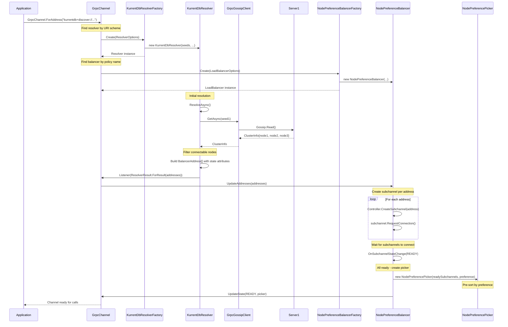
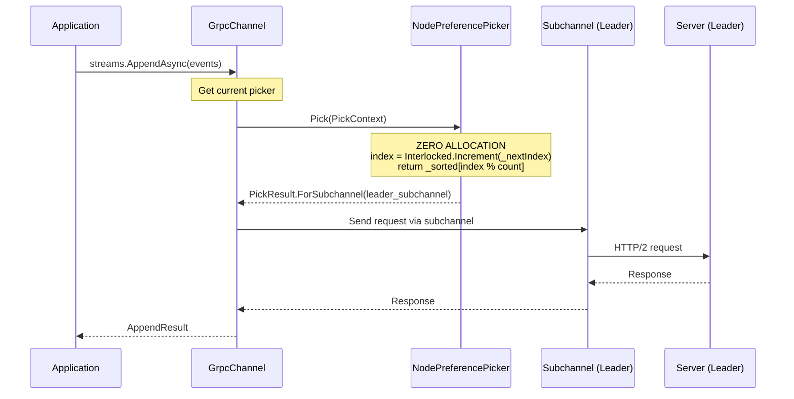
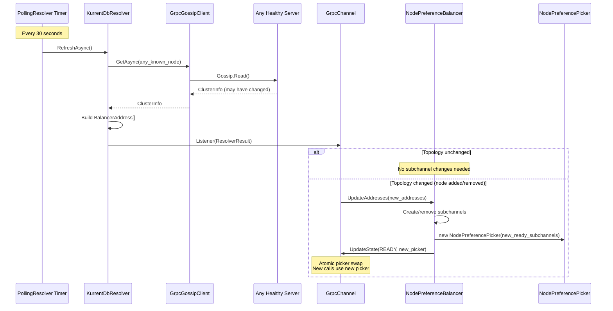
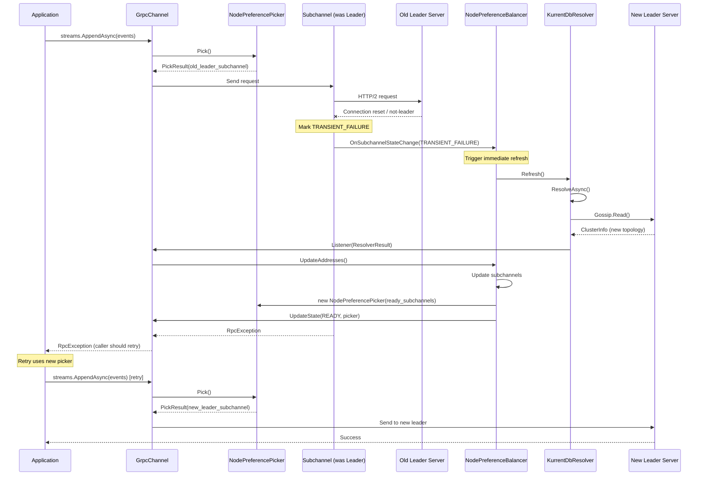

# Tech-Spec: KurrentDB gRPC Cluster Load Balancing

**Created:** 2026-01-09
**Status:** Ready for Development
**Reference:** [Legacy Gossip Discovery Analysis](./reference-legacy-gossip-discovery.md)

---

## 1. Overview

### 1.1 Problem Statement

The KurrentDB .NET client currently uses a custom gossip-based cluster discovery implementation that predates .NET's native gRPC load balancing support. This legacy system:

- Reinvents ~2000 lines of code that .NET provides out-of-the-box
- Creates a single-channel bottleneck limiting parallelism
- Blocks up to 30 seconds on first gRPC call during discovery
- Only refreshes topology reactively (after failures), not proactively
- Has allocation-heavy hot paths causing GC pressure at high RPS

See [Legacy Gossip Discovery Analysis](./reference-legacy-gossip-discovery.md) for detailed problem analysis.

### 1.2 Solution

Implement cluster load balancing using **Microsoft's recommended gRPC client-side load balancing pattern**. This requires building:

1. **Custom Resolver** - Discovers cluster topology via gossip protocol
2. **Custom Load Balancer** - Manages subchannels and creates pickers
3. **Custom Subchannel Picker** - Selects nodes based on preference per-call

### 1.3 Scope

**In Scope:**
- Custom `ResolverFactory` and `Resolver` implementation
- Custom `LoadBalancerFactory` and `LoadBalancer` implementation
- Custom `SubchannelPicker` with node preference support
- DI registration extensions
- URI scheme handling (`kurrentdb://` and `kurrentdb+discover://`)

**Out of Scope:**
- Changes to gossip protocol (use existing `proto/kurrentdb/protocol/v1/gossip.proto`)
- Health checking integration (future enhancement)
- Per-call node preference via metadata (future enhancement)

---

## 2. Microsoft gRPC Load Balancing Architecture

### 2.1 Why This Architecture?

Microsoft's gRPC client-side load balancing is built on a **factory pattern with clear separation of concerns**. Understanding WHY each component exists is critical for correct implementation:

```
┌─────────────────────────────────────────────────────────────────────────────┐
│                              GrpcChannel                                    │
│                                                                             │
│  ┌─────────────────────────────────────────────────────────────────────┐   │
│  │                           Resolution Layer                           │   │
│  │                                                                       │   │
│  │   ResolverFactory ──creates──► Resolver                              │   │
│  │   (maps URI scheme)            (discovers addresses)                 │   │
│  │                                      │                               │   │
│  │                                      ▼                               │   │
│  │                              ResolverResult                          │   │
│  │                              (BalancerAddress[])                     │   │
│  └──────────────────────────────────────────────────────────────────────┘   │
│                                      │                                      │
│                                      ▼                                      │
│  ┌─────────────────────────────────────────────────────────────────────┐   │
│  │                          Balancing Layer                             │   │
│  │                                                                       │   │
│  │   LoadBalancerFactory ──creates──► LoadBalancer                      │   │
│  │   (maps policy name)               (manages connections)             │   │
│  │                                           │                          │   │
│  │                                           ▼                          │   │
│  │                                    Subchannel[]                      │   │
│  │                                    (HTTP/2 connections)              │   │
│  │                                           │                          │   │
│  │                                           ▼                          │   │
│  │                                  SubchannelPicker                    │   │
│  │                                  (selects per call)                  │   │
│  └──────────────────────────────────────────────────────────────────────┘   │
│                                      │                                      │
│                                      ▼                                      │
│                               PickResult                                    │
│                               (selected Subchannel)                         │
└─────────────────────────────────────────────────────────────────────────────┘
```

### 2.2 Component Purposes

| Component | Why It Exists | What It Does |
|-----------|---------------|--------------|
| **ResolverFactory** | gRPC needs to map URI schemes to resolvers | Creates resolver instances; `Name` property matches URI scheme |
| **Resolver** | Addresses change over time; need abstraction | Discovers server addresses; reports via `Listener` callback |
| **PollingResolver** | Many protocols need periodic refresh | Base class providing refresh timer; subclass implements `ResolveAsync()` |
| **LoadBalancerFactory** | Different apps need different balancing strategies | Creates load balancer instances; `Name` property matches policy name |
| **LoadBalancer** | Need to manage connection lifecycle | Creates/destroys subchannels; responds to address changes |
| **SubchannelsLoadBalancer** | Most balancers manage subchannel lists similarly | Base class handling subchannel state; subclass creates picker |
| **Subchannel** | HTTP/2 connections need lifecycle management | Represents one connection; handles reconnection automatically |
| **SubchannelPicker** | Selection strategy varies per use case | Chooses subchannel for each call; must be **zero-allocation** |
| **BalancerAddress** | Addresses need metadata | Host + port + attributes (we store node state here) |
| **BalancerAttributes** | Selection needs node metadata | Key-value store attached to each address |

### 2.3 Registration Flow

gRPC uses **dependency injection** to wire these components:

```csharp
// 1. Register factories in DI container
var services = new ServiceCollection();
services.AddSingleton<ResolverFactory, KurrentDbResolverFactory>();      // Maps "kurrentdb" scheme
services.AddSingleton<LoadBalancerFactory, NodePreferenceBalancerFactory>(); // Maps "kurrentdb" policy

// 2. Create channel with ServiceProvider
var channel = GrpcChannel.ForAddress(
    "kurrentdb+discover://node1:2113,node2:2113",  // URI scheme triggers resolver
    new GrpcChannelOptions {
        ServiceConfig = new ServiceConfig {
            LoadBalancingConfigs = {
                new LoadBalancingConfig("kurrentdb")  // Policy name triggers balancer
            }
        },
        ServiceProvider = services.BuildServiceProvider()
    });
```

**How gRPC wires components:**

1. URI `kurrentdb+discover://...` → finds `ResolverFactory` where `Name == "kurrentdb+discover"`
2. ServiceConfig policy `"kurrentdb"` → finds `LoadBalancerFactory` where `Name == "kurrentdb"`
3. Channel calls `ResolverFactory.Create()` → gets `Resolver` instance
4. Channel calls `LoadBalancerFactory.Create()` → gets `LoadBalancer` instance
5. Resolver discovers addresses → reports via `Listener(ResolverResult)`
6. LoadBalancer receives addresses → creates `Subchannel` per address
7. LoadBalancer creates `SubchannelPicker` from ready subchannels
8. Each gRPC call → `SubchannelPicker.Pick()` → returns `PickResult` with selected subchannel

---

## 3. Component Hierarchy

### 3.1 File Structure

```
src/KurrentDB.Client/
├── Kurrent.Client/
│   └── LoadBalancing/
│       ├── Resolution/
│       │   ├── KurrentDbResolver.cs           // PollingResolver implementation
│       │   └── KurrentDbResolverFactory.cs    // ResolverFactory implementation
│       ├── Balancing/
│       │   ├── NodePreferenceBalancer.cs      // SubchannelsLoadBalancer implementation
│       │   ├── NodePreferenceBalancerFactory.cs // LoadBalancerFactory implementation
│       │   └── NodePreferencePicker.cs        // SubchannelPicker implementation
│       ├── Configuration/
│       │   ├── KurrentDbLoadBalancingOptions.cs // Configuration options
│       │   └── NodePreference.cs              // Enum: Leader, Follower, Random, ReadOnlyReplica
│       └── Extensions/
│           └── ServiceCollectionExtensions.cs  // DI registration helpers
```

### 3.2 Class Hierarchy

```
Microsoft.Extensions.DependencyInjection
└── IServiceCollection
    └── AddKurrentDbLoadBalancing()  ◄── Our extension method

Grpc.Net.Client.Balancer
├── ResolverFactory (abstract)
│   └── KurrentDbResolverFactory     ◄── Our implementation
│       Name = "kurrentdb" or "kurrentdb+discover"
│
├── Resolver (abstract)
│   └── PollingResolver (abstract)
│       └── KurrentDbResolver        ◄── Our implementation
│           - _seeds: DnsEndPoint[]
│           - _gossipClient: IGossipClient
│           + ResolveAsync()
│           + Refresh()
│
├── LoadBalancerFactory (abstract)
│   └── NodePreferenceBalancerFactory ◄── Our implementation
│       Name = "kurrentdb"
│
├── LoadBalancer (abstract)
│   └── SubchannelsLoadBalancer (abstract)
│       └── NodePreferenceBalancer    ◄── Our implementation
│           - _preference: NodePreference
│           + CreatePicker(List<Subchannel>)
│
└── SubchannelPicker (abstract)
    └── NodePreferencePicker          ◄── Our implementation
        - _sortedSubchannels: Subchannel[]  (pre-sorted!)
        - _nextIndex: int
        + Pick(PickContext) → PickResult
```

### 3.3 Dependency Graph

```
                    ┌───────────────────────┐
                    │  GrpcChannelOptions   │
                    │  - ServiceProvider    │
                    │  - ServiceConfig      │
                    └───────────┬───────────┘
                                │
            ┌───────────────────┼───────────────────┐
            ▼                   ▼                   ▼
┌───────────────────┐  ┌────────────────┐  ┌───────────────────┐
│ ResolverFactory   │  │LoadBalancer    │  │ ServiceConfig     │
│ (from DI)         │  │Factory (DI)    │  │ - LoadBalancing   │
└─────────┬─────────┘  └───────┬────────┘  │   Configs         │
          │                    │           └───────────────────┘
          ▼                    ▼
┌───────────────────┐  ┌───────────────────┐
│KurrentDbResolver  │  │NodePreference     │
│                   │  │Balancer           │
│ - IGossipClient ──┼──│                   │
│                   │  │ - NodePreference  │
└─────────┬─────────┘  └─────────┬─────────┘
          │                      │
          │ Listener()           │ CreatePicker()
          ▼                      ▼
┌───────────────────┐  ┌───────────────────┐
│ ResolverResult    │  │NodePreference     │
│ - BalancerAddress │  │Picker             │
│   - Host          │  │                   │
│   - Port          │  │ - Subchannel[]    │
│   - Attributes    │  │   (pre-sorted)    │
│     - "state"     │  │                   │
└───────────────────┘  └───────────────────┘
```

---

## 4. Component Responsibilities

### 4.1 KurrentDbResolverFactory

**Purpose:** Map URI scheme to resolver instance.

**Responsibilities:**
1. Match URI schemes `kurrentdb` (single node) and `kurrentdb+discover` (cluster)
2. Parse seed nodes from URI host
3. Create `KurrentDbResolver` with parsed configuration

```csharp
public sealed class KurrentDbResolverFactory : ResolverFactory
{
    private readonly IGossipClient _gossipClient;
    private readonly KurrentDbLoadBalancingOptions _options;

    // gRPC matches this against URI scheme
    public override string Name => "kurrentdb";  // Handles both kurrentdb:// and kurrentdb+discover://

    public override Resolver Create(ResolverOptions options)
    {
        var seeds = ParseSeeds(options.Address);
        return new KurrentDbResolver(
            seeds,
            options.DefaultPort,
            options.LoggerFactory,
            _gossipClient,
            _options);
    }

    private static DnsEndPoint[] ParseSeeds(Uri address)
    {
        // kurrentdb://host:port → single seed
        // kurrentdb+discover://host1:port,host2:port → multiple seeds
        // ...
    }
}
```

### 4.2 KurrentDbResolver

**Purpose:** Discover cluster topology via gossip protocol.

**Responsibilities:**
1. Query gossip endpoints to get cluster members
2. Filter to connectable node states only
3. Report addresses with state metadata via `Listener` callback
4. Refresh periodically (default: 30 seconds) AND on-demand via `Refresh()`

```csharp
public sealed class KurrentDbResolver : PollingResolver
{
    private readonly DnsEndPoint[] _seeds;
    private readonly IGossipClient _gossipClient;
    private readonly VNodeState[] _connectableStates;

    public KurrentDbResolver(
        DnsEndPoint[] seeds,
        int defaultPort,
        ILoggerFactory loggerFactory,
        IGossipClient gossipClient,
        KurrentDbLoadBalancingOptions options)
        : base(loggerFactory, options.RefreshInterval)
    {
        _seeds = seeds;
        _gossipClient = gossipClient;
        _connectableStates = [VNodeState.Leader, VNodeState.Follower, VNodeState.ReadOnlyReplica, ...];
    }

    protected override async Task ResolveAsync(CancellationToken cancellationToken)
    {
        // 1. Try each seed until successful
        ClusterInfo? clusterInfo = null;
        foreach (var seed in _seeds)
        {
            try
            {
                clusterInfo = await _gossipClient.GetAsync(seed, cancellationToken);
                break;
            }
            catch { /* try next seed */ }
        }

        if (clusterInfo is null)
        {
            Listener(ResolverResult.ForFailure(new Status(StatusCode.Unavailable, "No seeds reachable")));
            return;
        }

        // 2. Filter to connectable nodes and build addresses
        var addresses = clusterInfo.Members
            .Where(m => m.IsAlive && _connectableStates.Contains(m.State))
            .Select(m => new BalancerAddress(
                m.EndPoint.Host,
                m.EndPoint.Port,
                new BalancerAttributes { { "state", m.State } }))
            .ToArray();

        // 3. Report to channel
        Listener(ResolverResult.ForResult(addresses));
    }

    // Called by LoadBalancer when subchannel fails
    public override void Refresh()
    {
        _ = ResolveAsync(CancellationToken.None);
    }
}
```

### 4.3 NodePreferenceBalancerFactory

**Purpose:** Map policy name to load balancer instance.

**Responsibilities:**
1. Match policy name from `ServiceConfig.LoadBalancingConfigs`
2. Create `NodePreferenceBalancer` with configured preference

```csharp
public sealed class NodePreferenceBalancerFactory : LoadBalancerFactory
{
    private readonly NodePreference _defaultPreference;

    // gRPC matches this against ServiceConfig policy name
    public override string Name => "kurrentdb";

    public override LoadBalancer Create(LoadBalancerOptions options)
    {
        return new NodePreferenceBalancer(
            options.Controller,
            options.LoggerFactory,
            _defaultPreference);
    }
}
```

### 4.4 NodePreferenceBalancer

**Purpose:** Manage subchannels and create pickers.

**Responsibilities:**
1. Create one subchannel per address from resolver
2. Track subchannel ready state
3. Create new picker when subchannel list changes
4. Request resolver refresh when subchannels fail

```csharp
public sealed class NodePreferenceBalancer : SubchannelsLoadBalancer
{
    private readonly NodePreference _preference;

    public NodePreferenceBalancer(
        IChannelControlHelper controller,
        ILoggerFactory loggerFactory,
        NodePreference preference)
        : base(controller, loggerFactory)
    {
        _preference = preference;
    }

    // Called by base class when ready subchannels change
    protected override SubchannelPicker CreatePicker(IReadOnlyList<Subchannel> readySubchannels)
    {
        return new NodePreferencePicker(readySubchannels, _preference);
    }
}
```

### 4.5 NodePreferencePicker

**Purpose:** Select subchannel for each gRPC call.

**Responsibilities:**
1. Pre-sort subchannels by node preference at construction (COLD path)
2. Return subchannel with zero allocations on `Pick()` (HOT path)
3. Round-robin within same preference tier

**CRITICAL:** This is called for EVERY gRPC call. Must be zero-allocation.

```csharp
public sealed class NodePreferencePicker : SubchannelPicker
{
    private readonly Subchannel[] _sortedSubchannels;
    private int _nextIndex;

    public NodePreferencePicker(IReadOnlyList<Subchannel> readySubchannels, NodePreference preference)
    {
        // COLD PATH: Sort once at construction
        _sortedSubchannels = readySubchannels
            .OrderBy(sc => GetPriority(sc, preference))
            .ThenBy(_ => Random.Shared.Next())  // Random tiebreaker within tier
            .ToArray();
    }

    public override PickResult Pick(PickContext context)
    {
        // HOT PATH: Zero allocations
        if (_sortedSubchannels.Length == 0)
            return PickResult.ForFailure(new Status(StatusCode.Unavailable, "No ready subchannels"));

        var index = Interlocked.Increment(ref _nextIndex);
        return PickResult.ForSubchannel(_sortedSubchannels[index % _sortedSubchannels.Length]);
    }

    private static int GetPriority(Subchannel subchannel, NodePreference preference)
    {
        var state = (VNodeState)subchannel.CurrentAddress.Attributes.Get<VNodeState>("state");

        return preference switch
        {
            NodePreference.Leader => state switch
            {
                VNodeState.Leader => 0,
                VNodeState.Follower => 1,
                VNodeState.ReadOnlyReplica => 2,
                _ => 99
            },
            NodePreference.Follower => state switch
            {
                VNodeState.Follower => 0,
                VNodeState.Leader => 1,
                VNodeState.ReadOnlyReplica => 2,
                _ => 99
            },
            NodePreference.Random => 0,  // All equal
            NodePreference.ReadOnlyReplica => state switch
            {
                VNodeState.ReadOnlyReplica => 0,
                VNodeState.Follower => 1,
                VNodeState.Leader => 2,
                _ => 99
            },
            _ => 99
        };
    }
}
```

---

## 5. Data Flow Sequence Diagrams

### 5.1 Channel Creation & Initial Resolution



### 5.2 Per-Call Load Balancing (Hot Path)



### 5.3 Periodic Topology Refresh



### 5.4 Reactive Refresh on Failure



---

## 6. Configuration

### 6.1 Options Class

```csharp
/// <summary>
/// Configuration options for KurrentDB gRPC load balancing.
/// </summary>
public sealed class KurrentDbLoadBalancingOptions
{
    /// <summary>
    /// How often to refresh cluster topology. Default: 30 seconds.
    /// Set to <see cref="Timeout.InfiniteTimeSpan"/> to disable periodic refresh.
    /// </summary>
    public TimeSpan RefreshInterval { get; set; } = TimeSpan.FromSeconds(30);

    /// <summary>
    /// Maximum attempts to discover cluster per refresh cycle. Default: 10.
    /// </summary>
    public int MaxDiscoverAttempts { get; set; } = 10;

    /// <summary>
    /// Delay between failed discovery attempts. Default: 100ms.
    /// </summary>
    public TimeSpan DiscoveryInterval { get; set; } = TimeSpan.FromMilliseconds(100);

    /// <summary>
    /// Default node preference for load balancing. Default: Leader.
    /// </summary>
    public NodePreference DefaultNodePreference { get; set; } = NodePreference.Leader;

    /// <summary>
    /// Timeout for gossip requests. Default: 5 seconds.
    /// </summary>
    public TimeSpan GossipTimeout { get; set; } = TimeSpan.FromSeconds(5);
}
```

### 6.2 DI Registration Extension

```csharp
public static class ServiceCollectionExtensions
{
    /// <summary>
    /// Adds KurrentDB gRPC load balancing services to the DI container.
    /// </summary>
    public static IServiceCollection AddKurrentDbLoadBalancing(
        this IServiceCollection services,
        Action<KurrentDbLoadBalancingOptions>? configure = null)
    {
        var options = new KurrentDbLoadBalancingOptions();
        configure?.Invoke(options);

        services.AddSingleton(options);
        services.AddSingleton<IGossipClient, GrpcGossipClient>();
        services.AddSingleton<ResolverFactory, KurrentDbResolverFactory>();
        services.AddSingleton<LoadBalancerFactory, NodePreferenceBalancerFactory>();

        return services;
    }
}
```

### 6.3 Usage Example

```csharp
// Setup DI
var services = new ServiceCollection();
services.AddKurrentDbLoadBalancing(options =>
{
    options.RefreshInterval = TimeSpan.FromSeconds(15);
    options.DefaultNodePreference = NodePreference.Follower;
});

// Create channel
var channel = GrpcChannel.ForAddress(
    "kurrentdb+discover://node1:2113,node2:2113,node3:2113",
    new GrpcChannelOptions
    {
        ServiceConfig = new ServiceConfig
        {
            LoadBalancingConfigs = { new LoadBalancingConfig("kurrentdb") }
        },
        ServiceProvider = services.BuildServiceProvider()
    });

// Use channel
var client = new Streams.StreamsClient(channel);
```

---

## 7. Technical Decisions

| Decision | Resolution | Rationale |
|----------|------------|-----------|
| **Base class for Resolver** | `PollingResolver` | Provides built-in refresh timer; we just implement `ResolveAsync()` |
| **Base class for LoadBalancer** | `SubchannelsLoadBalancer` | Handles subchannel lifecycle; we just implement `CreatePicker()` |
| **URI schemes** | `kurrentdb://` (single) and `kurrentdb+discover://` (cluster) | Clear distinction between deployment modes |
| **Node state storage** | `BalancerAttributes` on `BalancerAddress` | gRPC's built-in mechanism for address metadata |
| **Refresh strategy** | Periodic (30s) + reactive | Proactive refresh prevents stale topology; reactive handles failures immediately |
| **Picker sorting** | Pre-sort at construction | Zero-allocation hot path; picker is immutable and replaced atomically |
| **Failover** | Let call fail, caller retries | Avoids idempotency issues; gRPC `RetryPolicy` handles retries if needed |

---

## 8. Performance Requirements

### 8.1 Allocation Budgets

| Path | Budget | Rationale |
|------|--------|-----------|
| `Pick()` (hot path) | **0 bytes** | Called per gRPC call; millions of times |
| Picker construction | < 1 KB | Cold path; only on topology change |
| Gossip refresh | < 4 KB | Every 30 seconds; acceptable |
| Startup | Unbounded | One-time; doesn't affect steady-state |

### 8.2 Latency Targets

| Operation | Target | Notes |
|-----------|--------|-------|
| `Pick()` | < 10 ns | Must not block gRPC calls |
| First call latency | < 1 second | vs. legacy 30+ seconds worst case |
| Topology refresh | < 500 ms | Background, non-blocking |

### 8.3 Zero-Allocation Patterns

```csharp
// Pre-computed state attribute cache (16 possible states)
private static readonly BalancerAttributes[] StateAttributesCache =
    Enum.GetValues<VNodeState>()
        .Select(state => new BalancerAttributes { { "state", state } })
        .ToArray();

// Zero-allocation lookup
private static BalancerAttributes GetCachedAttributes(VNodeState state) =>
    StateAttributesCache[(int)state];

// Picker: Pre-sorted array, atomic index increment
public override PickResult Pick(PickContext context)
{
    var index = Interlocked.Increment(ref _nextIndex);
    return PickResult.ForSubchannel(_sortedSubchannels[index % _sortedSubchannels.Length]);
}
```

---

## 9. Implementation Plan

### 9.1 Tasks

- [ ] **Task 1:** Create `KurrentDbLoadBalancingOptions` configuration class
- [ ] **Task 2:** Implement `KurrentDbResolverFactory` with URI parsing
- [ ] **Task 3:** Implement `KurrentDbResolver` extending `PollingResolver`
- [ ] **Task 4:** Implement `NodePreferenceBalancerFactory`
- [ ] **Task 5:** Implement `NodePreferenceBalancer` extending `SubchannelsLoadBalancer`
- [ ] **Task 6:** Implement `NodePreferencePicker` with zero-allocation `Pick()`
- [ ] **Task 7:** Create `ServiceCollectionExtensions` for DI registration
- [ ] **Task 8:** Add unit tests for resolver (mock gossip client)
- [ ] **Task 9:** Add unit tests for picker (verify priority ordering, zero-alloc)
- [ ] **Task 10:** Add integration tests with test cluster
- [ ] **Task 11:** Add benchmarks for `Pick()` method (verify < 10ns, 0 allocs)

### 9.2 Acceptance Criteria

- [ ] **AC1:** Single-node URI `kurrentdb://host:port` connects without gossip
- [ ] **AC2:** Cluster URI `kurrentdb+discover://h1:p,h2:p` discovers all nodes
- [ ] **AC3:** Resolver refreshes topology every 30 seconds by default
- [ ] **AC4:** Resolver refreshes immediately on subchannel failure
- [ ] **AC5:** Picker sorts subchannels by configured node preference
- [ ] **AC6:** `Pick()` allocates zero bytes (verified by benchmark)
- [ ] **AC7:** First gRPC call completes in < 1 second (vs. 30s legacy worst case)
- [ ] **AC8:** Topology changes are detected within refresh interval
- [ ] **AC9:** All legacy node preference behaviors are preserved

---

## 10. Testing Strategy

### 10.1 Unit Tests

| Test | Description |
|------|-------------|
| `ResolverFactory_MatchesUriScheme` | Verify `Name` property matches expected schemes |
| `Resolver_ParsesMultipleSeeds` | Verify `host1:port,host2:port` parsing |
| `Resolver_FiltersConnectableStates` | Only Leader, Follower, ReadOnlyReplica pass |
| `Resolver_RetriesOnSeedFailure` | Falls back to next seed on error |
| `Picker_SortsByLeaderPreference` | Leader(0), Follower(1), ReadOnly(2) |
| `Picker_SortsByFollowerPreference` | Follower(0), Leader(1), ReadOnly(2) |
| `Picker_RoundRobinsWithinTier` | Same-priority subchannels get equal calls |
| `Picker_ZeroAllocations` | Memory profiler verifies no heap allocations |

### 10.2 Integration Tests

| Test | Description |
|------|-------------|
| `Channel_ConnectsToCluster` | Full end-to-end with 3-node test cluster |
| `Channel_FollowsLeaderOnWrite` | Append goes to leader node |
| `Channel_RecoversFromNodeFailure` | Kill node, verify failover |
| `Channel_DetectsTopologyChange` | Add node, verify discovered |

### 10.3 Benchmarks

```csharp
[MemoryDiagnoser]
[SimpleJob(RuntimeMoniker.Net90)]
public class PickerBenchmarks
{
    private NodePreferencePicker _picker;
    private PickContext _context;

    [GlobalSetup]
    public void Setup()
    {
        var subchannels = CreateMockSubchannels(5);
        _picker = new NodePreferencePicker(subchannels, NodePreference.Leader);
        _context = new PickContext();
    }

    [Benchmark]
    public PickResult Pick() => _picker.Pick(_context);

    // Target: < 10 ns, 0 bytes allocated
}
```

---

## 11. References

- [Legacy Gossip Discovery Analysis](./reference-legacy-gossip-discovery.md) - Detailed legacy implementation analysis
- [Microsoft gRPC Load Balancing](https://learn.microsoft.com/en-us/aspnet/core/grpc/loadbalancing) - Official documentation
- [Grpc.Net.Client Source](https://github.com/grpc/grpc-dotnet) - Reference implementation
- [Gossip Proto](../../proto/kurrentdb/protocol/v1/gossip.proto) - Protocol definition
