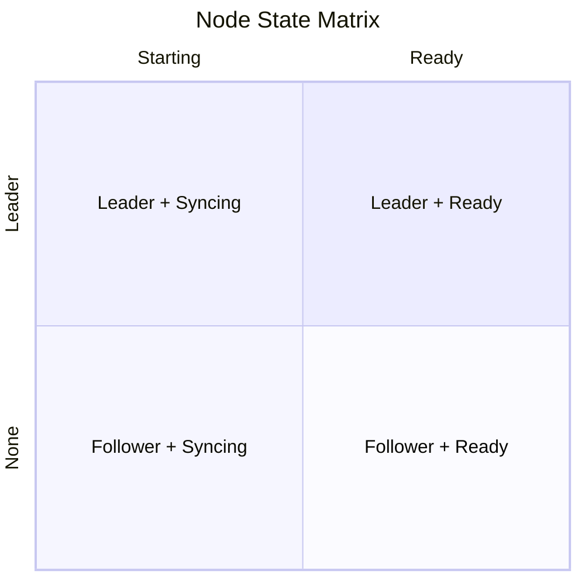
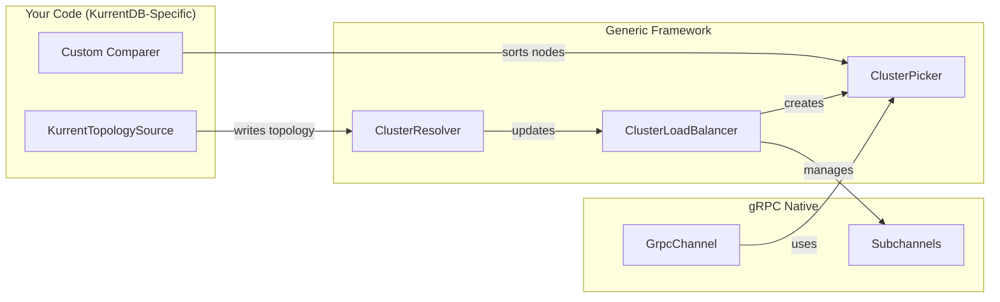
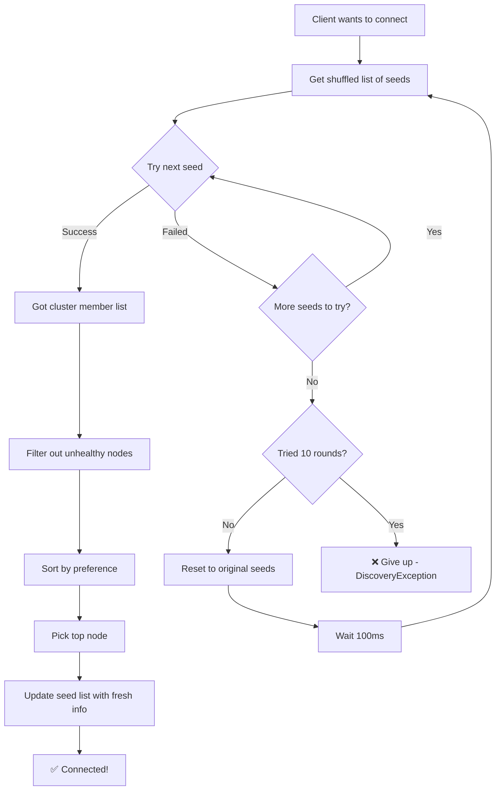
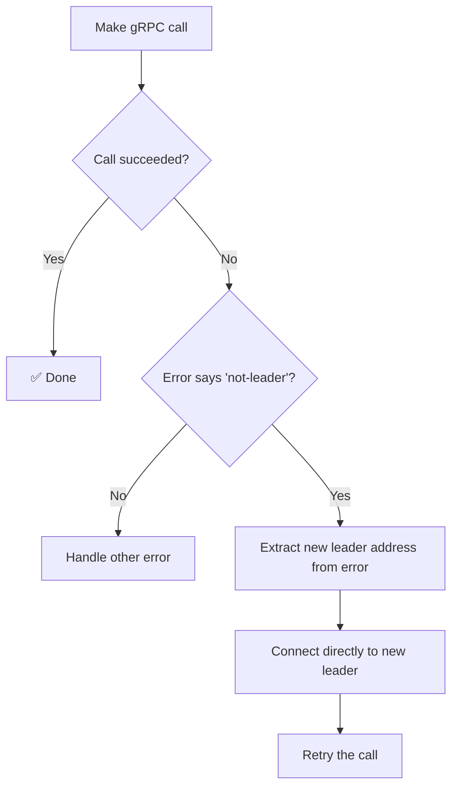
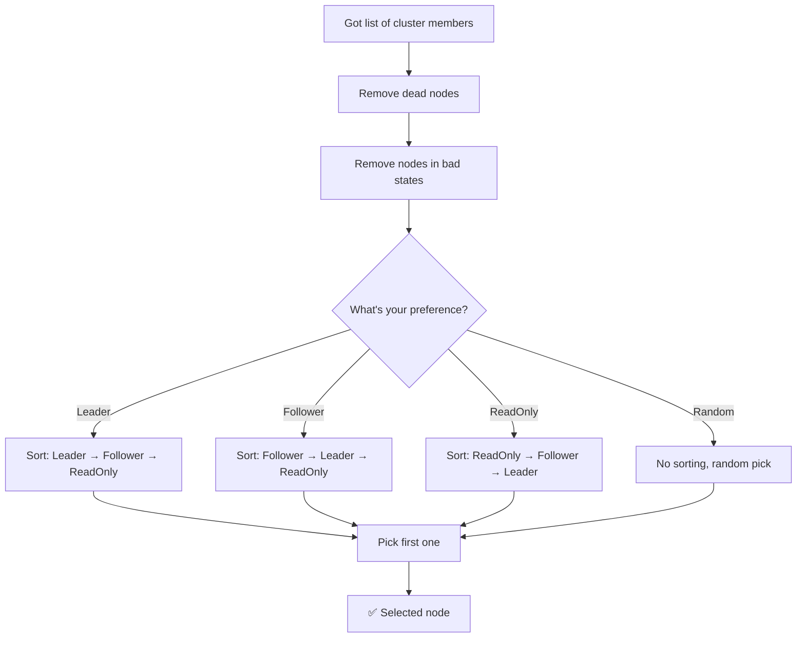
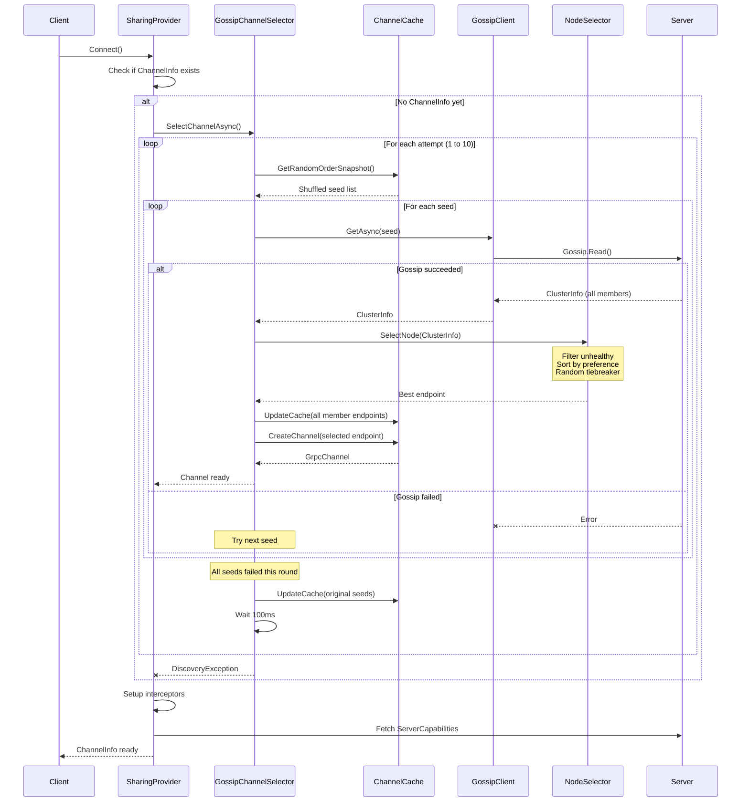
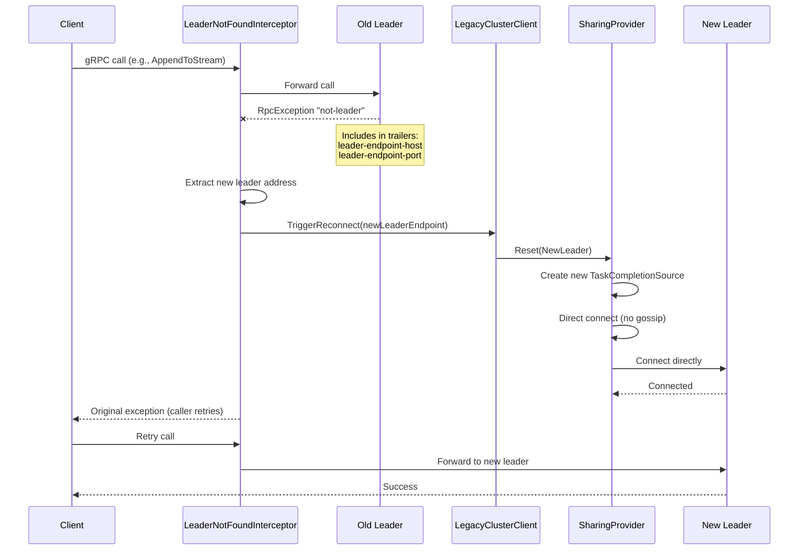

# Tech-Spec: Generic Cluster Load Balancing Framework

**Created:** 2026-01-09
**Status:** Ready for Development
**Author:** Sergio + Claude (Party Mode Review: Winston, Amelia, Murat)

---

## Overview

### Problem Statement

The current KurrentDB .NET client uses a legacy gossip-based cluster discovery and node selection implementation that:

1. **Reinvents gRPC load balancing** - ~2000 lines of custom code duplicating framework functionality
2. **Uses single shared channel** - All requests serialize through one HTTP/2 connection
3. **Blocks on first call** - Discovery can take up to 30s in worst case
4. **Reactive-only refresh** - Stale topology until failure occurs
5. **Allocation-heavy hot path** - LINQ allocations on every node selection
6. **All-or-nothing reconnection** - One bad node affects all clients
7. **No gRPC ecosystem integration** - Missing retry policies, health checking
8. **Hard to test** - Tight coupling, no DI

### Solution

Create a generic, protocol-agnostic cluster topology and load balancing framework that:

1. Uses native gRPC `Resolver` / `LoadBalancer` / `SubchannelPicker` infrastructure
2. Provides clean abstractions for topology discovery (`TopologySource<TNode>`)
3. Enables zero-allocation hot path in picker
4. Supports both DI and non-DI configuration
5. Maintains 100% compatibility with existing KurrentDB behavior

### Scope

**In Scope:**
- Generic load balancing framework (`Kurrent.Grpc.LoadBalancing`)
- KurrentDB-specific topology source (`Kurrent.Client.LoadBalancing`)
- Full compatibility with NodePreference, VNodeState, connection strings
- DI and non-DI configuration patterns
- Retry/discovery loop matching legacy behavior

**Out of Scope (Future Work):**
- OpenTelemetry integration
- gRPC health checking protocol
- Metrics collection
- Connection string parser changes

---

## Context for Development

### Codebase Patterns

**Existing Legacy Files (to be replaced):**
```
src/KurrentDB.Client/Legacy/RipAndTear/Client/Gossip/
├── Selectors/
│   ├── GossipChannelSelector.cs      # Main discovery engine
│   ├── SingleNodeChannelSelector.cs  # Direct connection
│   ├── ChannelSelector.cs            # Factory
│   └── IChannelSelector.cs           # Interface
├── NodeSelector.cs                    # Node selection with NodePreference
├── NodePreference.cs                  # Leader, Follower, Random, ReadOnlyReplica
├── NodePreferenceComparers.cs         # Priority comparers
├── ChannelCache.cs                    # Manual channel management
├── SharingProvider.cs                 # Async resource pattern
├── IGossipClient.cs                   # Gossip interface
├── GrpcGossipClient.cs                # Gossip implementation
├── ClusterMessage.cs                  # ClusterInfo, MemberInfo
└── ReconnectionRequired.cs            # Reconnection signals
```

**Code Style (from project.md):**
- K&R brace style, 4-space indentation
- `ConfigureAwait(false)` everywhere in library code
- Result pattern for errors (but this is infrastructure, exceptions OK)
- snake_case for test methods

### Files to Reference

| File | Purpose |
|------|---------|
| `proto/kurrentdb/protocol/v1/gossip.proto` | Gossip protocol definition |
| `GossipChannelSelector.cs` | Discovery algorithm to preserve |
| `NodeSelector.cs` | Node selection logic |
| `NodePreferenceComparers.cs` | Priority ordering per preference |
| `ChannelCache.cs` | Channel lifecycle patterns |

### Technical Decisions

| Decision | Choice | Rationale |
|----------|--------|-----------|
| **Channel ownership** | Resolver owns channel | Single point of control, source restart doesn't break flow |
| **Topology delivery** | `ChannelWriter<T>` passed to source | Decouples producer from consumer |
| **Comparer location** | On `TopologySource` (abstract class) | Source knows protocol, knows how to rank |
| **DI pattern** | ServiceProvider on GrpcChannelOptions | No global state, testable, multi-cluster support |
| **URI scheme** | `cluster:///` | Generic framework, protocol-agnostic |
| **Options vs Builder** | JSON-serializable in options, code-only in builder | `Seeds`, `UseTls`, `Resilience` in options; `TopologySource`, `PollingDelay`, `RefreshPolicy` in builder |
| **Default RefreshPolicy** | Built from `ResilienceOptions.RefreshOnStatusCodes` | Config-friendly int[] defaults to `[14]` (Unavailable) |
| **Topology source abstraction** | Abstract classes (not interfaces) | `TopologySource` → `PollingTopologySource` hierarchy enables shared implementation |

---

## Core Model: Two-Axis Node State

### Design Philosophy

As distributed systems evolve, the specific terminology used by internal consensus protocols (Raft, Paxos, Zab) often becomes a barrier to clear application-level logic. This model abstracts internal "vnode" states into a **Two-Axis Architecture**: **Role** (Authority) and **Status** (Health).

By separating *what a node is authorized to do* from *how it is currently performing*, we create a protocol-agnostic interface suitable for modern distributed databases and service meshes.

### The Two Axes



#### NodeRole (The "What") - Authority & Permissions

| Role | Description | Legacy VNodeState |
|------|-------------|-------------------|
| **None** | No defined role yet | Initializing, Unknown |
| **Leader** | Authoritative for writes and coordination | Leader, PreLeader |
| **Follower** | Voting member that replicates data | Follower, PreReplica, CatchingUp, Clone |
| **ReadOnly** | Non-voting member for read scaling | ReadOnlyReplica, PreReadOnlyReplica, ReadOnlyLeaderless |
| **Manager** | Administrative/orchestration only | Manager |
| **Resigning** | Leader handing off authority | ResigningLeader |

#### NodeStatus (The "How") - Health & Sync State

| Status | Description | Legacy VNodeState |
|--------|-------------|-------------------|
| **Starting** | Booting or discovering peers | Initializing, DiscoverLeader, Unknown |
| **Syncing** | Catching up on logs | CatchingUp, Clone, all "Pre-" states |
| **Ready** | Fully operational and current | Leader, Follower, ReadOnlyReplica, Manager |
| **Isolated** | Healthy but lost quorum contact | ReadOnlyLeaderless |
| **Stopping** | Graceful shutdown in progress | ShuttingDown, ResigningLeader |
| **Stopped** | Shutdown complete | Shutdown |

### Why This Works

#### Eligibility Becomes Trivial

**Legacy approach (memorize 11 excluded states):**
```csharp
static readonly VNodeState[] NotAllowedStates = [
    Manager, ShuttingDown, Shutdown, Unknown, Initializing,
    CatchingUp, ResigningLeader, PreLeader, PreReplica,
    PreReadOnlyReplica, Clone, DiscoverLeader
];
```

**Two-axis approach (just read the properties):**
```csharp
bool CanServeReads  => Status is Ready or Isolated;
bool CanAcceptWrites => Role == Leader && Status == Ready;
bool IsEligible      => Status is Ready or Isolated;
```

#### Protocol-Agnostic Mapping

| Protocol | Leader | Follower | Syncing |
|----------|--------|----------|---------|
| **Raft** | Leader | Follower | Candidate = Leader + Syncing |
| **Paxos** | Distinguished Proposer | Acceptor | Learner = ReadOnly |
| **EventStoreDB** | Leader | Follower | PreLeader = Leader + Syncing |

#### Observability-First

In 2026, monitoring systems prioritize "Ready-ness." A single enum doesn't tell you if a node is "PreLeader" because it's fast-syncing or because it's stuck. The two-axis model provides immediate diagnostic clarity.

#### Grey Failure Handling

Most modern cluster failures aren't crashes but network partitions. The `Isolated` status explicitly handles nodes that have data but cannot reach a majority - enabling stale reads when that's acceptable.

### ClusterNode Model

```csharp
namespace Kurrent.Grpc.LoadBalancing;

/// <summary>
/// Represents the functional role a node is AUTHORIZED to perform.
/// </summary>
public enum NodeRole {
    None      = 0,  // No defined role yet
    Leader    = 1,  // Authoritative for writes and coordination
    Follower  = 2,  // Voting member that replicates data
    ReadOnly  = 3,  // Non-voting, read-scaling member
    Manager   = 4,  // Administrative/orchestration only
    Resigning = 5   // Leader handing off authority
}

/// <summary>
/// Represents the node's synchronization HEALTH and operational progress.
/// </summary>
public enum NodeStatus {
    Starting = 0,  // Booting or discovering peers
    Syncing  = 1,  // Catching up on logs
    Ready    = 2,  // Fully operational
    Isolated = 3,  // Healthy but lost quorum contact
    Stopping = 4,  // Graceful shutdown in progress
    Stopped  = 5   // Shutdown complete
}

/// <summary>
/// Protocol-agnostic representation of a cluster node.
/// Separates "Role" (Authority) from "Status" (Health).
/// </summary>
public readonly record struct ClusterNode {
    public required Guid         NodeId   { get; init; }
    public required DnsEndPoint  EndPoint { get; init; }
    public required NodeRole     Role     { get; init; }
    public required NodeStatus   Status   { get; init; }

    /// <summary>
    /// Protocol-specific metadata (e.g., VNodeState, term, epoch).
    /// </summary>
    public ImmutableDictionary<string, object> Metadata { get; init; }
        = ImmutableDictionary<string, object>.Empty;

    /// <summary>Can this node serve read requests?</summary>
    public bool CanServeReads => Status is NodeStatus.Ready or NodeStatus.Isolated;

    /// <summary>Can this node accept write requests?</summary>
    public bool CanAcceptWrites => Role == NodeRole.Leader && Status == NodeStatus.Ready;

    /// <summary>Is this node eligible for client traffic?</summary>
    public bool IsEligible => Status is NodeStatus.Ready or NodeStatus.Isolated;
}
```

### Legacy VNodeState Mapping

```csharp
namespace Kurrent.Client.LoadBalancing;

public static class KurrentNodeAdapter {
    /// <summary>
    /// Maps legacy 16-state VNodeState to the 2-axis model.
    /// </summary>
    public static ClusterNode FromVNodeState(
        Guid nodeId, DnsEndPoint endPoint, VNodeState state, bool isAlive) {

        var (role, status) = state switch {
            VNodeState.Initializing       => (NodeRole.None,      NodeStatus.Starting),
            VNodeState.DiscoverLeader     => (NodeRole.None,      NodeStatus.Starting),
            VNodeState.Unknown            => (NodeRole.None,      NodeStatus.Starting),
            VNodeState.PreReplica         => (NodeRole.Follower,  NodeStatus.Syncing),
            VNodeState.CatchingUp         => (NodeRole.Follower,  NodeStatus.Syncing),
            VNodeState.Clone              => (NodeRole.Follower,  NodeStatus.Syncing),
            VNodeState.Follower           => (NodeRole.Follower,  NodeStatus.Ready),
            VNodeState.PreLeader          => (NodeRole.Leader,    NodeStatus.Syncing),
            VNodeState.Leader             => (NodeRole.Leader,    NodeStatus.Ready),
            VNodeState.Manager            => (NodeRole.Manager,   NodeStatus.Ready),
            VNodeState.ShuttingDown       => (NodeRole.None,      NodeStatus.Stopping),
            VNodeState.Shutdown           => (NodeRole.None,      NodeStatus.Stopped),
            VNodeState.ReadOnlyLeaderless => (NodeRole.ReadOnly,  NodeStatus.Isolated),
            VNodeState.PreReadOnlyReplica => (NodeRole.ReadOnly,  NodeStatus.Syncing),
            VNodeState.ReadOnlyReplica    => (NodeRole.ReadOnly,  NodeStatus.Ready),
            VNodeState.ResigningLeader    => (NodeRole.Resigning, NodeStatus.Stopping),
            _                             => (NodeRole.None,      NodeStatus.Starting)
        };

        // Override status if node is dead
        if (!isAlive)
            status = NodeStatus.Stopped;

        return new ClusterNode {
            NodeId   = nodeId,
            EndPoint = endPoint,
            Role     = role,
            Status   = status,
            Metadata = ImmutableDictionary<string, object>.Empty
                .Add("VNodeState", state)
                .Add("IsAlive", isAlive)
        };
    }
}
```

### Why No IClusterNode Interface?

The `ClusterNode` struct **is** the universal abstraction:

| Old Design | New Design |
|------------|------------|
| `IClusterNode` interface | `ClusterNode` struct |
| Protocol types implement interface | Protocol adapters create `ClusterNode` |
| `IsEligible`, `Priority` properties | `CanServeReads`, `CanAcceptWrites`, `IsEligible` |
| Framework depends on abstraction | Framework depends on universal model |

The `Metadata` dictionary handles protocol-specific extras without polluting the core model.

---

## Architecture

### Component Diagram

```
┌─────────────────────────────────────────────────────────────────────────────┐
│  Kurrent.Grpc.LoadBalancing (Generic Framework)                             │
│                                                                             │
│  ┌─────────────────────────────────────────────────────────────────────┐   │
│  │  Core Model                                                          │   │
│  │  ┌─────────────┐  ┌──────────────┐  ┌────────────────────────────┐  │   │
│  │  │ NodeRole    │  │ NodeStatus   │  │ ClusterNode                │  │   │
│  │  │ • Leader    │  │ • Starting   │  │ • NodeId, EndPoint         │  │   │
│  │  │ • Follower  │──│ • Syncing    │──│ • Role, Status             │  │   │
│  │  │ • ReadOnly  │  │ • Ready      │  │ • CanServeReads            │  │   │
│  │  │ • Manager   │  │ • Isolated   │  │ • CanAcceptWrites          │  │   │
│  │  │ • Resigning │  │ • Stopping   │  │ • Metadata                 │  │   │
│  │  └─────────────┘  └──────────────┘  └────────────────────────────┘  │   │
│  └─────────────────────────────────────────────────────────────────────┘   │
│                                                                             │
│  ┌─────────────────────────────────────────────────────────────────────┐   │
│  │  Topology Sources                                                    │   │
│  │  ┌─────────────────────────┐     ┌──────────────────────────────┐   │   │
│  │  │ TopologySource          │     │ ClusterTopology              │   │   │
│  │  │ • RunAsync()            │────►│ • Nodes: ClusterNode[]       │   │   │
│  │  │ • Compare()             │     │ • Timestamp                  │   │   │
│  │  └───────────┬─────────────┘     └──────────────────────────────┘   │   │
│  │              │                                                       │   │
│  │              ▼                                                       │   │
│  │  ┌─────────────────────────┐                                        │   │
│  │  │ PollingTopologySource   │                                        │   │
│  │  │ • ReadAsync() abstract  │                                        │   │
│  │  │ • PollingInterval       │                                        │   │
│  │  └─────────────────────────┘                                        │   │
│  └─────────────────────────────────────────────────────────────────────┘   │
│                                                                             │
│  ┌─────────────────────────────────────────────────────────────────────┐   │
│  │  gRPC Integration                                                    │   │
│  │  ┌─────────────────────────────────────────────────────────────┐    │   │
│  │  │  ClusterResolver : Resolver                                  │    │   │
│  │  │  • Owns Channel<ClusterTopology>                             │    │   │
│  │  │  • Discovery retry loop                                      │    │   │
│  │  └──────────────────────────┬──────────────────────────────────┘    │   │
│  │                              │                                       │   │
│  │                              ▼                                       │   │
│  │  ┌─────────────────────────────────────────────────────────────┐    │   │
│  │  │  ClusterLoadBalancer : LoadBalancer                          │    │   │
│  │  │  • Creates/manages Subchannels                               │    │   │
│  │  │  • Creates ClusterPicker on topology change                  │    │   │
│  │  └──────────────────────────┬──────────────────────────────────┘    │   │
│  │                              │                                       │   │
│  │                              ▼                                       │   │
│  │  ┌─────────────────────────────────────────────────────────────┐    │   │
│  │  │  ClusterPicker : SubchannelPicker                            │    │   │
│  │  │  • Pre-sorted at construction (zero-alloc Pick)              │    │   │
│  │  │  • Uses IComparer<ClusterNode> from source                   │    │   │
│  │  └─────────────────────────────────────────────────────────────┘    │   │
│  └─────────────────────────────────────────────────────────────────────┘   │
└─────────────────────────────────────────────────────────────────────────────┘

┌─────────────────────────────────────────────────────────────────────────────┐
│  Kurrent.Client.LoadBalancing (KurrentDB-Specific)                          │
│                                                                             │
│  ┌─────────────────────────────────────────────────────────────────────┐   │
│  │  KurrentNodeAdapter                                                  │   │
│  │  • FromVNodeState(nodeId, endPoint, state, isAlive) → ClusterNode   │   │
│  │  • Maps 16 VNodeState values to Role + Status                        │   │
│  └─────────────────────────────────────────────────────────────────────┘   │
│                                                                             │
│  ┌─────────────────────────────────────────────────────────────────────┐   │
│  │  KurrentTopologySource : PollingTopologySource                       │   │
│  │  • ReadAsync() - gossip protocol via Gossip.GossipClient             │   │
│  │  • Compare() - NodePreference-based ordering                         │   │
│  └─────────────────────────────────────────────────────────────────────┘   │
│                                                                             │
│  ┌─────────────────────────────────────────────────────────────────────┐   │
│  │  KurrentClusterOptions : ClusterOptions                              │   │
│  │  • NodePreference (Leader, Follower, ReadOnlyReplica, Random)        │   │
│  │  • Seeds, PollingInterval, MaxDiscoverAttempts, etc.                 │   │
│  └─────────────────────────────────────────────────────────────────────┘   │
└─────────────────────────────────────────────────────────────────────────────┘
```

### Data Flow

```
KurrentTopologySource.ReadAsync()
         │
         │ Gossip.Read() → ClusterInfo
         │
         ▼
ClusterTopology<KurrentNode>
         │
         │ writer.WriteAsync()
         ▼
Channel<ClusterTopology<KurrentNode>>  ← Owned by ClusterResolver
         │
         │ reader.ReadAllAsync()
         ▼
ClusterResolver.ConsumeAsync()
         │
         │ Map to BalancerAddress[]
         ▼
ClusterLoadBalancer.UpdateAddresses()
         │
         │ Create/update Subchannels
         ▼
ClusterPicker (pre-sorted)
         │
         │ Pick() → zero-alloc
         ▼
Subchannel → gRPC Call
```

---

## Configuration & Registration

### Design Principles

1. **JSON-Serializable Options** - `LoadBalancingOptions` and `ResilienceOptions` are simple POCOs that can be bound from `IConfiguration` (appsettings.json, environment variables, etc.)

2. **Builder for Non-Serializable** - `PollingDelay`, `TopologySource`, `RefreshPolicy`, and `LoggerFactory` are NOT in options because they can't be serialized. They're configured via the builder pattern.

3. **RefreshOnStatusCodes → Default Policy** - When no custom `RefreshPolicy` is set, the builder uses `ResilienceOptions.RefreshOnStatusCodes` to create the default policy:
   ```csharp
   var refreshPolicy = _refreshPolicy
       ?? RefreshPolicy.FromStatusCodeInts(_resilience.RefreshOnStatusCodes);
   ```

4. **Standard gRPC Patterns** - Uses native `GrpcChannelOptions` for all gRPC-specific configuration. We don't reinvent the wheel.

### Configuration Options

```csharp
// JSON-serializable - can be in appsettings.json
public sealed class LoadBalancingOptions {
    public string[] Seeds { get; set; } = [];         // Cluster seed endpoints
    public bool UseTls { get; set; }                  // Use TLS for connections
    public ResilienceOptions Resilience { get; set; } = new();
}

public sealed class ResilienceOptions {
    public TimeSpan Timeout { get; set; } = TimeSpan.FromSeconds(5);
    public int MaxDiscoveryAttempts { get; set; } = 10;
    public TimeSpan InitialBackoff { get; set; } = TimeSpan.FromMilliseconds(100);
    public TimeSpan MaxBackoff { get; set; } = TimeSpan.FromSeconds(5);
    public int[] RefreshOnStatusCodes { get; set; } = [14]; // Unavailable (default)
}
```

**Sample appsettings.json:**
```json
{
  "LoadBalancing": {
    "Seeds": ["node1:2113", "node2:2113", "node3:2113"],
    "UseTls": true,
    "Resilience": {
      "Timeout": "00:00:05",
      "MaxDiscoveryAttempts": 10,
      "InitialBackoff": "00:00:00.100",
      "MaxBackoff": "00:00:05",
      "RefreshOnStatusCodes": [14]
    }
  }
}
```

### RefreshPolicy

The `RefreshPolicy` determines when gRPC errors should trigger a topology refresh. It's a delegate-based design for maximum flexibility:

```csharp
public delegate bool ShouldRefreshTopology(RpcException exception);
```

**Built-in Policies:**

| Policy | Description |
|--------|-------------|
| `RefreshPolicy.Default` | Refresh on `StatusCode.Unavailable` |
| `RefreshPolicy.OnStatusCodes(...)` | Refresh on specific status codes |
| `RefreshPolicy.OnMessageContains(...)` | Refresh when message contains triggers |
| `RefreshPolicy.Any(...)` | Refresh if ANY policy returns true |
| `RefreshPolicy.All(...)` | Refresh if ALL policies return true |
| `RefreshPolicy.FromStatusCodeInts(...)` | Build from int[] (for config binding) |

**Default Behavior:**
When no custom policy is set, `ResilienceOptions.RefreshOnStatusCodes` is used:
```csharp
// Default: [14] = StatusCode.Unavailable
// Results in: RefreshPolicy.OnStatusCodes(StatusCode.Unavailable)
```

**Custom Policy Example:**
```csharp
.WithRefreshPolicy(RefreshPolicy.Any(
    RefreshPolicy.OnStatusCodes(StatusCode.Unavailable, StatusCode.DeadlineExceeded),
    RefreshPolicy.OnMessageContains("not-leader", "no leader")
))
```

### Usage Examples

#### Non-DI Usage (Standalone)

```csharp
// Minimal - just seeds
var channel = GrpcLoadBalancedChannel.ForAddress("cluster:///my-cluster", builder => builder
    .WithSeeds("node1:2113", "node2:2113", "node3:2113")
    .WithPollingTopologySource(new KurrentTopologySource(), TimeSpan.FromSeconds(30))
);

// Full configuration
var channel = GrpcLoadBalancedChannel.ForAddress("cluster:///my-cluster", builder => builder
    .WithSeeds("node1:2113", "node2:2113", "node3:2113")
    .UseTls()
    .WithResilience(r => {
        r.Timeout = TimeSpan.FromSeconds(10);
        r.MaxDiscoveryAttempts = 5;
    })
    .WithPollingTopologySource(new KurrentTopologySource(), TimeSpan.FromSeconds(30))
    .WithRefreshPolicy(RefreshPolicy.OnStatusCodes(StatusCode.Unavailable))
    .WithLoggerFactory(loggerFactory)
    .ConfigureChannel(options => {
        options.MaxReceiveMessageSize = 16 * 1024 * 1024;
    })
);

// From configuration
var channel = GrpcLoadBalancedChannel.FromConfiguration(
    configuration.GetSection("LoadBalancing"),
    builder => builder
        .WithPollingTopologySource(new KurrentTopologySource())
);
```

#### DI Usage (ASP.NET Core / Generic Host)

```csharp
// In Program.cs or Startup.cs
services.AddGrpcLoadBalancing("kurrentdb")
    .WithSeeds("node1:2113", "node2:2113", "node3:2113")
    .WithPollingTopologySource<KurrentTopologySource>(TimeSpan.FromSeconds(30))
    .UseTls()
    .Build();

// From configuration
services.AddGrpcLoadBalancing("kurrentdb", configuration.GetSection("LoadBalancing"))
    .WithPollingTopologySource<KurrentTopologySource>()
    .Build();

// Inject GrpcChannel
public class MyService {
    readonly GrpcChannel _channel;
    public MyService(GrpcChannel channel) => _channel = channel;
}
```

#### KurrentDB-Specific Usage

```csharp
// Non-DI
var channel = GrpcLoadBalancedChannel.ForAddress("cluster:///kurrentdb", builder => builder
    .WithSeeds("node1:2113", "node2:2113", "node3:2113")
    .WithPollingTopologySource(
        new KurrentTopologySource(new KurrentClusterOptions {
            NodePreference = NodePreference.Follower
        }),
        TimeSpan.FromSeconds(30))
    .WithRefreshPolicy(RefreshPolicy.Any(
        RefreshPolicy.OnStatusCodes(StatusCode.Unavailable),
        RefreshPolicy.OnMessageContains("not-leader")
    ))
);

// DI
services.AddGrpcLoadBalancing("kurrentdb")
    .WithSeeds("node1:2113", "node2:2113", "node3:2113")
    .WithPollingTopologySource<KurrentTopologySource>(TimeSpan.FromSeconds(30))
    .Build();

services.Configure<KurrentClusterOptions>(options => {
    options.NodePreference = NodePreference.Follower;
});
```

### Component Interaction

```
┌─────────────────────────────────────────────────────────────────────────────┐
│  Configuration Flow                                                         │
│                                                                             │
│  appsettings.json ─────► LoadBalancingOptions ─────► LoadBalancingBuilder  │
│                                                               │             │
│  Code Configuration ──────────────────────────────────────────┘             │
│                                                               │             │
│                         ┌─────────────────────────────────────┘             │
│                         ▼                                                   │
│  ┌─────────────────────────────────────────────────────────────────────┐   │
│  │  Builder.Build()                                                     │   │
│  │                                                                      │   │
│  │  1. Create RefreshPolicy from ResilienceOptions (if not set)        │   │
│  │  2. Create TopologySource (polling or streaming)                    │   │
│  │  3. Register ClusterResolverFactory with ServiceProvider             │   │
│  │  4. Register ClusterLoadBalancerFactory with ServiceProvider         │   │
│  │  5. Create RefreshTriggerInterceptor with policy                    │   │
│  │  6. Configure GrpcChannelOptions                                     │   │
│  │  7. Return GrpcChannel.ForAddress("cluster:///{id}", options)        │   │
│  └─────────────────────────────────────────────────────────────────────┘   │
└─────────────────────────────────────────────────────────────────────────────┘
```

---

## Implementation Plan

### Tasks

#### Phase 1: Core Model (`Kurrent.Grpc.LoadBalancing`)

- [ ] **Task 1.1:** Create `NodeRole` enum
  ```csharp
  public enum NodeRole {
      None      = 0,  // No defined role yet
      Leader    = 1,  // Authoritative for writes and coordination
      Follower  = 2,  // Voting member that replicates data
      ReadOnly  = 3,  // Non-voting, read-scaling member
      Manager   = 4,  // Administrative/orchestration only
      Resigning = 5   // Leader handing off authority
  }
  ```

- [ ] **Task 1.2:** Create `NodeStatus` enum
  ```csharp
  public enum NodeStatus {
      Starting = 0,  // Booting or discovering peers
      Syncing  = 1,  // Catching up on logs
      Ready    = 2,  // Fully operational
      Isolated = 3,  // Healthy but lost quorum contact
      Stopping = 4,  // Graceful shutdown in progress
      Stopped  = 5   // Shutdown complete
  }
  ```

- [ ] **Task 1.3:** Create `ClusterNode` struct
  ```csharp
  public readonly record struct ClusterNode {
      public required Guid         NodeId   { get; init; }
      public required DnsEndPoint  EndPoint { get; init; }
      public required NodeRole     Role     { get; init; }
      public required NodeStatus   Status   { get; init; }

      public ImmutableDictionary<string, object> Metadata { get; init; }
          = ImmutableDictionary<string, object>.Empty;

      public bool CanServeReads  => Status is NodeStatus.Ready or NodeStatus.Isolated;
      public bool CanAcceptWrites => Role == NodeRole.Leader && Status == NodeStatus.Ready;
      public bool IsEligible      => Status is NodeStatus.Ready or NodeStatus.Isolated;
  }
  ```

- [ ] **Task 1.4:** Create `ClusterTopology` record
  ```csharp
  public sealed record ClusterTopology {
      public required IReadOnlyList<ClusterNode> Nodes { get; init; }
      public DateTimeOffset Timestamp { get; init; } = DateTimeOffset.UtcNow;
  }
  ```

- [ ] **Task 1.5:** Create `TopologyContext` record
  ```csharp
  public sealed record TopologyContext(
      ChannelBase Channel,
      IReadOnlyList<DnsEndPoint> Seeds,
      CancellationToken CancellationToken = default) {
      public ILogger? Logger { get; init; }
  }
  ```

#### Phase 2: Topology Sources (`Kurrent.Grpc.LoadBalancing`)

- [ ] **Task 2.1:** Create `TopologySource` abstract base
  ```csharp
  public abstract class TopologySource : IComparer<ClusterNode> {
      internal abstract Task RunAsync(
          ChannelWriter<ClusterTopology> writer,
          TopologyContext context);

      public virtual int Compare(ClusterNode x, ClusterNode y) {
          // Default: Ready before Isolated, then by Role
          var statusCompare = GetStatusPriority(x.Status) - GetStatusPriority(y.Status);
          if (statusCompare != 0) return statusCompare;
          return GetRolePriority(x.Role) - GetRolePriority(y.Role);
      }
  }
  ```

- [ ] **Task 2.2:** Create `PollingTopologySource` abstract class
  ```csharp
  public abstract class PollingTopologySource : TopologySource {
      private readonly TimeSpan _pollingInterval;

      protected PollingTopologySource(TimeSpan pollingInterval)
          => _pollingInterval = pollingInterval;

      protected abstract ValueTask<ClusterTopology> ReadAsync(TopologyContext context);

      internal sealed override async Task RunAsync(
          ChannelWriter<ClusterTopology> writer,
          TopologyContext context) {

          while (!context.CancellationToken.IsCancellationRequested) {
              var topology = await ReadAsync(context).ConfigureAwait(false);
              await writer.WriteAsync(topology, context.CancellationToken).ConfigureAwait(false);
              await Task.Delay(_pollingInterval, context.CancellationToken).ConfigureAwait(false);
          }
      }
  }
  ```

- [ ] **Task 2.3:** Create configuration options (see Configuration section below)

#### Phase 2.5: Configuration & Builders (`Kurrent.Grpc.LoadBalancing`)

- [ ] **Task 2.5.1:** Create `LoadBalancingOptions` (JSON-serializable)
  ```csharp
  public sealed class LoadBalancingOptions {
      public string[] Seeds { get; set; } = [];
      public bool UseTls { get; set; }
      public ResilienceOptions Resilience { get; set; } = new();
  }
  ```

- [ ] **Task 2.5.2:** Create `ResilienceOptions` (JSON-serializable)
  ```csharp
  public sealed class ResilienceOptions {
      public TimeSpan Timeout { get; set; } = TimeSpan.FromSeconds(5);
      public int MaxDiscoveryAttempts { get; set; } = 10;
      public TimeSpan InitialBackoff { get; set; } = TimeSpan.FromMilliseconds(100);
      public TimeSpan MaxBackoff { get; set; } = TimeSpan.FromSeconds(5);
      public int[] RefreshOnStatusCodes { get; set; } = [14]; // Unavailable
  }
  ```

- [ ] **Task 2.5.3:** Create `RefreshPolicy` delegate and helpers
  ```csharp
  public delegate bool ShouldRefreshTopology(RpcException exception);

  public static class RefreshPolicy {
      public static readonly ShouldRefreshTopology Default =
          static ex => ex.StatusCode == StatusCode.Unavailable;

      public static ShouldRefreshTopology OnStatusCodes(params StatusCode[] codes) {
          var set = codes.ToHashSet();
          return ex => set.Contains(ex.StatusCode);
      }

      public static ShouldRefreshTopology OnMessageContains(params string[] triggers) =>
          ex => triggers.Any(t => ex.Message.Contains(t, StringComparison.OrdinalIgnoreCase));

      public static ShouldRefreshTopology Any(params ShouldRefreshTopology[] policies) =>
          ex => policies.Any(p => p(ex));

      public static ShouldRefreshTopology All(params ShouldRefreshTopology[] policies) =>
          ex => policies.All(p => p(ex));

      public static ShouldRefreshTopology FromStatusCodeInts(params int[] statusCodes) =>
          OnStatusCodes(statusCodes.Select(c => (StatusCode)c).ToArray());
  }
  ```

- [ ] **Task 2.5.4:** Create `RefreshTriggerInterceptor`
  ```csharp
  public sealed class RefreshTriggerInterceptor : Interceptor {
      readonly ShouldRefreshTopology _shouldRefresh;
      readonly Action _triggerRefresh;

      public RefreshTriggerInterceptor(ShouldRefreshTopology shouldRefresh, Action triggerRefresh) {
          _shouldRefresh = shouldRefresh;
          _triggerRefresh = triggerRefresh;
      }

      public override AsyncUnaryCall<TResponse> AsyncUnaryCall<TRequest, TResponse>(...) {
          var response = base.AsyncUnaryCall(request, context, continuation);
          return new AsyncUnaryCall<TResponse>(
              HandleResponse(response.ResponseAsync),
              response.ResponseHeadersAsync,
              response.GetStatus,
              response.GetTrailers,
              response.Dispose);
      }

      // Similar overrides for AsyncClientStreamingCall, AsyncServerStreamingCall, AsyncDuplexStreamingCall

      async Task<T> HandleResponse<T>(Task<T> responseTask) {
          try {
              return await responseTask.ConfigureAwait(false);
          } catch (RpcException ex) when (_shouldRefresh(ex)) {
              _triggerRefresh();
              throw;
          }
      }
  }
  ```

- [ ] **Task 2.5.5:** Create `LoadBalancingBuilder` (non-DI)
  ```csharp
  public sealed class LoadBalancingBuilder {
      string[] _seeds = [];
      bool _useTls;
      ResilienceOptions _resilience = new();
      TopologySource? _topologySource;
      TimeSpan? _pollingDelay;
      ShouldRefreshTopology? _refreshPolicy;
      ILoggerFactory? _loggerFactory;
      Action<GrpcChannelOptions>? _configureChannel;

      public LoadBalancingBuilder WithSeeds(params string[] endpoints) { _seeds = endpoints; return this; }
      public LoadBalancingBuilder WithSeeds(params DnsEndPoint[] endpoints) { ... }
      public LoadBalancingBuilder WithResilience(Action<ResilienceOptions> configure) { ... }
      public LoadBalancingBuilder WithPollingTopologySource(PollingTopologySource source, TimeSpan? delay = null) { ... }
      public LoadBalancingBuilder WithStreamingTopologySource(TopologySource source) { ... }
      public LoadBalancingBuilder WithRefreshPolicy(ShouldRefreshTopology policy) { _refreshPolicy = policy; return this; }
      public LoadBalancingBuilder WithLoggerFactory(ILoggerFactory factory) { _loggerFactory = factory; return this; }
      public LoadBalancingBuilder ConfigureChannel(Action<GrpcChannelOptions> configure) { ... }
      public LoadBalancingBuilder UseTls(bool useTls = true) { _useTls = useTls; return this; }

      public GrpcChannel Build() {
          // Build default refresh policy from ResilienceOptions if not set
          var refreshPolicy = _refreshPolicy
              ?? RefreshPolicy.FromStatusCodeInts(_resilience.RefreshOnStatusCodes);

          // Register resolver and load balancer factories via ServiceProvider
          var services = new ServiceCollection();
          services.AddSingleton<ResolverFactory>(sp => new ClusterResolverFactory(...));
          services.AddSingleton<LoadBalancerFactory>(sp => new ClusterLoadBalancerFactory(...));

          var options = new GrpcChannelOptions {
              ServiceProvider = services.BuildServiceProvider(),
              LoggerFactory = _loggerFactory
          };
          _configureChannel?.Invoke(options);

          return GrpcChannel.ForAddress($"cluster:///{Guid.NewGuid()}", options);
      }
  }
  ```

- [ ] **Task 2.5.6:** Create `LoadBalancingServiceBuilder` (DI)
  ```csharp
  public sealed class LoadBalancingServiceBuilder {
      readonly IServiceCollection _services;
      readonly string _channelId;
      ResilienceOptions _resilience = new();
      Type? _topologySourceType;
      TimeSpan? _pollingDelay;
      ShouldRefreshTopology? _refreshPolicy;
      Action<GrpcChannelOptions>? _configureChannel;

      internal LoadBalancingServiceBuilder(IServiceCollection services, string channelId) {
          _services = services;
          _channelId = channelId;
      }

      public LoadBalancingServiceBuilder WithSeeds(params string[] endpoints) { ... }
      public LoadBalancingServiceBuilder WithResilience(Action<ResilienceOptions> configure) { ... }
      public LoadBalancingServiceBuilder WithPollingTopologySource<TSource>(TimeSpan? delay = null)
          where TSource : PollingTopologySource { ... }
      public LoadBalancingServiceBuilder WithStreamingTopologySource<TSource>()
          where TSource : TopologySource { ... }
      public LoadBalancingServiceBuilder WithRefreshPolicy(ShouldRefreshTopology policy) { ... }
      public LoadBalancingServiceBuilder ConfigureChannel(Action<GrpcChannelOptions> configure) { ... }
      public LoadBalancingServiceBuilder UseTls(bool useTls = true) { ... }

      public IServiceCollection Build() {
          // Register all required services
          _services.AddSingleton<ResolverFactory, ClusterResolverFactory>();
          _services.AddSingleton<LoadBalancerFactory, ClusterLoadBalancerFactory>();
          _services.AddSingleton(_topologySourceType!);

          // Register GrpcChannel factory
          _services.AddSingleton(sp => {
              var refreshPolicy = _refreshPolicy
                  ?? RefreshPolicy.FromStatusCodeInts(_resilience.RefreshOnStatusCodes);

              var options = new GrpcChannelOptions {
                  ServiceProvider = sp,
                  LoggerFactory = sp.GetService<ILoggerFactory>()
              };
              _configureChannel?.Invoke(options);
              return GrpcChannel.ForAddress($"cluster:///{_channelId}", options);
          });

          return _services;
      }
  }
  ```

- [ ] **Task 2.5.7:** Create entry points
  ```csharp
  // Non-DI entry point
  public static class GrpcLoadBalancedChannel {
      public static GrpcChannel ForAddress(string address, Action<LoadBalancingBuilder> configure) {
          var builder = new LoadBalancingBuilder();
          configure(builder);
          return builder.Build();
      }

      public static GrpcChannel FromConfiguration(
          IConfiguration configuration,
          Action<LoadBalancingBuilder>? configure = null) {
          var options = configuration.Get<LoadBalancingOptions>() ?? new();
          var builder = new LoadBalancingBuilder()
              .WithSeeds(options.Seeds)
              .UseTls(options.UseTls)
              .WithResilience(r => {
                  r.Timeout = options.Resilience.Timeout;
                  r.MaxDiscoveryAttempts = options.Resilience.MaxDiscoveryAttempts;
                  r.InitialBackoff = options.Resilience.InitialBackoff;
                  r.MaxBackoff = options.Resilience.MaxBackoff;
                  r.RefreshOnStatusCodes = options.Resilience.RefreshOnStatusCodes;
              });
          configure?.Invoke(builder);
          return builder.Build();
      }
  }

  // DI entry point
  public static class ServiceCollectionExtensions {
      public static LoadBalancingServiceBuilder AddGrpcLoadBalancing(
          this IServiceCollection services,
          string channelId) {
          return new LoadBalancingServiceBuilder(services, channelId);
      }

      public static LoadBalancingServiceBuilder AddGrpcLoadBalancing(
          this IServiceCollection services,
          string channelId,
          IConfiguration configuration) {
          var options = configuration.Get<LoadBalancingOptions>() ?? new();
          return new LoadBalancingServiceBuilder(services, channelId)
              .WithSeeds(options.Seeds)
              .UseTls(options.UseTls)
              .WithResilience(r => {
                  r.Timeout = options.Resilience.Timeout;
                  r.MaxDiscoveryAttempts = options.Resilience.MaxDiscoveryAttempts;
                  r.InitialBackoff = options.Resilience.InitialBackoff;
                  r.MaxBackoff = options.Resilience.MaxBackoff;
                  r.RefreshOnStatusCodes = options.Resilience.RefreshOnStatusCodes;
              });
      }
  }
  ```

#### Phase 3: gRPC Integration (`Kurrent.Grpc.LoadBalancing`)

- [ ] **Task 3.1:** Create `ClusterResolver` implementing gRPC `Resolver`
    - Owns `Channel<ClusterTopology>`
    - Manages source lifecycle (start/stop/restart)
    - Implements discovery retry loop (matching legacy behavior)
    - Shuffles seeds per round
    - Reseeds on round failure

- [ ] **Task 3.2:** Create `ClusterLoadBalancer` implementing gRPC `LoadBalancer`
    - Creates/manages Subchannels per node
    - Creates new `ClusterPicker` on topology change
    - Removes stale subchannels

- [ ] **Task 3.3:** Create `ClusterPicker` implementing gRPC `SubchannelPicker`
    - Pre-sorts subchannels at construction using `IComparer<ClusterNode>`
    - Zero-allocation `Pick()` method
    - Round-robin within same priority

- [ ] **Task 3.4:** Create `ClusterResolverFactory` and `ClusterLoadBalancerFactory`
    - Factory pattern for gRPC integration
    - Registered via `ServiceProvider`

- [ ] **Task 3.5:** Create DI extensions
  ```csharp
  public static IServiceCollection AddClusterLoadBalancing<TSource>(
      this IServiceCollection services,
      Action<ClusterOptions>? configure = null)
      where TSource : TopologySource
  ```

#### Phase 4: KurrentDB Implementation (`Kurrent.Client.LoadBalancing`)

- [ ] **Task 4.1:** Create `KurrentNodeAdapter` for VNodeState mapping
  ```csharp
  public static class KurrentNodeAdapter {
      public static ClusterNode FromVNodeState(
          Guid nodeId, DnsEndPoint endPoint, VNodeState state, bool isAlive);
  }
  ```

- [ ] **Task 4.2:** Create `KurrentClusterOptions` with KurrentDB-specific settings
  ```csharp
  public sealed class KurrentClusterOptions : ClusterOptions {
      public NodePreference NodePreference { get; init; } = NodePreference.Leader;
  }
  ```

- [ ] **Task 4.3:** Create `KurrentTopologySource` implementing gossip protocol
    - Extends `PollingTopologySource`
    - Implements `ReadAsync()` using `Gossip.GossipClient`
    - Uses `KurrentNodeAdapter.FromVNodeState()` to map nodes
    - Overrides `Compare()` with NodePreference-based ordering

- [ ] **Task 4.4:** Create `KurrentChannelFactory` for non-DI usage
  ```csharp
  public static class KurrentChannelFactory {
      public static GrpcChannel Create(KurrentClusterOptions options);
  }
  ```

- [ ] **Task 4.5:** Create DI extensions for KurrentDB
  ```csharp
  public static IServiceCollection AddKurrentLoadBalancing(
      this IServiceCollection services,
      Action<KurrentClusterOptions>? configure = null)
  ```

#### Phase 5: Integration & Migration

- [ ] **Task 5.1:** Wire new load balancing into `KurrentClient`
- [ ] **Task 5.2:** Ensure connection string parsing works with new system
- [ ] **Task 5.3:** Deprecate legacy classes with `[Obsolete]` attributes
- [ ] **Task 5.4:** Update documentation

### Acceptance Criteria

- [ ] **AC 1:** Given a cluster with 3 nodes (Leader, Follower, Follower), when NodePreference is Leader, then all writes go to Leader node
- [ ] **AC 2:** Given a cluster with 3 nodes, when NodePreference is Follower, then reads prefer Follower nodes
- [ ] **AC 3:** Given a cluster where Leader fails, when next gRPC call is made, then resolver discovers new topology and routes to new Leader
- [ ] **AC 4:** Given connection string `kurrentdb+discover://node1:2113,node2:2113`, when client connects, then gossip discovery is used
- [ ] **AC 5:** Given all seeds fail in a round, when DiscoveryInterval elapses, then seeds are reshuffled and retried
- [ ] **AC 6:** Given MaxDiscoverAttempts exceeded, when discovery fails, then `DiscoveryException` is thrown
- [ ] **AC 7:** Given DI configuration, when services are registered, then `GrpcChannel` uses custom resolver/balancer
- [ ] **AC 8:** Given non-DI usage, when `KurrentChannelFactory.Create()` is called, then channel works identically

---

## Additional Context

### Complete Legacy Behavior Documentation

This section documents ALL legacy gossip/balancing logic components, their behaviors, and identified issues.

---

### How New Framework Replaces Legacy

#### Component Mapping

| Legacy Component | New Replacement | Improvement |
|------------------|-----------------|-------------|
| `SharingProvider` | gRPC's native channel management | ✅ No more broken exception handling |
| `GossipChannelSelector` | `ClusterResolver<KurrentNode>` | ✅ Native resolver with retry loop |
| `NodeSelector` | `ClusterPicker<KurrentNode>` | ✅ Zero-allocation Pick() |
| `NodePreferenceComparers` | `KurrentTopologySource.Compare()` | ✅ Custom comparer on source |
| `ChannelCache` | gRPC's Subchannel management | ✅ Framework handles lifecycle |
| `GrpcGossipClient` | `KurrentTopologySource.ReadAsync()` | ✅ Same gossip, cleaner abstraction |
| `LeaderNotFoundInterceptor` | Still needed (triggers `Resolver.Refresh()`) | ✅ Integrates with native refresh |

---

#### Bugs Fixed by New Implementation

| Bug | Legacy Problem | New Solution |
|-----|----------------|--------------|
| 🔴 **Exception to all waiters** | `SharingProvider` propagates exception THEN retries | gRPC resolver handles retries internally, callers don't see intermediate failures |
| 🔴 **Incomplete Dispose** | Just sets flag, doesn't cancel | `CancellationToken` flows through, proper cleanup |
| 🟡 **Interceptor chain recreated** | New chain on every reconnect | Interceptors configured once on channel |
| 🟡 **ServerCapabilities every time** | Fetched on every reconnect | Cache or fetch once |
| 🟡 **Single shared channel** | All requests through one connection | Multiple subchannels per node |

---

#### New Architecture (Simple View)



---

#### What You Write vs What Framework Handles

**You Write (KurrentDB-Specific):**

| Component | Responsibility |
|-----------|----------------|
| `KurrentTopologySource.ReadAsync()` | Gossip protocol - fetch cluster members |
| `KurrentTopologySource.Compare()` | NodePreference ordering |
| `KurrentNode.IsEligible` | 5 allowed states, 11 excluded |

**Framework Handles (Generic):**

| Concern | Handled By |
|---------|------------|
| Retry loop (10 attempts, reseed, 100ms delay) | `ClusterResolver` |
| Shuffling seeds | `ClusterResolver` |
| Subchannel creation/disposal | `ClusterLoadBalancer` |
| Zero-allocation node picking | `ClusterPicker` |
| Channel lifecycle | gRPC native |
| Connection pooling | gRPC native |

---

#### KurrentTopologySource Example

```csharp
public class KurrentTopologySource : PollingTopologySource<KurrentNode> {
    readonly NodePreference _nodePreference;

    public KurrentTopologySource(KurrentClusterOptions options)
        : base(options.DiscoveryDelay) {
        _nodePreference = options.NodePreference;
    }

    // 1. READ: Gossip protocol (replaces GrpcGossipClient)
    protected override async ValueTask<ClusterTopology<KurrentNode>> ReadAsync(
        TopologyContext context) {

        var client = new Gossip.GossipClient(context.Channel);
        var result = await client.ReadAsync(new Empty()).ConfigureAwait(false);

        return new ClusterTopology<KurrentNode> {
            Nodes = result.Members
                .Select(m => new KurrentNode {
                    EndPoint   = new DnsEndPoint(m.HttpEndPoint.Address, (int)m.HttpEndPoint.Port),
                    State      = (VNodeState)m.State,
                    IsEligible = IsEligible(m.State, m.IsAlive),
                    Priority   = GetPriority(m.State)
                })
                .ToList()
        };
    }

    // 2. COMPARE: NodePreference ordering (replaces NodePreferenceComparers)
    public override int Compare(KurrentNode? x, KurrentNode? y) =>
        (x?.Priority ?? int.MaxValue) - (y?.Priority ?? int.MaxValue);

    // 3. ELIGIBILITY: Same rules as legacy NodeSelector
    static bool IsEligible(VNodeState state, bool isAlive) =>
        isAlive && state is
            VNodeState.Leader or
            VNodeState.Follower or
            VNodeState.ReadOnlyReplica or
            VNodeState.ReadOnlyLeaderless or
            VNodeState.PreReadOnlyReplica;

    // 4. PRIORITY: Based on NodePreference (replaces NodePreferenceComparers)
    int GetPriority(VNodeState state) => _nodePreference switch {
        NodePreference.Leader => state switch {
            VNodeState.Leader             => 0,
            VNodeState.Follower           => 1,
            VNodeState.ReadOnlyReplica    => 2,
            VNodeState.PreReadOnlyReplica => 3,
            VNodeState.ReadOnlyLeaderless => 4,
            _                             => int.MaxValue
        },
        NodePreference.Follower => state switch {
            VNodeState.Follower           => 0,
            VNodeState.Leader             => 1,
            VNodeState.ReadOnlyReplica    => 2,
            VNodeState.PreReadOnlyReplica => 3,
            VNodeState.ReadOnlyLeaderless => 4,
            _                             => int.MaxValue
        },
        NodePreference.ReadOnlyReplica => state switch {
            VNodeState.ReadOnlyReplica    => 0,
            VNodeState.PreReadOnlyReplica => 1,
            VNodeState.ReadOnlyLeaderless => 2,
            VNodeState.Leader             => 3,
            VNodeState.Follower           => 4,
            _                             => int.MaxValue
        },
        _ => 0  // Random - all equal priority
    };
}
```

---

### TL;DR - What the Discovery Logic Actually Does

#### The Simple Version

**Goal:** Find a healthy database node to connect to, preferring the one that matches what you asked for (Leader for writes, Follower for reads, etc.)

**How it works:**

1. **Start with seed addresses** - You give the client a list of known server addresses (seeds)

2. **Ask any seed "who's in the cluster?"** - Pick a random seed and ask it for the full list of cluster members via gossip

3. **Pick the best node from the response** - From all the nodes returned:
    - Throw away unhealthy ones (dead, starting up, shutting down, etc.)
    - Sort the rest by your preference (Leader first? Follower first?)
    - Pick the top one

4. **Update your list** - Replace your seed list with the fresh cluster info (so you have current addresses)

5. **If it failed, try another seed** - If that seed didn't respond, try the next one

6. **If ALL seeds failed, wait and retry** - Reset to original seeds, wait 100ms, try again

7. **Give up after 10 rounds** - If nothing works after 10 full rounds, throw an error

#### When the Leader Changes

1. **You make a call and get "not-leader" error** - The server tells you it's no longer the leader

2. **The error includes the NEW leader address** - Server helpfully tells you where the new leader is

3. **Connect directly to new leader** - Skip gossip, go straight to the address you were told

---

### Discovery Flow (Simple)



---

### Leader Change Flow (Simple)



---

### Node Selection (Simple)



---

### Which Node States Are OK to Connect To?

| State | Can Connect? | Why |
|-------|--------------|-----|
| **Leader** | ✅ Yes | Primary node, handles writes |
| **Follower** | ✅ Yes | Secondary node, good for reads |
| **ReadOnlyReplica** | ✅ Yes | Read-only copy |
| **ReadOnlyLeaderless** | ✅ Yes | Fallback read-only |
| **PreReadOnlyReplica** | ✅ Yes | Almost ready |
| Manager | ❌ No | Cluster coordinator only |
| ShuttingDown | ❌ No | Going away |
| Shutdown | ❌ No | Already gone |
| Initializing | ❌ No | Just starting |
| CatchingUp | ❌ No | Still syncing data |
| PreLeader | ❌ No | About to be leader |
| PreReplica | ❌ No | About to be replica |
| Clone | ❌ No | Copying data |
| Unknown | ❌ No | Who knows |
| DiscoverLeader | ❌ No | Looking for leader |
| ResigningLeader | ❌ No | Stepping down |

---

### Configuration Defaults

| Setting | Default | What it means |
|---------|---------|---------------|
| Max Attempts | 10 | Try 10 full rounds before giving up |
| Discovery Interval | 100ms | Wait this long between failed rounds |
| Gossip Timeout | 5 seconds | How long to wait for a gossip response |
| Node Preference | Leader | Prefer the leader node by default |

---

## Detailed Technical Documentation

Below is the detailed technical documentation with code references for implementation.

---

#### Component Architecture

```
┌─────────────────────────────────────────────────────────────────────────────┐
│                          LegacyClusterClient                                │
│  ┌─────────────────┐    ┌──────────────────────────────────────────────┐   │
│  │  ChannelCache   │    │  SharingProvider<ReconnectionRequired,       │   │
│  │  (Dictionary)   │◄───│                  ChannelInfo>                │   │
│  └────────┬────────┘    └──────────────────────────────────────────────┘   │
│           │                              ▲                                  │
│           ▼                              │                                  │
│  ┌─────────────────────────────────────────────────────────────────────┐   │
│  │                        IChannelSelector                              │   │
│  │  ┌─────────────────────┐    ┌─────────────────────────────────────┐ │   │
│  │  │SingleNodeSelector   │ OR │      GossipChannelSelector          │ │   │
│  │  │(Direct connection)  │    │  ┌─────────────────┐ ┌────────────┐ │ │   │
│  │  └─────────────────────┘    │  │NodeSelector     │ │IGossipClient│ │ │   │
│  │                             │  └─────────────────┘ └────────────┘ │ │   │
│  │                             └─────────────────────────────────────┘ │   │
│  └─────────────────────────────────────────────────────────────────────┘   │
└─────────────────────────────────────────────────────────────────────────────┘
```

---

#### 1. LegacyClusterClient (`LegacyClusterClient.cs`)

**Purpose:** Entry point for cluster connection management.

**Key Behaviors:**
```csharp
// Mode selection (line 37-39)
IChannelSelector channelSelector = settings.ConnectivitySettings.IsSingleNode
    ? new SingleNodeChannelSelector(settings, _channelCache)      // Direct
    : new GossipChannelSelector(settings, _channelCache, new GrpcGossipClient(settings));  // Gossip
```

**Reconnection Triggers:**
- `TriggerReconnect(DnsEndPoint? leaderEndpoint)` - Called by `LeaderNotFoundInterceptor`
- `ForceReconnect(DnsEndPoint? leaderEndpoint)` - Public API for forced reconnection

**Reconnection Modes:**
```csharp
abstract record ReconnectionRequired {
    record None;                              // No reconnection needed
    record Rediscover;                        // Full gossip discovery
    record NewLeader(DnsEndPoint EndPoint);   // Direct to known leader
}
```

**🔴 ISSUE: Interceptor Chain Recreated on Every Reconnection**
```csharp
// Line 52 - Every reconnection creates new interceptor chain
var invoker = channelInfo.Channel.CreateCallInvoker().Intercept(ConfigureInterceptors());
```
This means interceptor state (if any) is lost on reconnection.

**🔴 ISSUE: ServerCapabilities Fetched on EVERY Reconnection**
```csharp
// Lines 54-66 - Fetches capabilities every time, even for same cluster
capabilities = await new GrpcServerCapabilitiesClient(settings)
    .GetAsync(invoker, token)
    .ConfigureAwait(false);
```
Should cache capabilities since they rarely change.

---

#### 2. SharingProvider (`SharingProvider.cs`)

**Purpose:** Generic async resource management with automatic retry and sharing.

**Key Mechanism:**
- Single `TaskCompletionSource<TOutput>` shared by all callers
- Factory called only once at a time (not thread-safe requirement)
- `OnBroken` callback triggers replacement with atomic `CompareExchange`

**Factory Flow:**
```csharp
// FillBoxAsync() - Called to produce new item
try {
    var item = await _factory(input, x => OnBroken(box, x)).ConfigureAwait(false);
    _onRefresh(item);
    box.TrySetResult(item);  // SUCCESS: All waiters get result
}
catch (Exception ex) {
    await Task.Yield();                                    // Step 1
    await Task.Delay(_factoryRetryDelay).ConfigureAwait(false);  // Step 2 - WAIT FIRST
    box.TrySetException(ex);                               // Step 3 - SET EXCEPTION
    OnBroken(box, _initialInput);                          // Step 4 - THEN RETRY
}
```

**🔴 CRITICAL BUG: Exception Handling Order is Wrong**

The sequence is:
1. `Task.Yield()` - Avoid stack overflow
2. `Task.Delay(_factoryRetryDelay)` - Wait (typically 100ms)
3. `box.TrySetException(ex)` - ALL WAITERS GET EXCEPTION
4. `OnBroken(box, _initialInput)` - Start retry

**Problem:** ALL callers waiting on `CurrentAsync` receive the exception AFTER the delay, THEN a new attempt starts. They have to re-await `CurrentAsync` to get the retry result.

**Expected Behavior:** Retry should happen transparently. Callers should only see exceptions after all retries exhausted.

**🔴 ISSUE: Dispose() is Incomplete**
```csharp
public void Dispose() => _disposed = true;  // Just sets flag!
```
- No cancellation of in-flight factory operations
- No cleanup of pending `TaskCompletionSource`
- Callers waiting on `CurrentAsync` may hang forever

---

#### 3. GossipChannelSelector (`GossipChannelSelector.cs`)

**Purpose:** Main discovery engine that finds eligible nodes via gossip protocol.

**Discovery Algorithm (EXACT BEHAVIOR):**
```csharp
async Task<DnsEndPoint> DiscoverAsync(CancellationToken cancellationToken) {
    for (var attempt = 1; attempt <= MaxDiscoverAttempts; attempt++) {
        // SHUFFLE: Random order each iteration
        foreach (var kvp in _channels.GetRandomOrderSnapshot()) {
            try {
                // TRY GOSSIP
                var clusterInfo = await _gossipClient.GetAsync(channel, ct).ConfigureAwait(false);

                // SELECT NODE by preference
                var selectedEndpoint = _nodeSelector.SelectNode(clusterInfo);

                // UPDATE CACHE with ALL members from gossip
                _channels.UpdateCache(clusterInfo.Members.Select(x => x.EndPoint).ToArray());

                return selectedEndpoint;  // SUCCESS!

            } catch (Exception ex) {
                // LOG with appropriate level
                _log.Log(GetLogLevelForDiscoveryAttempt(attempt), ex, ...);
                // CONTINUE to next endpoint
            }
        }

        // ALL ENDPOINTS FAILED THIS ROUND
        // RESEED with original gossip seeds
        _channels.UpdateCache(_settings.ConnectivitySettings.GossipSeeds);

        // WAIT before retry
        await Task.Delay(DiscoveryInterval, ct).ConfigureAwait(false);
    }

    throw new DiscoveryException(MaxDiscoverAttempts);
}
```

**Log Level Selection:**
```csharp
LogLevel GetLogLevelForDiscoveryAttempt(int attempt) => attempt switch {
    _ when attempt == MaxDiscoverAttempts => LogLevel.Error,  // Last attempt = Error
    1                                     => LogLevel.Warning, // First attempt = Warning
    _                                     => LogLevel.Debug    // Middle attempts = Debug
};
```

**Key Configuration:**
| Setting | Default | Description |
|---------|---------|-------------|
| `MaxDiscoverAttempts` | 10 | Total discovery rounds |
| `DiscoveryInterval` | 100ms | Delay between failed rounds |
| `GossipTimeout` | 5s | Per-gossip call timeout |

---

#### 4. SingleNodeChannelSelector (`SingleNodeChannelSelector.cs`)

**Purpose:** Direct connection to single node (no gossip).

**Behavior:**
```csharp
// Simple: Always returns same endpoint
public Task<(GrpcChannel, GrpcChannelOptions)> SelectChannelAsync(CancellationToken ct) =>
    Task.FromResult(SelectEndpointChannel(_endPoint));

// Mode determined by IsSingleNode
public bool IsSingleNode => GossipSeeds.Length == 0;
```

**When Used:**
- Connection string: `kurrentdb://localhost:2113`
- No gossip seeds configured

---

#### 5. NodeSelector (`NodeSelector.cs`)

**Purpose:** Selects best node from cluster info based on NodePreference.

**NOT ALLOWED States (NEVER Connect):**
```csharp
static readonly VNodeState[] NotAllowedStates = [
    Manager,            // Cluster coordinator, not for client traffic
    ShuttingDown,       // Node is stopping
    Shutdown,           // Node is stopped
    Unknown,            // State not determined
    Initializing,       // Node starting up
    CatchingUp,         // Replicating data, not ready
    ResigningLeader,    // Leader stepping down
    PreLeader,          // Becoming leader, not ready
    PreReplica,         // Becoming replica, not ready
    PreReadOnlyReplica, // Becoming read-only, not ready
    Clone,              // Cloning data, not ready
    DiscoverLeader      // Finding leader, not ready
];
```

**ELIGIBLE States (CAN Connect):**
| State | Value | Notes |
|-------|-------|-------|
| `Leader` | 8 | Primary for writes |
| `Follower` | 6 | Secondary, good for reads |
| `ReadOnlyReplica` | 14 | Read-only node |
| `ReadOnlyLeaderless` | 12 | Fallback read-only |
| `PreReadOnlyReplica` | 13 | Transitional but connectable |

**Selection Algorithm:**
```csharp
public DnsEndPoint SelectNode(ClusterInfo clusterInfo) {
    lock (_random) {  // Thread safety for Random
        var node = clusterInfo.Members
            .Where(IsConnectable)                              // Filter eligible
            .OrderBy(node => node.State, _nodeStateComparer)   // Sort by preference
            .ThenBy(_ => _random.Next())                       // Random tiebreaker
            .FirstOrDefault();

        if (node is null)
            throw new Exception("No nodes are in a connectable state.");

        return node.EndPoint;
    }
}

static bool IsConnectable(MemberInfo node) =>
    node.IsAlive && !NotAllowedStates.Contains(node.State);
```

**🟡 NOTE: Random Seeded with 0**
```csharp
readonly Random _random = new(0);  // Deterministic seed!
```
This means same cluster info always produces same "random" order. May be intentional for reproducibility.

---

#### 6. NodePreferenceComparers (`NodePreferenceComparers.cs`)

**Purpose:** Priority ordering for each NodePreference setting.

**Leader Preference (Default):**
```csharp
Leader(0) < Follower(1) < ReadOnlyReplica(2) < PreReadOnlyReplica(3) < ReadOnlyLeaderless(4)
```
Prefers Leader for all operations.

**Follower Preference:**
```csharp
Follower(0) < Leader(1) < ReadOnlyReplica(2) < PreReadOnlyReplica(3) < ReadOnlyLeaderless(4)
```
Prefers Followers, falls back to Leader.

**ReadOnlyReplica Preference:**
```csharp
ReadOnlyReplica(0) < PreReadOnlyReplica(1) < ReadOnlyLeaderless(2) < Leader(3) < Follower(4)
```
Strongly prefers read-only nodes.

**Random Preference:**
```csharp
All states return 0  // No preference, pure random selection
```

**Non-eligible states return `int.MaxValue`** - Sorted to end, filtered anyway.

---

#### 7. ChannelCache (`ChannelCache.cs`)

**Purpose:** Maintains reusable `GrpcChannel` instances keyed by endpoint.

**Thread Safety:** Uses `lock (_lock)` for all operations.

**Key Operations:**

**CreateChannel (Lazy Creation):**
```csharp
public (GrpcChannel, GrpcChannelOptions) CreateChannel(DnsEndPoint endPoint) {
    lock (_lock) {
        if (_channels.TryGetValue(endPoint, out var existing))
            return existing;  // REUSE existing

        var channel = settings.CreateChannel(endPoint, out var options);
        return _channels[endPoint] = (channel, options);  // CREATE new
    }
}
```

**GetRandomOrderSnapshot (Shuffled View):**
```csharp
public KeyValuePair<DnsEndPoint, GrpcChannel>[] GetRandomOrderSnapshot() {
    lock (_lock) {
        return _channels
            .OrderBy(_ => _random.Next())  // SHUFFLE
            .Select(kvp => new KeyValuePair<DnsEndPoint, GrpcChannel>(kvp.Key, kvp.Value.Channel))
            .ToArray();
    }
}
```

**UpdateCache (Sync with Cluster):**
```csharp
public void UpdateCache(DnsEndPoint[] endPoints) {
    lock (_lock) {
        // REMOVE entries not in new set
        foreach (var kvp in _channels.Where(kvp => !endPointSet.Contains(kvp.Key))) {
            _channels.Remove(kvp.Key);
            channelsToDispose.Add(kvp.Value.Channel);  // Mark for disposal
        }

        // DISPOSE removed channels (fire-and-forget)
        if (channelsToDispose.Count > 0)
            _ = DisposeChannelsAsync(channelsToDispose);

        // ADD new endpoints
        foreach (var endPoint in endPoints)
            if (!_channels.ContainsKey(endPoint))
                CreateChannel(endPoint);
    }
}
```

**Endpoint Comparison:** Case-insensitive hostname, exact port match.
```csharp
string.Equals(x.Host, y.Host, StringComparison.OrdinalIgnoreCase) && x.Port == y.Port;
```

**🟡 NOTE: Random Seeded with 0**
Same as NodeSelector - deterministic "random" order.

---

#### 8. GrpcGossipClient (`GrpcGossipClient.cs`)

**Purpose:** Fetches cluster topology via gRPC gossip protocol.

**Protocol:**
```protobuf
// proto/kurrentdb/protocol/v1/gossip.proto
service Gossip {
    rpc Read(Empty) returns (ClusterInfo);
}
```

**Implementation:**
```csharp
public async ValueTask<ClusterInfo> GetAsync(ChannelBase channel, CancellationToken ct) {
    var client = new Gossip.GossipClient(channel);
    using var call = client.ReadAsync(new Empty(), KurrentDBCallOptions.CreateNonStreaming(settings, ct));
    var result = await call.ResponseAsync.ConfigureAwait(false);

    return new(
        result.Members
            .Select(x => new MemberInfo(
                Uuid.FromDto(x.InstanceId),
                (VNodeState)x.State,
                x.IsAlive,
                new DnsEndPoint(x.HttpEndPoint.Address, (int)x.HttpEndPoint.Port)
            )).ToArray()
    );
}
```

**🟡 Allocation Analysis:**
- Creates new `ClusterInfo` record
- Creates new `MemberInfo` record per member
- Creates new `DnsEndPoint` per member
- LINQ `.Select().ToArray()` allocations

---

#### 9. LeaderNotFoundInterceptor (`LeaderNotFoundInterceptor.cs`)

**Purpose:** Detects leader changes and triggers cluster refresh.

**Detection Mechanism:**
```csharp
const string ErrorCode       = "not-leader";
const string EndpointHostKey = "leader-endpoint-host";
const string EndpointPortKey = "leader-endpoint-port";

CheckForLeaderChange = task => {
    if (task.Exception?.InnerException is not RpcException rex || !rex.IsLegacyError(ErrorCode))
        return;

    // Extract new leader from trailers
    var host = rex.Trailers.GetValue(EndpointHostKey)!;
    var port = int.Parse(rex.Trailers.GetValue(EndpointPortKey)!);
    var newLeaderEndpoint = new DnsEndPoint(host, port);

    // Trigger reconnection to new leader
    clusterClient.TriggerReconnect(newLeaderEndpoint);
};
```

**Intercepted Call Types:**
- `AsyncUnaryCall` - Simple request/response
- `AsyncClientStreamingCall` - Client streams requests
- `AsyncServerStreamingCall` - Server streams responses
- `AsyncDuplexStreamingCall` - Bidirectional streaming

**Continuation Strategy:**
```csharp
response.ResponseAsync.ContinueWith(CheckForLeaderChange, ExecuteSynchronously | OnlyOnFaulted);
```
- `ExecuteSynchronously` - Inline execution, no task scheduling
- `OnlyOnFaulted` - Only runs if task faults (exception)

---

#### 10. ClusterMessages (`ClusterMessage.cs`)

**Purpose:** DTOs for cluster information.

**VNodeState Enum (16 States):**
```csharp
public enum VNodeState {
    Initializing       = 0,   // ❌
    DiscoverLeader     = 1,   // ❌
    Unknown            = 2,   // ❌
    PreReplica         = 3,   // ❌
    CatchingUp         = 4,   // ❌
    Clone              = 5,   // ❌
    Follower           = 6,   // ✅
    PreLeader          = 7,   // ❌
    Leader             = 8,   // ✅
    Manager            = 9,   // ❌
    ShuttingDown       = 10,  // ❌
    Shutdown           = 11,  // ❌
    ReadOnlyLeaderless = 12,  // ✅
    PreReadOnlyReplica = 13,  // ✅
    ReadOnlyReplica    = 14,  // ✅
    ResigningLeader    = 15   // ❌
}
```

**Records:**
```csharp
public record ClusterInfo(MemberInfo[] Members);
public record MemberInfo(Uuid InstanceId, VNodeState State, bool IsAlive, DnsEndPoint EndPoint);
```

---

#### 11. Configuration (`KurrentDBClientConnectivitySettings.cs`)

**Default Values:**
```csharp
public static KurrentDBClientConnectivitySettings Default => new() {
    MaxDiscoverAttempts = 10,
    GossipTimeout       = TimeSpan.FromSeconds(5),
    DiscoveryInterval   = TimeSpan.FromMilliseconds(100),
    NodePreference      = NodePreference.Leader,
    KeepAliveInterval   = TimeSpan.FromSeconds(10),
    KeepAliveTimeout    = TimeSpan.FromSeconds(10),
    TlsVerifyCert       = true
};
```

**Mode Detection:**
```csharp
public bool IsSingleNode => GossipSeeds.Length == 0;
```

---

### Summary: Issues to Fix in New Implementation

| ID | Severity | Component | Issue |
|----|----------|-----------|-------|
| 1 | 🔴 Critical | SharingProvider | Exception propagates to ALL waiters BEFORE retry starts |
| 2 | 🔴 Critical | SharingProvider | Dispose() doesn't cancel in-flight operations |
| 3 | 🟡 Medium | LegacyClusterClient | Interceptor chain recreated on every reconnection |
| 4 | 🟡 Medium | LegacyClusterClient | ServerCapabilities fetched on every reconnection |
| 5 | 🟡 Medium | ChannelCache | Fire-and-forget disposal may not complete |
| 6 | 🟢 Low | NodeSelector | Deterministic random seed (may be intentional) |
| 7 | 🟢 Low | GrpcGossipClient | Allocation-heavy response parsing |

---

### Legacy Discovery Flow Sequence (Technical)



---

### Leader Change Detection Flow (Technical)



### Dependencies

**NuGet Packages:**
- `Grpc.Net.Client` (existing)
- `Microsoft.Extensions.DependencyInjection.Abstractions` (for DI extensions)
- `Microsoft.Extensions.Logging.Abstractions` (for ILogger)
- `System.Threading.Channels` (for internal channel)

### Testing Strategy

**Unit Tests:**
- `TopologySource` with mock channel writer
- `PollingTopologySource` with fake `ReadAsync`
- `ClusterPicker` sorting and selection
- `KurrentNode` eligibility and priority calculation

**Integration Tests:**
- Full discovery flow with mock gossip server
- Failover scenarios (leader change, node death)
- Retry/reseed behavior

### Future Considerations (Out of Scope)

1. **OpenTelemetry Integration** - Add tracing spans for discovery, topology changes
2. **Health Checking** - Integrate with gRPC health protocol
3. **Metrics** - Expose discovery latency, topology change frequency
4. **Push-based Topology** - `StreamingTopologySource` for server-push scenarios

---

## Notes

- This design was validated in Party Mode with Winston (Architect), Amelia (Developer), and Murat (Test Architect)
- The generic framework (`Kurrent.Grpc.LoadBalancing`) is designed to be shareable with other teams
- Zero-allocation `Pick()` is a hard requirement for hot path performance
- Legacy code will be deprecated, not removed, in first release
